# Лабораторная работа 2 — мониторинг сервиса

https://github.com/KeladKaal/containerization-and-orchestration/blob/main-rus/lecture-2-observability/lab.md

### Сначала подняли локальный Kubernetes

Для лабораторной использовали `kind`: Kubernetes запускается внутри Docker,
поэтому отдельная виртуальная машина не нужна. Кластер назвали `lab2`, после
создания проверили, что control-plane находится в состоянии `Ready`.

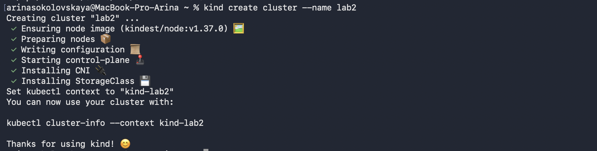

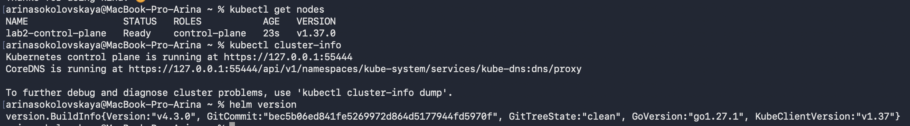

Образ приложения собирался локально и не публиковался во внешний registry.
Поэтому его отдельно загрузили внутрь kind-ноды командой
`kind load docker-image`. Без этого Kubernetes внутри kind не увидел бы образ
`lab2-api:part0`.

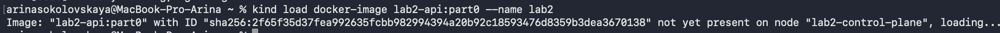

### Затем сделали Helm chart для api

Chart создали из стандартного шаблона Helm, после чего убрали ненужные
шаблоны ingress, HPA и тестового подключения. Оставили Deployment, Service,
ServiceAccount и позже добавили ServiceMonitor.

Сначала проверили структуру chart через `helm lint`, затем посмотрели
отрендеренные манифесты через `helm template`. Это помогло увидеть, какой YAML
действительно будет отправлен Kubernetes: образ `lab2-api:part0`, порт `8080`,
путь проверки `/health`.

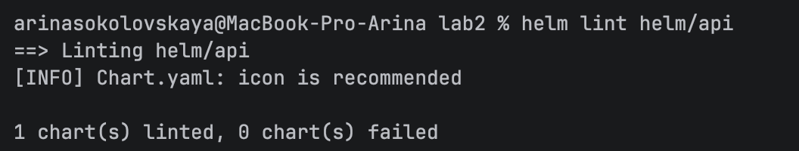

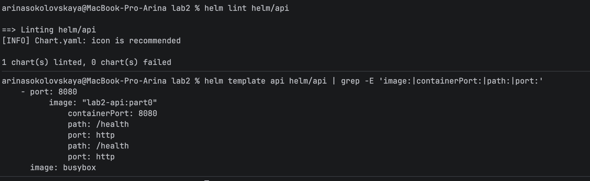

Chart установили в namespace `lab2`. Helm показал статус `deployed`, а
Deployment создал один готовый Pod и Service типа `ClusterIP`.

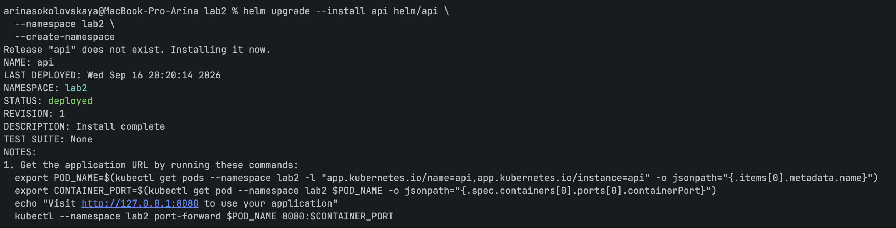

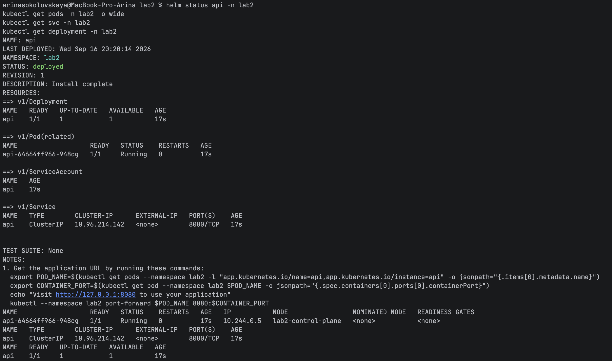

### Проверили приложение через port-forward

Service имеет внутренний адрес кластера, поэтому для локальной проверки
пробросили порт `18080` на `8080` внутри Pod-а.

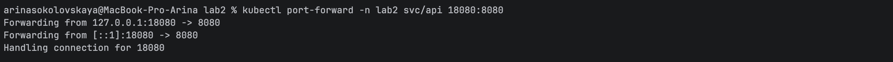

После этого проверили специально подготовленные endpoint-ы:

- `/health` вернул `200 OK`;
- `/fail` вернул `500`, чтобы появилась ошибка для мониторинга;
- `/slow` ответил с задержкой около двух секунд;
- `/load` поставил в очередь 25 запросов к `/health`.

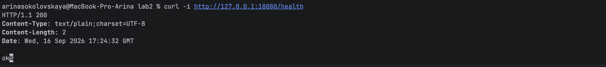

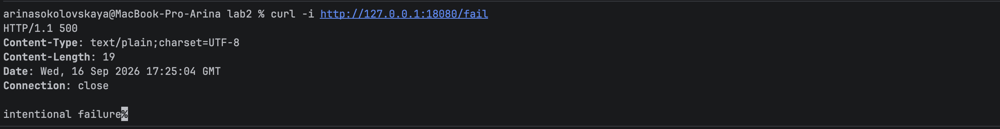

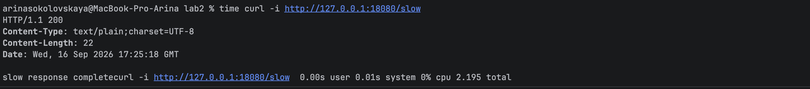

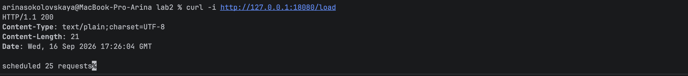

После этих запросов `/metrics` уже содержал счётчики ошибок и histogram
длительности. Это подтвердило, что приложение действительно готово быть
источником данных для Prometheus.

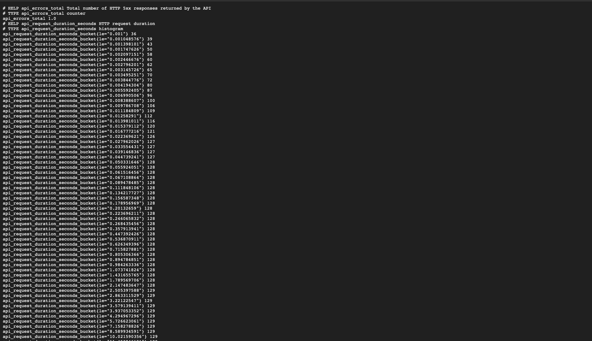

В логах видны JSON-события HTTP-запросов со статусом, длительностью и
`trace_id`. Позже по этому идентификатору свяжем лог с трассировкой в Jaeger.

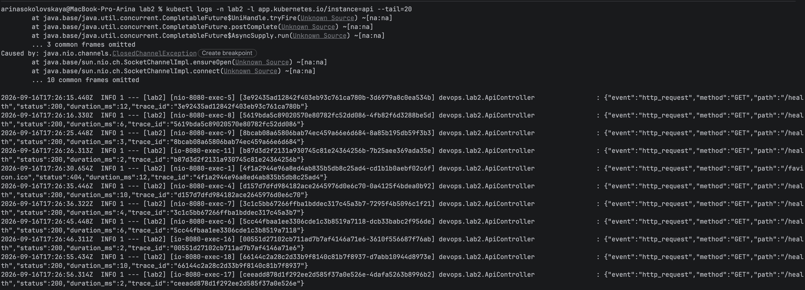

### Подключили Prometheus и Grafana

Для мониторинга добавили Helm-репозиторий `prometheus-community`, обновили
индекс chart-ов и установили общий chart `kube-prometheus-stack` в namespace
`monitoring`.

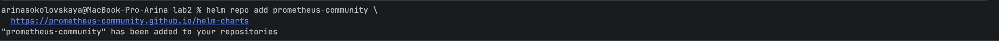

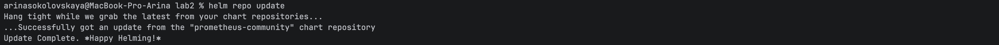

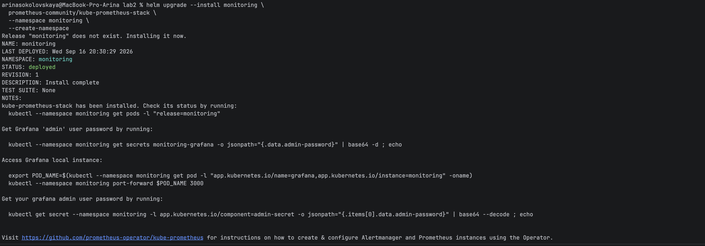

После установки дождались готовности Prometheus, Grafana, Alertmanager,
оператора и остальных компонентов.

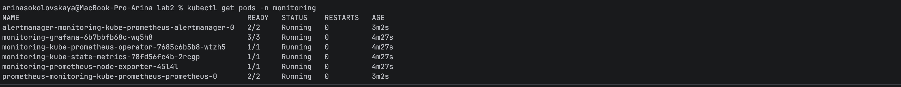

### Столкнулись с CrashLoopBackOff и разобрались почему

После изменения конфигурации Pod начал перезапускаться. В выводе было видно
`CrashLoopBackOff`, а Service не получал готовый endpoint. Это означало, что
контейнер существовал, но Kubernetes не считал его готовым для трафика.

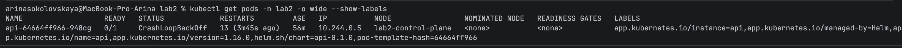

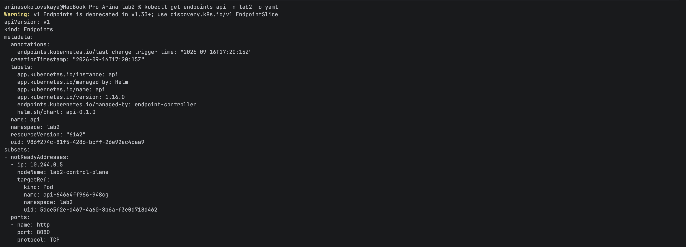

Причина оказалась в probes: liveness и readiness начинали проверять приложение
слишком рано, пока Spring Boot ещё запускался. Дополнительно в логах был виден
ConnectException к `localhost:4318`: это попытка отправить OTLP-метрики, когда
OTLP receiver ещё не установлен. Для текущего этапа эта ошибка не мешала
Prometheus scrape-ить `/metrics`, но её нужно учитывать при настройке Jaeger и
OpenTelemetry.

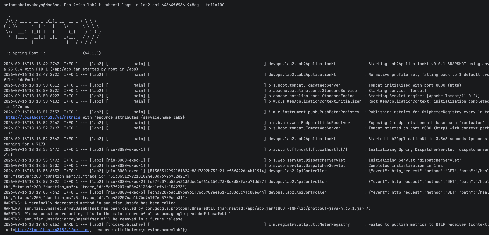

Добавили `startupProbe`, чтобы дать приложению время на запуск, а параметры
liveness/readiness сделали менее агрессивными. После обновления Helm release
дождались успешного rollout.

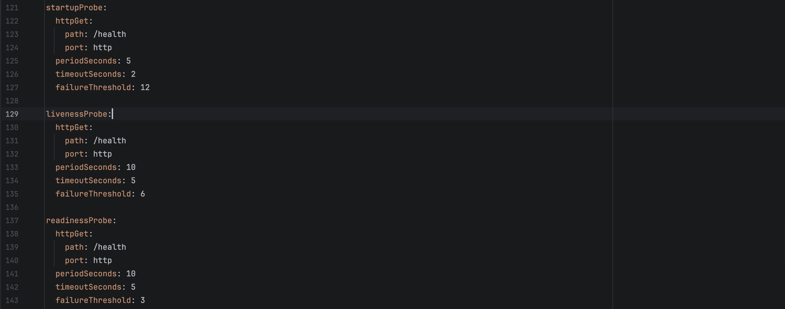

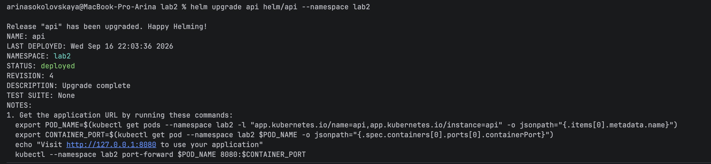

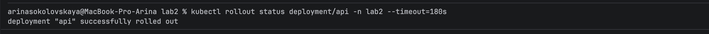

Через несколько минут Pod оставался `Running`, имел статус `1/1`, а Service
получил настоящий endpoint `10.244.0.14:8080`.

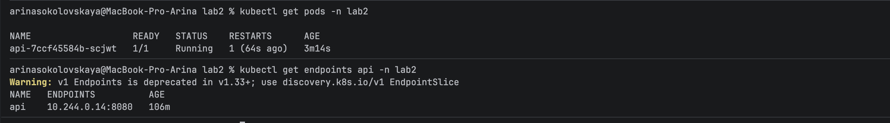

Позже при работе с Grafana столкнулись ещё с одной проблемой: `port-forward`
стал обрываться, а Kubernetes API начал отвечать `TLS handshake timeout`. При
проверке control-plane выяснилось, что в kind-нode было всего около 2 GiB RAM,
из которых свободными оставались примерно 15 MiB. `etcd` и `kube-apiserver`
перезапускались, поэтому Grafana оставалась в состоянии `2/3`, а её endpoint
на порт 3000 временно переставал отвечать.

Диск при этом не был переполнен: занято было около 8%. Увеличили память Colima
до 4 GiB и перезапустили локальную Docker VM. После этого Kubernetes API снова
стал отвечать, `etcd` перестал перезапускаться, а Grafana восстановила работу.

### Проверили, что Prometheus видит api

Prometheus открыли через port-forward на локальном порту `9090`.

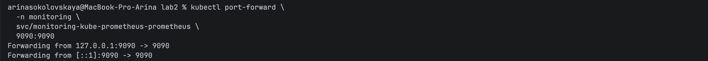

На странице Targets появился target
`serviceMonitor/lab2/api/0`. Его endpoint —
`http://10.244.0.14:8080/metrics`, состояние — `UP`. Это доказывает всю цепочку:

```text
Service → ServiceMonitor → Prometheus → /metrics api
```

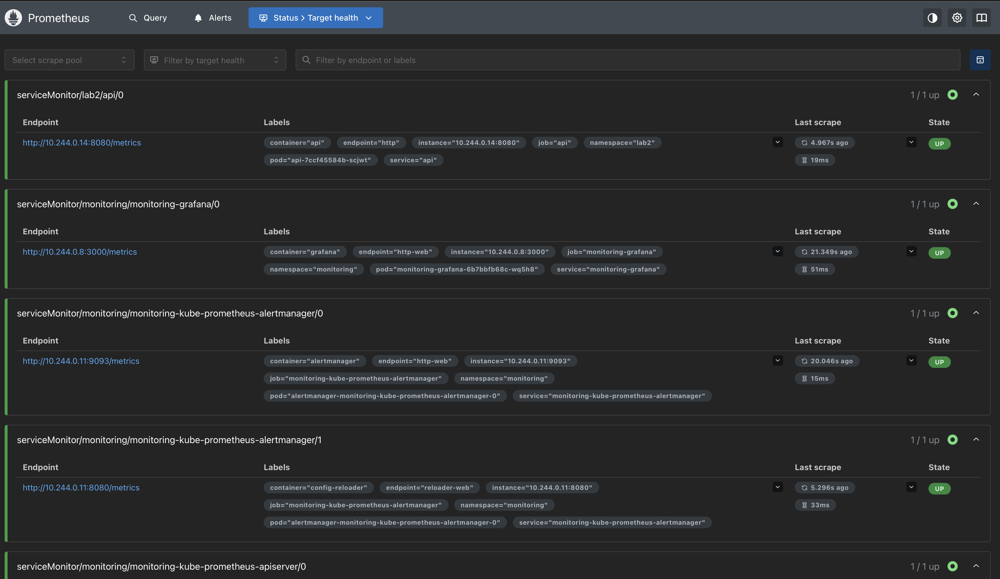

Запрос `api_requests_total` показал реальные значения счётчика. На графике
видны две серии, потому что после перезапуска Pod получил новый IP и новое имя,
а Prometheus сохранил временные ряды с разными labels.

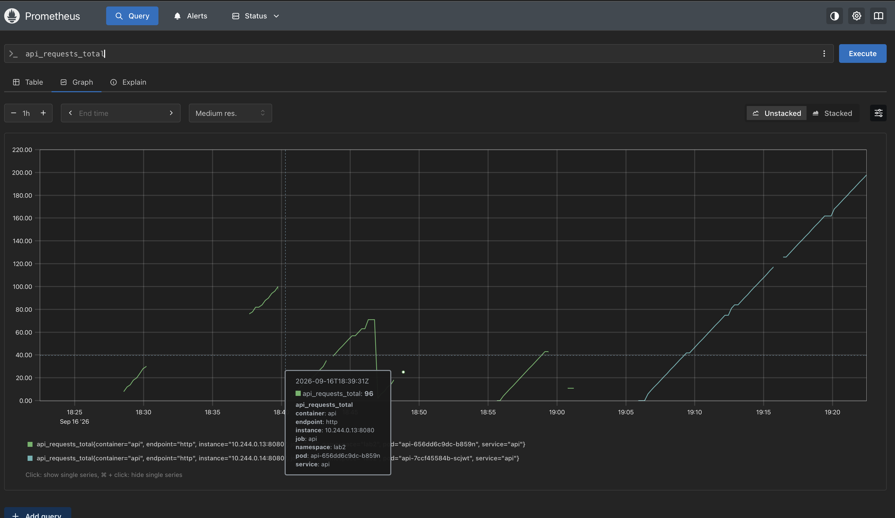

На этом месте часть с базовым сбором метрик закончена. Дальше нужно собрать
RED-дашборд в Grafana, затем подключить Loki, Jaeger и алерты.

### Собрали первый RED-дашборд в Grafana

Grafana открывали через Service `monitoring-grafana` и временный
`port-forward` с локального порта `3000`.

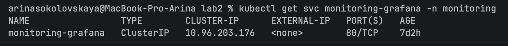

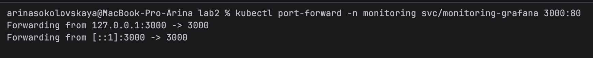

В Dashboard `RED` создали три панели и вставили PromQL-запросы в режиме
`Code`, а не в визуальном `Builder`:

- `Rate` — скорость запросов через `rate(api_requests_total[5m])`;
- `Error rate` — процент ошибок относительно общего количества запросов;
- `p95 duration` — 95-й перцентиль длительности по histogram bucket-ам.

Сначала столкнулись с ошибкой Prometheus `unexpected identifier "api"`: полный
PromQL был вставлен в поле визуального конструктора. Переключение `Builder →
Code` исправило запрос.

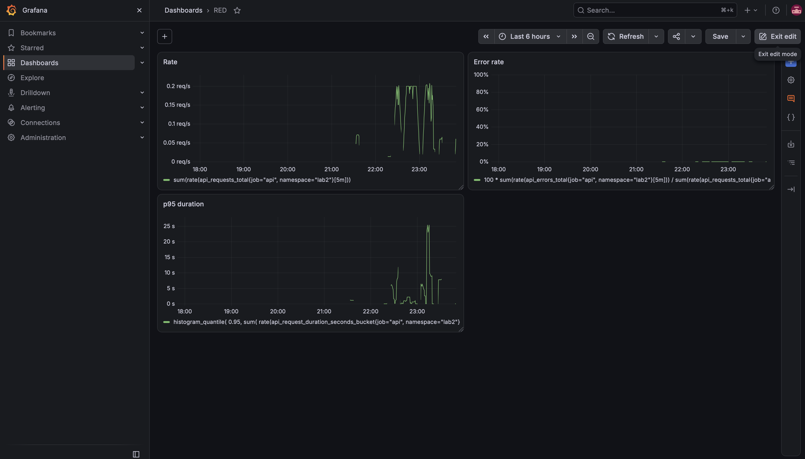

После сохранения Dashboard на нём появились все три графика.

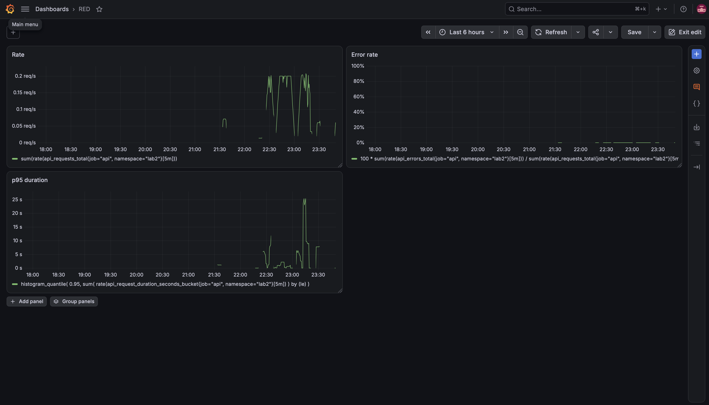

Затем вызвали `/load`, `/fail` и `/slow`. После этого на графиках появились
изменения: Rate вырос во время нагрузки, Error rate отреагировал на ошибку,
а p95 duration вырос из-за медленного endpoint-а.

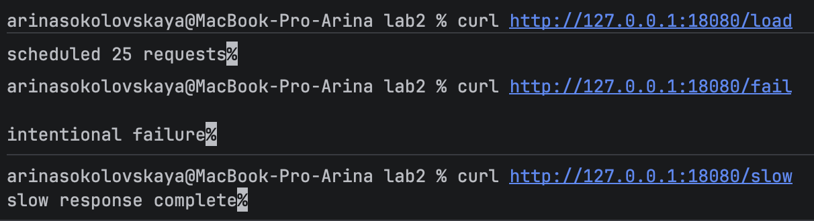

Статус RED-этапа: **выполнено**.

## Part 0 — сервис

### Этап 0. Подготовка и проверка сервиса

Цель этапа — подготовить небольшое приложение, на котором можно наблюдать
метрики, логи и трассировки на следующих этапах лабораторной работы.

Сервис написан на Kotlin и Spring Boot. Основная логика находится в
`ApiController`, сбор HTTP-метрик и JSON-логов — в `RequestMetricsFilter`, а
Prometheus registry создаётся в `MetricsConfiguration`.

Проверочный сценарий:

1. `/health` возвращает HTTP 200 и используется для проверки состояния Pod-а.
2. `/fail` возвращает HTTP 500, увеличивает счётчик ошибок и помечает текущий
   OpenTelemetry span как ошибочный.
3. `/slow` задерживает ответ на 1–3 секунды и создаёт дочерний span `slow-op`.
4. `/load` асинхронно запускает 25 запросов к `/health`, создавая нагрузку.
5. `/metrics` отдаёт накопленные метрики в формате Prometheus.

Для каждого запроса, кроме `/metrics`, фильтр сохраняет статус, длительность,
HTTP-метод, путь и `trace_id`. На их основе формируются:

- `api_requests_total` — общее количество запросов;
- `api_errors_total` — количество ответов со статусом 500 и выше;
- `api_request_duration_seconds_*` — histogram длительности запросов.

Проверка выполнялась командами:

```bash
curl -i http://localhost:8080/health
curl -i http://localhost:8080/fail
time curl -i http://localhost:8080/slow
curl -i http://localhost:8080/load
curl -s http://localhost:8080/metrics | grep '^api_'
```

Эндпоинты:

- `GET /health` — возвращает `ok`;
- `GET /fail` — возвращает HTTP 500 и помечает текущую трассировку как ошибочную;
- `GET /slow` — отвечает с задержкой 1–3 секунды и создаёт вложенный span `slow-op`;
- `GET /load` — асинхронно создаёт серию запросов к `/health`;
- `GET /metrics` — отдаёт Prometheus-метрики.

Метрики:

- `api_requests_total` — счётчик запросов;
- `api_errors_total` — счётчик HTTP 5xx;
- `api_request_duration_seconds` — histogram длительности запросов.

Логи пишутся в stdout в JSON-формате и содержат `trace_id`.

### Как устроен запрос внутри сервиса

Каждый запрос, кроме `/metrics`, проходит через `RequestMetricsFilter`. Фильтр
запоминает время начала, передаёт запрос контроллеру, а в блоке `finally`
записывает результат даже при ошибке. Он увеличивает общий счётчик, сохраняет
длительность в Timer, увеличивает счётчик ошибок для статусов 500 и выше и
пишет структурированный JSON-лог.

`ApiController` использует вручную созданный `PrometheusMeterRegistry`. Метод
`/metrics` вызывает `scrape()` и возвращает накопленные значения в формате,
который понимает Prometheus. Сам `/metrics` исключён из фильтра, чтобы запросы
Prometheus не искажали статистику бизнес-запросов.

`/slow` создаёт дочерний OpenTelemetry span `slow-op` и случайно задерживает
ответ на 1–3 секунды. Поэтому его длительность видна одновременно в метрике
Timer и в waterfall-трассировке.

`/fail` возвращает HTTP 500 и помечает текущий span как ошибочный. Фильтр видит
этот статус и увеличивает `api_errors_total`.

`/load` запускает 25 асинхронных запросов к `/health` и сразу возвращает ответ
`scheduled 25 requests`. Поэтому сам `/load` завершается быстро, а созданная им
нагрузка продолжает увеличивать счётчики `/health`.

Вероятность сэмплирования трассировок установлена в `1.0`, то есть для учебного
стенда сохраняется каждый trace. Экспорт трассировок в Jaeger настраивается на
следующем этапе.

Сервис контейнеризован в [Dockerfile](Dockerfile).

## Part 1 — метрики

### Что сделано

- создан локальный кластер kind;
- образ `lab2-api:part0` загружен в kind-ноду;
- создан Helm chart `helm/api`;
- `api` развёрнут в namespace `lab2`;
- добавлен `ServiceMonitor`;
- установлен `kube-prometheus-stack` в namespace `monitoring`;
- Prometheus обнаружил `api` и показывает target `serviceMonitor/lab2/api/0` со статусом `UP`.

### Проверяемые PromQL-запросы

Скорость запросов:

```promql
sum(rate(api_requests_total[5m]))
```

Доля ошибок:

```promql
sum(rate(api_errors_total[5m]))
/
sum(rate(api_requests_total[5m]))
```

95-й перцентиль времени ответа:

```promql
histogram_quantile(
  0.95,
  sum(rate(api_request_duration_seconds_bucket[5m])) by (le)
)
```

## Part 2 — логи

### Подготовили конфигурацию Loki

Сначала сохранили стандартные значения чарта командой `helm show values` и
проверили, можно ли использовать их без изменений. Проверка показала, что
чарт по умолчанию ожидает S3-bucket для хранения chunks:

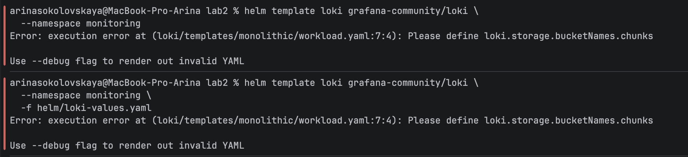

Дальше разбирали ошибки последовательно через `helm template`. После выбора
filesystem-хранилища Helm обнаружил включённые компоненты распределённого
режима (`read`, `write`, `backend`), которым тоже нужно объектное хранилище:

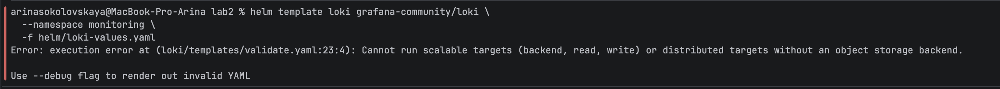

Для монолитного режима оставили один `singleBinary`, а у `read`, `write` и
`backend` выставили нулевое количество реплик. После этого Helm попросил явно
описать схему индексов:

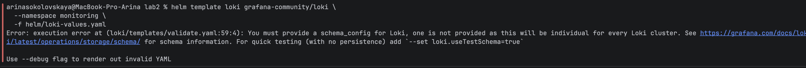

Добавили `schemaConfig` с `tsdb`, схемой `v13` и filesystem в качестве
объектного хранилища. После этого команда:

```bash
helm template loki grafana-community/loki \
  --namespace monitoring \
  -f helm/loki-values.yaml
```

начала успешно генерировать Kubernetes-манифесты Loki:

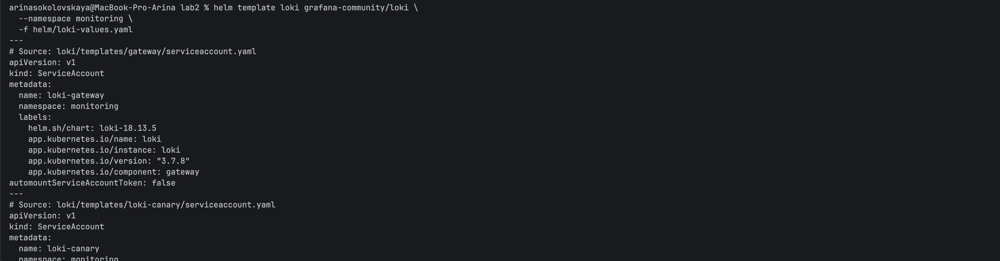

На этом шаге Loki ещё не устанавливался в кластер. Мы сначала проверили, что
конфигурация проходит встроенную в Helm-проверку чарта, и только после этого
переходим к установке.

### Установили Loki

Установили чарт командой `helm upgrade --install`. Helm создал релиз `loki` в
namespace `monitoring`, релиз получил статус `deployed`:

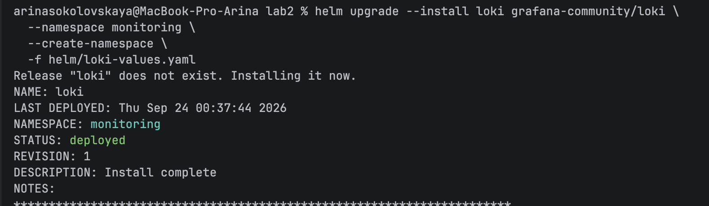

Основной pod Loki и gateway запустились, а сервисы получили ClusterIP-адреса
для дальнейшего подключения изнутри кластера:

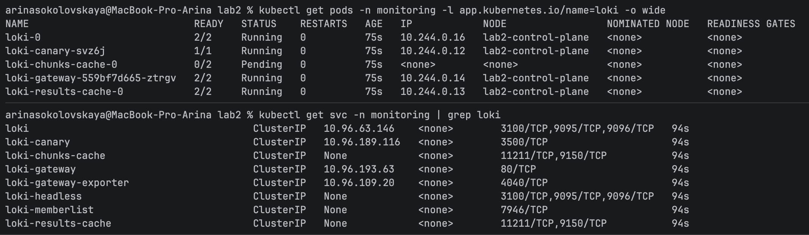

На первом запуске `loki-chunks-cache-0` оказался в состоянии `Pending`. Это
отдельный необязательный кэш, который не нужен для учебного сценария. Мы
отключили `resultsCache` и `chunksCache` через values и повторили upgrade.
После этого остались только необходимые компоненты, и все они перешли в
`Running`:

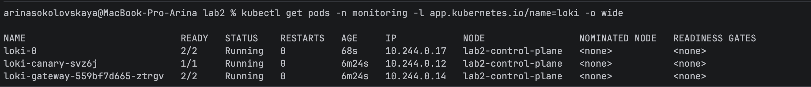

### Проверили HTTP API Loki

Проверили Loki напрямую через его Service `loki` и получили `HTTP/1.1 200 OK`
с телом `ready`:

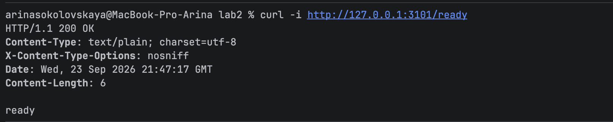

Затем проверили gateway отдельным port-forward. Запрос к
`/loki/api/v1/status/buildinfo` также вернул `200 OK` и JSON с версией Loki:

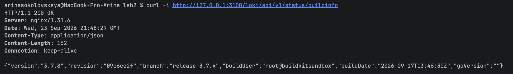

Сначала запрос `/ready` через gateway возвращал `404`, потому что этот путь не
проксируется nginx-gateway. Прямая проверка через Service Loki подтвердила, что
сам Loki исправен.

### Подготовили Helm-конфигурацию Alloy

Перед установкой Alloy сохранили стандартный файл values чарта:

```bash
helm show values grafana/alloy > helm/alloy-values.yaml
```

Пока это только шаблон с настройками по умолчанию. Следующим шагом добавим в
него конфигурацию Alloy: обнаружение Pod-ов, чтение их логов и отправку в
`loki-gateway`.

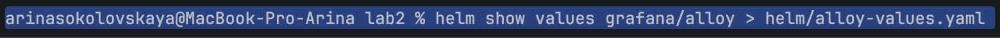

### Установили Alloy

В отдельном `alloy-config.alloy` описали pipeline: Alloy обнаруживает Pod-ы,
читает их логи через Kubernetes API и передаёт записи в Loki gateway. Затем
передали этот файл в Helm через `--set-file` и установили релиз `alloy`:

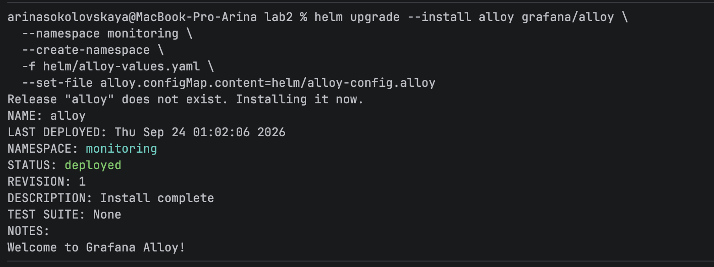

Helm создал ConfigMap с конфигурацией, ServiceAccount, ClusterRole и
DaemonSet. Поскольку в kind-кластере одна нода, запустился один Alloy pod:

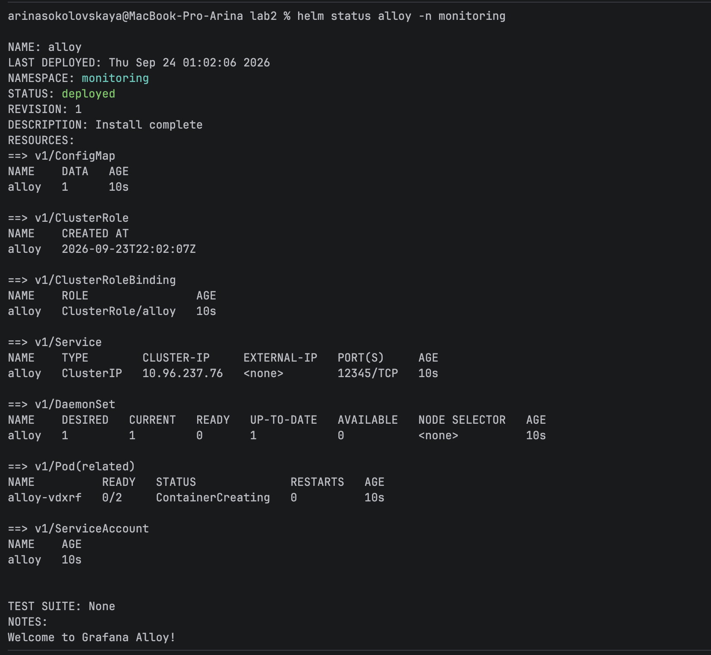

Сначала pod был в `ContainerCreating`, затем перешёл в `Running` и стал готовым
по обоим контейнерам:

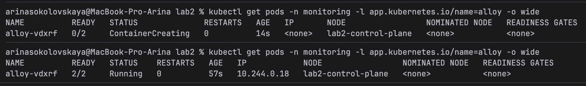

### Разобрали ошибку авторизации между Alloy и Loki

После установки Alloy в его логах появился ответ Loki:

```text
401 Unauthorized: no org id
```

Это означало, что в Loki осталось стандартное значение
`auth_enabled: true`, а Alloy не передавал tenant header. Для локальной
лаборатории отключили авторизацию в `helm/loki-values.yaml`:

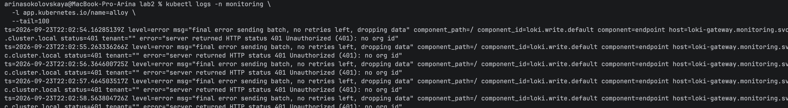

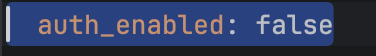

После upgrade Loki Alloy нужно проверять только по свежим логам: старые записи
с `401` могут оставаться в выводе `kubectl logs`. Поэтому итоговая проверка
делается с ограничением по времени, например `--since=2m`.

Свежий вывод Alloy больше не содержит `401 Unauthorized` и показывает, что
компонент `loki.source.kubernetes` открывает потоки логов Pod-ов:

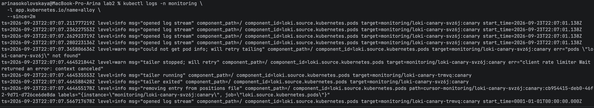

После повторного вызова `/fail` нашли в Loki поток API по фактическому label
`instance`. В найденных записях сохранились путь `/fail`, статус `500` и
`trace_id`:

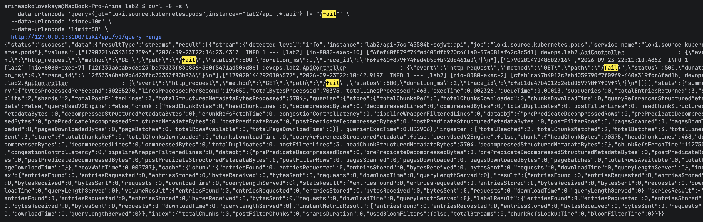

## Part 3 — трассировки

### Подготовили Helm-конфигурацию Jaeger

Добавили официальный Helm-репозиторий Jaeger и сохранили стандартные values:

```bash
helm repo add jaegertracing https://jaegertracing.github.io/helm-charts
helm repo update
helm show values jaegertracing/jaeger > helm/jaeger-values.yaml
```


Теперь сначала посмотрим, какие компоненты и OTLP-порты предоставляет чарт по
умолчанию, а затем установим Jaeger и направим в него трассировки API.

Рендеринг показал стандартный Deployment, Service и нужные порты:

- `4317` — OTLP gRPC;
- `4318` — OTLP HTTP;
- `16686` — веб-интерфейс Jaeger;
- `14250` — внутренний Jaeger gRPC endpoint.


### Установили Jaeger

Установили Jaeger через Helm в namespace `monitoring`. Сразу после установки
pod некоторое время находился в `ContainerCreating`, поэтому дождались
готовности Deployment:


После запуска Jaeger pod перешёл в состояние `Running`, а Service опубликовал
OTLP-порты `4317` и `4318` и web UI на `16686`:


### Направили API в Jaeger

Сначала приложение пыталось отправлять OTLP-данные на `localhost:4318`. Внутри
Pod это означало сам API-контейнер, поэтому соединение не устанавливалось.
Добавили в Helm Deployment переменную:

```text
OTEL_EXPORTER_OTLP_ENDPOINT=http://jaeger.monitoring.svc.cluster.local:4318
```

После исправления отступов YAML Helm успешно обновил релиз `api`:


### Проверили первую трассировку

Через port-forward вызвали долгий endpoint API:

```bash
curl -i http://127.0.0.1:18080/slow
```

API вернул `HTTP/1.1 200`, поэтому сам endpoint отработал успешно:


После этого нашли трассировку в Jaeger. В ней видны сервис `lab2`, операция
`http get /slow`, длительность около 1,3 секунды, статус `200` и режим
`Trace Timeline`:


После подключения ручного tracer-а повторный запрос показал полную вложенность:
основной server span `http get /slow` и дочерний внутренний span `slow-op`.
В Jaeger видны глубина `2`, два span и длительность около 1,7 секунды:


### Проверили ошибочную трассировку и связали её с логом

Вызов `/fail` вернул ожидаемый `HTTP 500`:


В логе API зафиксированы путь `/fail`, статус `500` и `trace_id`:


По этому же `trace_id` нашли трассировку в Jaeger. В ней отображаются
`error=true`, `otel.status_code=ERROR`, описание `intentional failure` и HTTP
статус `500`:


## Part 4 — алерты

### Настроили receiver Alertmanager

По умолчанию alerts попадали в receiver `null`, поэтому Alertmanager их
показывал, но не отправлял внешнее уведомление. Добавили
`AlertmanagerConfig` с webhook receiver, который выбирает alerts с меткой
`service=api` и отправляет их на webhook.site.

После вызова `/fail` и остановки API webhook получил реальные `POST`-запросы
от Alertmanager размером около 1,6 KB:


- В Alertmanager отфильтровали alerts по имени `Api.*` и увидели сработавшие
  правила `ApiHighErrorRate` и `ApiHighLatency`:

  

- Отдельно проверили `ApiUnavailable`, который появляется, когда у Deployment
  `api` нет доступных реплик:

  

- Тело webhook-запроса подтверждает, что Alertmanager отправляет именно
  состояние `firing`, имя алерта и его labels:

  

После подключения Karma она получила тот же активный alert от Alertmanager и
показала его отдельной группой `ApiUnavailable`. В карточке видны namespace
`lab2`, сервис `api`, критичность `critical` и receiver webhook:


