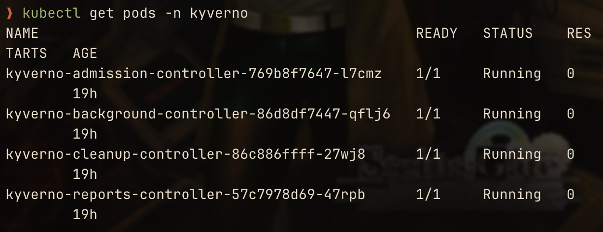
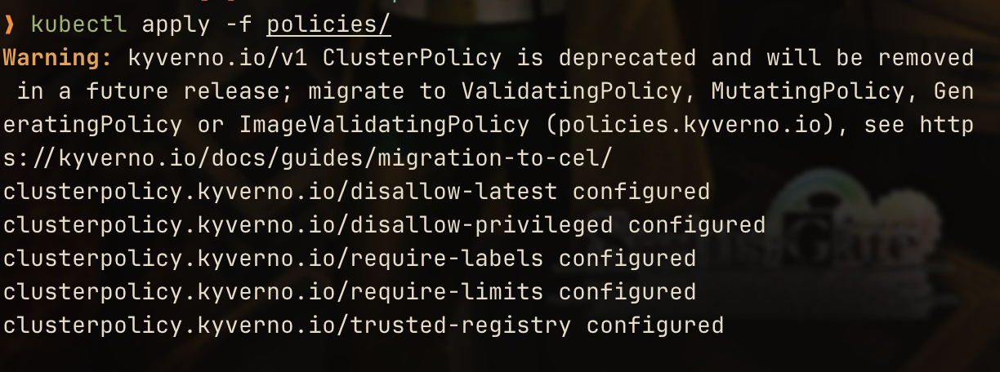
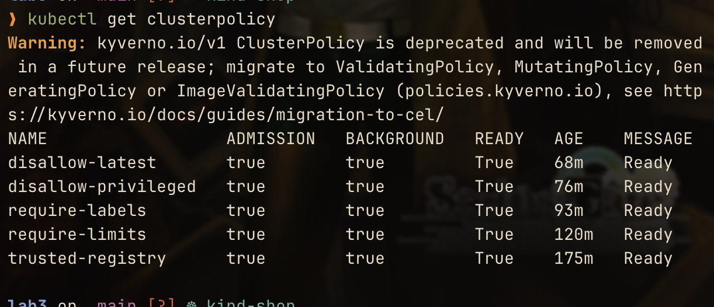
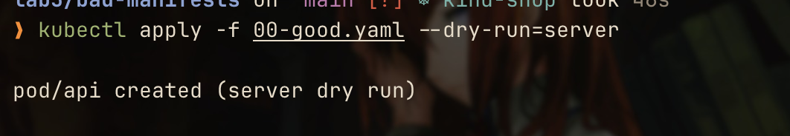
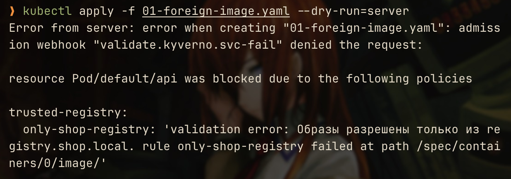
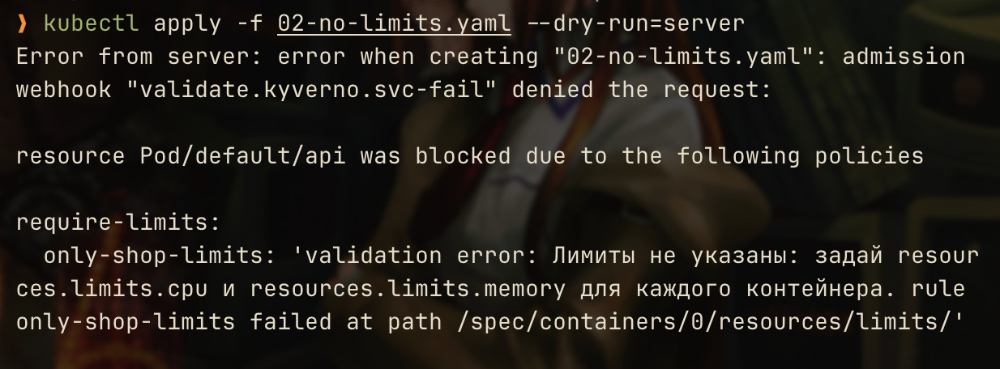
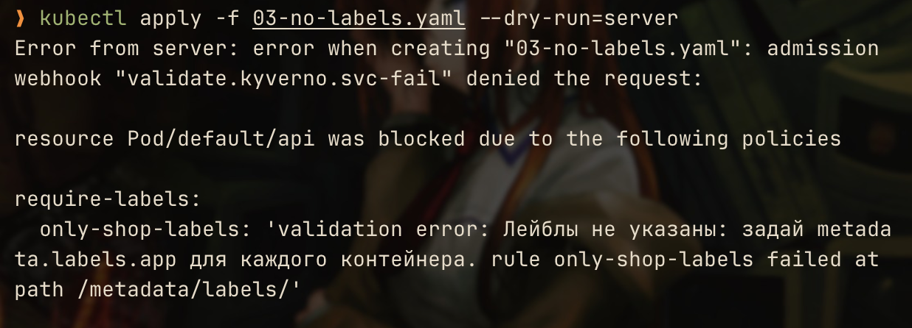
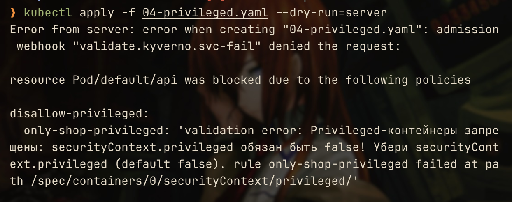
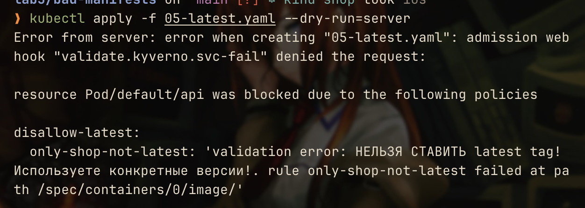
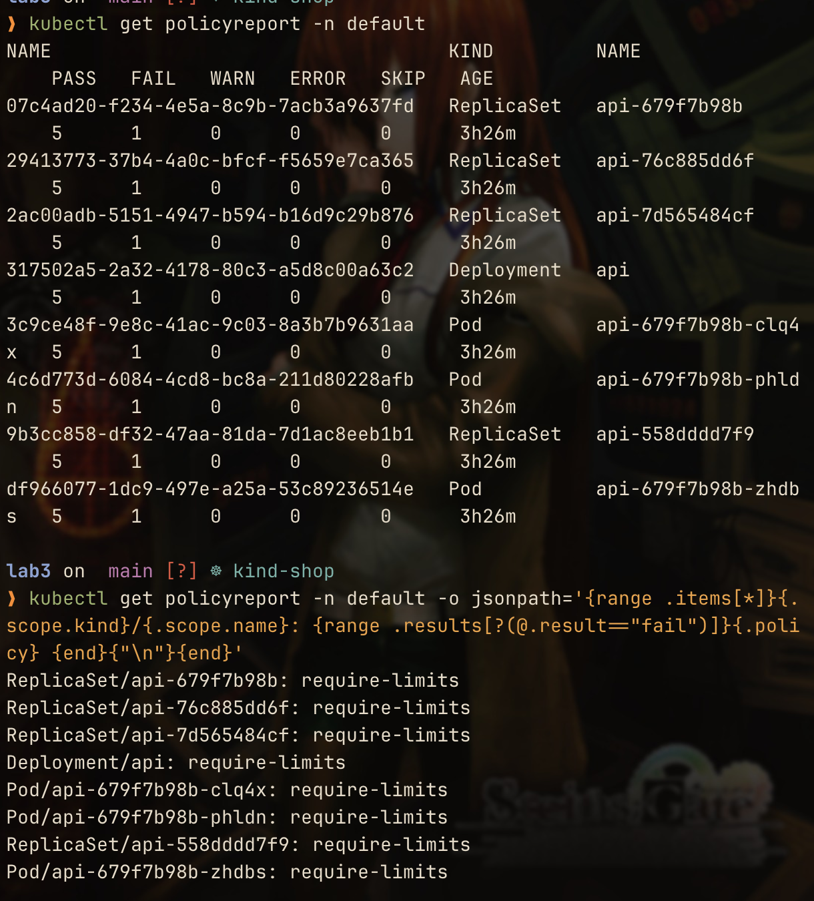

# Лаба 3: платформа для shop

https://github.com/KeladKaal/containerization-and-orchestration/blob/main-rus/lecture-3-kubernetes-control-plane/lab.md

Кластер: kind `shop` (1 control-plane + 2 worker), конфиг в `kind-config.yaml`.
Образы: `make images` собирает `api`/`worker` и загружает их в ноды.

## Часть 1: Ограждения на кластер

### Выбор движка

Я никогда не работал с k8s :), поэтому по совету великой нейронки я использовал kyverno. Как я понял, в Gatekeeper пишут на языке Rego, и я подумал, зачем мне его в лишний раз смотреть, когда я могу взять движок kyverno и писать политики на YAML, на котором пишутся манифесты под объекты k8s.

Установили kyverno через helm, а helm через brew ( macOS пакетный менеджер )

делаем `kubectl get pods -n kyverno`



### Правила

Применяем наши политики



Видно, что все наши политики работают



Политики лежат в `policies/`.

Главное называть их по-разному :), а то, если мы назовем их одинаково, api-server просто перезапишет существующую в etcd.

В политике есть два главных поля: 

`rules` - куда мы пишем правила
Ну и внутри правил у нас `validate`, который как раз проверяет наши манифесты на входе.

`failureAction` - сразу отклоняет объект, если он плохой ( Enforce ) или пропускает, но записывает ( Audit )
`message` - то, что возвращается при плохом манифесте, который не прошел `pattern` валидации
`pattern` - как раз смотрит то, как наш объект должен выглядеть

`trusted-registry.yaml` политика проверяет образы на скачивания с нашего регистра, а не с внешнего ( напр. docker Hub ) - просто сравнивания название образов "registry.shop.local/" + любые символы


```yaml
pattern:                    
    spec:
        containers:
        - image: "registry.shop.local/*"

```

`require-limits.yaml` политика проверяет лимиты на наши поды - "?*" говорит о том, что memory, cpu обязан указываться хоть какой-то ( напр. "128Mi" и "250m" соотвественно )

```yaml
containers:
- resources:
    limits:
        memory: "?*"
        cpu: "?*"   
```

`disallow-latest.yaml` моя собственная политика проверяет версию на `latest` - там два правила, которые проверяют на два варианта:

1) если поставили "образ:latest", то `image: "!*:latest"` это явно запретит

```yaml                  
pattern:                  
    spec:
        containers:
        - image: "!*:latest"       
```

2) ну и чтобы не подставился по умолчанию без конкретной версии добавляем еще и `image: "*:*"`, чтобы при добавлении контейнера указывали конкретную версию

```yaml
pattern:                   
    spec:
        containers:
        - image: "*:*"        
```

`disallow-privileged.yaml` политика запрещает как-то стучаться во внешний мир ноды ( напр. через root монтировать диск ноды к нашему контейнеру и видеть содержимое соседних подов ) 

Поскольку privileged по default всегда false, можно просто проверить, чтобы это поле никогда не было true

`=(field): value` говорит, что если поле есть оно обязано быть значением  `value`, если нет такого поля, то пропускаем ( потому что по default privileged = false )

```yaml
pattern:                    
    spec:
        containers:
        - =(securityContext):
            =(privileged): false 
```

`require-labels.yaml` политика проверяющая есть ли лейблы.

```yaml
pattern:                    
    metadata:
        labels:
            app: "?*"
```

### Проверка политик

Манифесты лежат в `bad-manifests/`.

`00-good.yaml` нужен, чтобы проверить не запрещают ли политики то, что не должны запрещать. Он проходит все правила.



`01-foreign-image.yaml` имеет внешний образ `image: nginx:1.27` ( не с нашего регистра ) 



`02-no-limits.yaml` не имеет лимитов



`03-no-labels.yaml` нет лейблов



`04-privileged.yaml` ставит явно `privileged: true`, чтобы проверить работает ли запрет



`05-latest.yaml` явно указывает latest версию `image: registry.shop.local/api:latest` 



### ПОДВОДЯ ИТОГИ 1 ГЛАВЫ

В чем проблема kyverno (скажем так): 

наверное, в том что он выставляет failurePolicy: Fail по умолчанию - короче, это значит, что если kyverno упал, то он не пропустит ни один манифест, пока его не поднять. 

С одной стороны это круто конечно, но с другой получается, что пока не поднять kyverno, процесс разработки просто встает :(, причем даже replicaset не может создать замену упавшему поду ( потому что она делает kubectl apply под капотом, а kyverno validation работает после RBAC при api-server )

ну и там  `allowExistingViolations` по умолчанию уже существующие поды, которые были добавлены до политики, просто игнорирует, и они живут и их видно в policyreport



Эти объекты создали до появления политик. Kyverno их пропустил и не убил, но записал в отчёт

Но это сделано для, например, ночной загрузки (когда надо заскейлить реплики)

## Часть 2: Чарт api и worker

## Часть 3: Postgres через оператора

## Часть 4: Падение control plane

## Часть 5: Мониторинг
