# Лаба 3: платформа для shop

https://github.com/KeladKaal/containerization-and-orchestration/blob/main-rus/lecture-3-kubernetes-control-plane/lab.md

Кратенькое содержимое:

Кластер: kind `shop` (1 control-plane + 2 worker), конфиг в `kind-config.yaml`.
Образы: `make images` собирает `api`/`worker` и загружает их в ноды.

## Кратенькая сборочка

Нужны Docker, kind, helm и kubectl. Все команды выполняются из папки `lab3/`.

1. Кластер:
   ```bash
   kind create cluster --config kind-config.yaml
   ```
2. Образы `api` и `worker` (в `values.yaml` у api тег `1.0.3`, у worker `1.0.0`):
   ```bash
   make images
   make images VERSION=1.0.3
   ```
3. Образ Postgres в нашем реестре (иначе его не пустит `trusted-registry`):
   ```bash
   make postgres-image
   ```
4. Kyverno и политики:
   ```bash
   helm repo add kyverno https://kyverno.github.io/kyverno/
   helm install kyverno kyverno/kyverno -n kyverno --create-namespace --version 3.9.1 --wait
   kubectl apply -f policies/
   ```
5. Оператор CloudNativePG:
   ```bash
   helm repo add cnpg https://cloudnative-pg.github.io/charts
   helm install cnpg cnpg/cloudnative-pg -n cnpg-system --create-namespace --version 0.29.1 --wait
   ```
6. Чарт `shop` (api, worker, postgres):
   ```bash
   helm upgrade --install shop chart/shop -n shop --create-namespace
   ```
7. Проверка: все поды `1/1`, кластер Postgres в `Cluster in healthy state`:
   ```bash
   kubectl get pods -n shop
   kubectl get cluster -n shop
   ```

Порядок важен: политики ставятся раньше чарта, а оператор раньше объекта `Cluster` (иначе API-сервер не знает такого типа).

## Часть 1: Ограждения на кластер

### Выбор движка

Я никогда не работал с k8s :), поэтому по совету великой нейронки я использовал kyverno. Как я понял, в Gatekeeper пишут на языке Rego, и я подумал, зачем мне его в лишний раз смотреть, когда я могу взять движок kyverno и писать политики на YAML, на котором пишутся манифесты под объекты k8s.

Установили kyverno через helm, а helm через brew ( macOS пакетный менеджер )

делаем `kubectl get pods -n kyverno`


### Правила

Применяем наши политики


Видно, что все наши политики работают


Политики лежат в `policies/`.

Главное называть их по-разному :), а то, если мы назовем их одинаково, api-server просто перезапишет существующую в etcd.

В политике есть два главных поля: 

`rules` - куда мы пишем правила
Ну и внутри правил у нас `validate`, который как раз проверяет наши манифесты на входе.

`failureAction` - сразу отклоняет объект, если он плохой ( Enforce ) или пропускает, но записывает ( Audit )
`message` - то, что возвращается при плохом манифесте, который не прошел `pattern` валидации
`pattern` - как раз смотрит то, как наш объект должен выглядеть

`trusted-registry.yaml` политика проверяет образы на скачивания с нашего регистра, а не с внешнего ( напр. docker Hub ) - просто сравнивания название образов "registry.shop.local/" + любые символы


```yaml
pattern:                    
    spec:
        containers:
        - image: "registry.shop.local/*"

```

`require-limits.yaml` политика проверяет лимиты на наши поды - "?*" говорит о том, что memory, cpu обязан указываться хоть какой-то ( напр. "128Mi" и "250m" соотвественно )

```yaml
containers:
- resources:
    limits:
        memory: "?*"
        cpu: "?*"   
```

`disallow-latest.yaml` моя собственная политика проверяет версию на `latest` - там два правила, которые проверяют на два варианта:

1) если поставили "образ:latest", то `image: "!*:latest"` это явно запретит

```yaml                  
pattern:                  
    spec:
        containers:
        - image: "!*:latest"       
```

2) ну и чтобы не подставился по умолчанию без конкретной версии добавляем еще и `image: "*:*"`, чтобы при добавлении контейнера указывали конкретную версию

```yaml
pattern:                   
    spec:
        containers:
        - image: "*:*"        
```

`disallow-privileged.yaml` политика запрещает как-то стучаться во внешний мир ноды ( напр. через root монтировать диск ноды к нашему контейнеру и видеть содержимое соседних подов ) 

Поскольку privileged по default всегда false, можно просто проверить, чтобы это поле никогда не было true

`=(field): value` говорит, что если поле есть оно обязано быть значением  `value`, если нет такого поля, то пропускаем ( потому что по default privileged = false )

```yaml
pattern:                    
    spec:
        containers:
        - =(securityContext):
            =(privileged): false 
```

`require-labels.yaml` политика проверяющая есть ли лейблы.

```yaml
pattern:                    
    metadata:
        labels:
            app: "?*"
```

### Проверка политик

Манифесты лежат в `bad-manifests/`.

`00-good.yaml` нужен, чтобы проверить не запрещают ли политики то, что не должны запрещать. Он проходит все правила.


`01-foreign-image.yaml` имеет внешний образ `image: nginx:1.27` ( не с нашего регистра ) 


`02-no-limits.yaml` не имеет лимитов


`03-no-labels.yaml` нет лейблов


`04-privileged.yaml` ставит явно `privileged: true`, чтобы проверить работает ли запрет


`05-latest.yaml` явно указывает latest версию `image: registry.shop.local/api:latest` 


### ПОДВОДЯ ИТОГИ 1 ГЛАВЫ

В чем проблема kyverno (скажем так): 

наверное, в том что он выставляет failurePolicy: Fail по умолчанию - короче, это значит, что если kyverno упал, то он не пропустит ни один манифест, пока его не поднять. 

С одной стороны это круто конечно, но с другой получается, что пока не поднять kyverno, процесс разработки просто встает :(, причем даже replicaset не может создать замену упавшему поду ( потому что она делает kubectl apply под капотом, а kyverno validation работает после RBAC при api-server )

ну и там  `allowExistingViolations` по умолчанию уже существующие поды, которые были добавлены до политики, просто игнорирует, и они живут и их видно в policyreport


Эти объекты создали до появления политик. Kyverno их пропустил и не убил, но записал в отчёт

Но это сделано для, например, ночной загрузки (когда надо заскейлить реплики)

## Часть 2: Чарт api и worker

На этом мои мучения только начинались. Если я думал, что понимаю как работает кубер - я ошибался

Чарт лежит в `chart/shop/`.

### Что в чарте

Удивительная штука под названию Helm из под капота, делает за нас довольно много рутины. 

Коротко, из чего состоит чарт:

`Chart.yaml` там метаданные чарта, имя и версия

`values.yaml` там сидят значения, которые меняем: api.replicas: 3

И еще у нас есть удивительная папка под названием `/templates` и туда мы помещаем все YAML-манифесты,  только изменяемые значения в них заменены на подстановки

Идея, в том чтобы писать наши изменяемые значения один раз в 
`values.yaml` и уже в каждый шаблон, кое требует это значение
подставлять `{{ .Values.field... }}` и Helm при upgrate,install просто возьмет
подставит в наши шаблоны наши значение и напрямую отправит их API-Server

Но помимо этого он умеет еще и откатывать версии.

Каждый install и каждый upgrade Helm записывает как ревизию 
и хранит её прямо в кластере

типо того:

`sh.helm.release.v1.shop.v1, ...v2`


### Установка: Kyverno не пускает плохой чарт

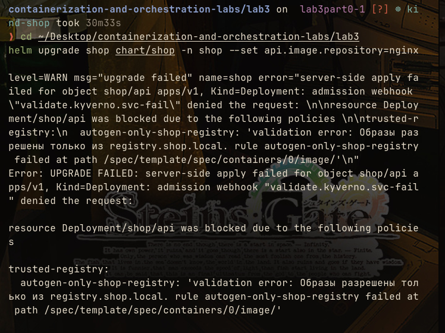

После того, как Kyverno был поставлен на стражу порядка в API-Server
из-за того, что стоят 5 политик, и cloudNativePG при установке не удовлетворял 3 из них
его пришлось исключить через namespace в этих политиках,
а потом еще и перенести образ Postgres в мой реестр. 

```YAML
exclude:
  any:
  - resources:
      namespaces: ["cnpg-system", "local-path-storage"]
```

Ну и затем, все поднялось и начало работать

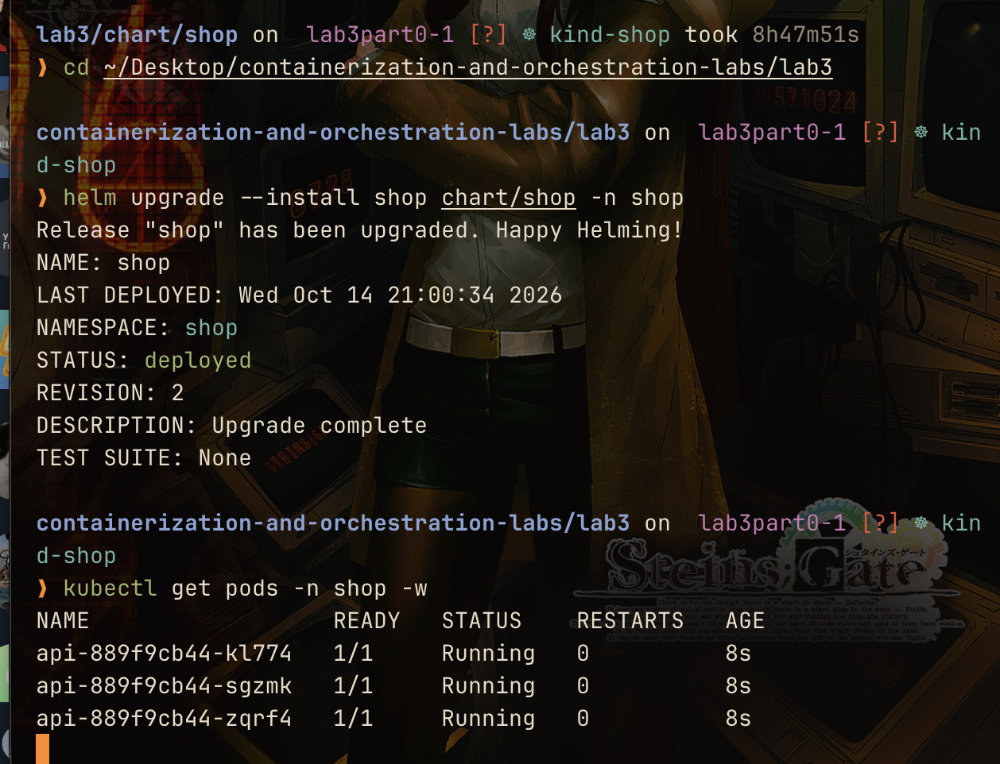

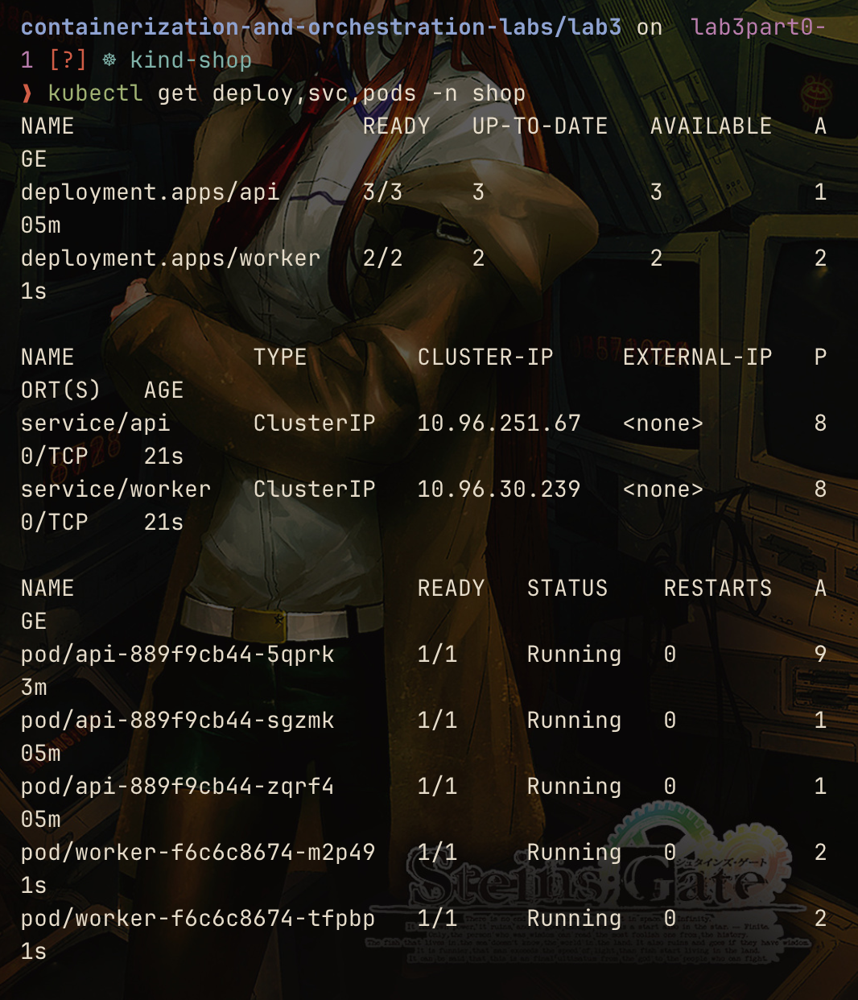

### Пробы

Я проверил развёрнутый чарт через helm get manifest: вписал их в Deployment 

`kubectl describe pod -n shop -l app=api | grep -E "Liveness|Readiness"`

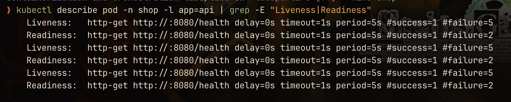

Пробы работают в сценарии со сломанной версией. При HEALTH_FAIL=true новые поды не
проходят readiness, поэтому rollout зависает, а старые поды не удаляются.
Этот сценарий описывается в разделе про rollback.

### Reconciliation: удалил под

далее тестил то, как работает удаление пода

попробовал удалить под в replicaset

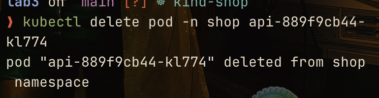

Параллельно в другом окне запустил 

`kubectl get pods -n shop -w`

И он тут же создал новый
Replicaset-controller (часть controller-manager)
тут же увидела, что их стало на один меньше
и желаемый результат не совпадает с фактическим
Поэтому отправила запрос на создание новой поды API-Server с префиксом
имени (имя + хеш содержимого (`template:` + непоставленные поля))
хвост API-Server сгерировал сам, записал в таблицу etcd
и затем уже Scheduler выбирал ноду для пода, и kubelet запустил наш новый под

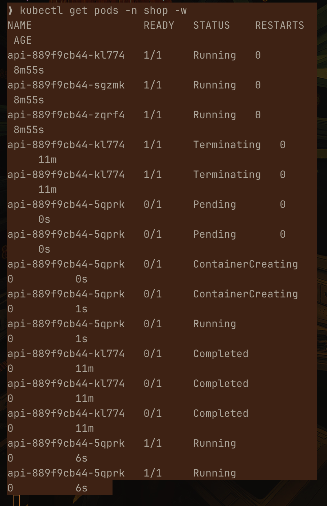

### Reconciliation: replicas в values

Дальше шел экспримент скейлинга наших подов и я стокнулся с тем, что оказывается
изменяя replicas новый replicaset (это только потом я уже понял что новая replicaset
создается ток при изменении template или при явном rollout restart - к слову
эта делает довольно простую но не очевидную вещь, дописывая в template
аннотацию `kubectl.kubernetes.io/restartedAt: <время>`) 


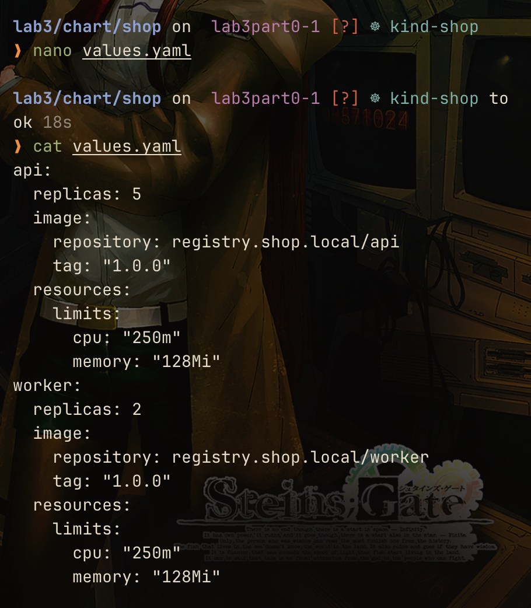

Далее мы через helm посылаем API-Server запрос на
изменённый Deployment с spec.replicas: 5

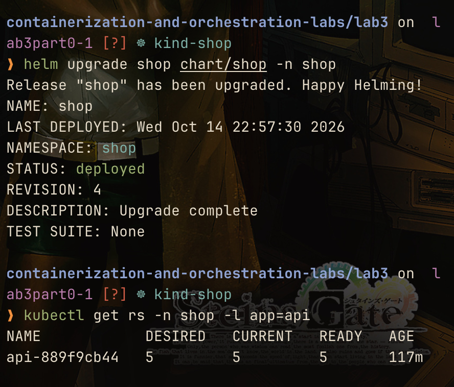

Таким образом, при изменениии Deployment:

deployment-controller следит за Deployment
когда в Deployment меняется replicas, 
он меняет replicas в ReplicaSet api-7bc878dcff с 3 на 5.

Дальше replicaset-controller, смотрит 
на то сколько реплик мы хотим получить и создаёт через API-сервер
2 объекта Pod. У этих подов ещё не указана нода, поле nodeName пустое.

Дальше уже подписанный schuduler смотрит какие ноды дать под поды

и наш kubelet просто запускает наши поды и приводит их в Ready

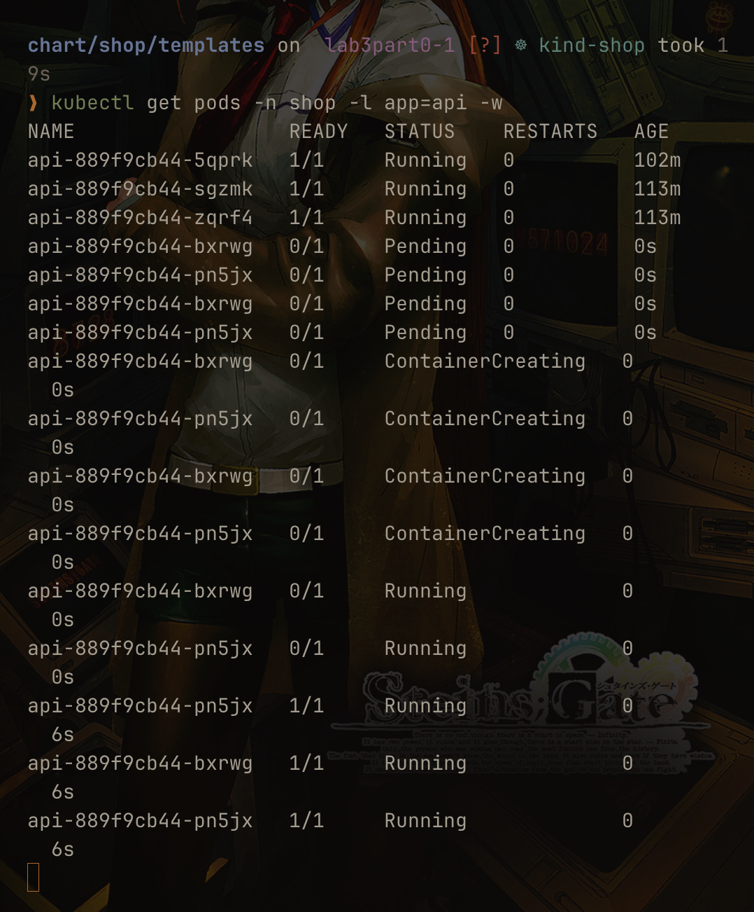

### Ручной kubectl scale и конфликт с Helm

Дальше кстати было интереснее, ведь возник конфликт с kubectl
Я попытался увеличить число реплик через консольную утилиту кубера, и в след раз
сделал изменение снова через helm upgrade, но мне отказали с ошибкой

```
Error: UPGRADE FAILED: conflict occurred while applying object shop/api apps/v1, Kind=Deployment:
Apply failed with 1 conflict: conflict with "kubectl" with subresource "scale" using apps/v1: .spec.replicas
```
Как я понял, когда Helm посылает API-Server он еще и следит за тем, 
кто владеет каждым отдельным полем.

Грубо говоря

Helm upgrade делает операцию Apply и он становится владельцем Helm
Дальше, kubectl scale делает операцию Update. И так работает, 
что при Update он ничего не проверяет и просто приписывает владение себе
Еще раз Helm upgrade делает операцию Apply и мы ловим ошибку, потому что у нас
нет прав менять поле, которое закреплено под другим владельцем

Поэтому пришлось сделать --force-conflicts, чтобы он не проверял владельца

### Rolling update: первая попытка

После этого поднял версию образа api с 1.0.0 до 1.0.1 в values.yaml 
и сделал helm upgrade, параллельно долбя /health в цикле.
Поменялся template, поэтому появился новый ReplicaSet api-67d654f8c5, 
и поды заменялись на новую версию по одному (RollingUpdate), а не все сразу.

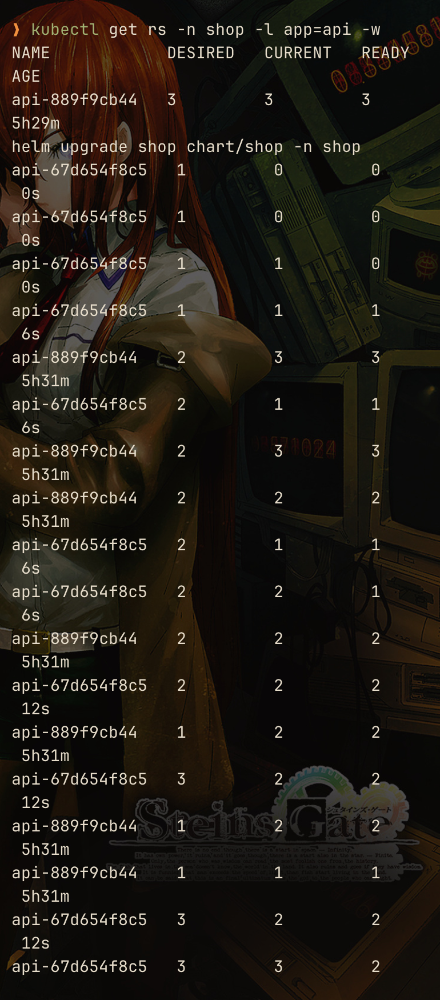

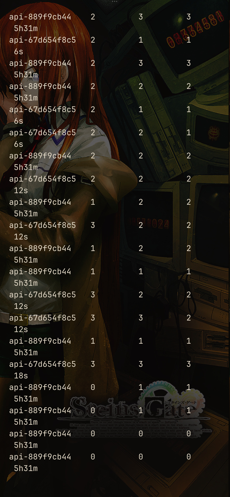

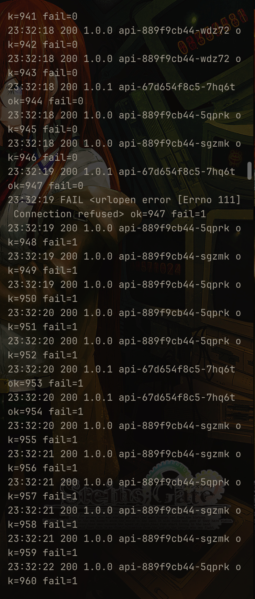

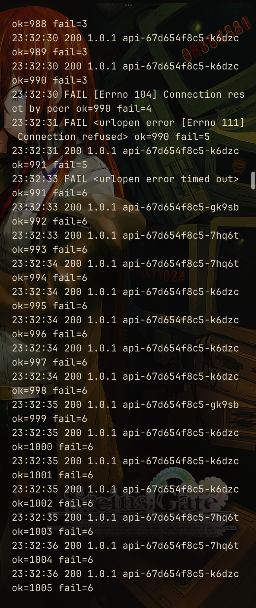

У Deployment есть два поля

maxSurge: 25%         сколько подов можно создать сверх replicas

сколько подов можно создать сверх 3. 0,75 округляется вверх, получается 1.
Значит, одновременно может существовать максимум 3 + 1 = 4 пода.

maxUnavailable: 25%   сколько подов может быть не Ready

0,75 округляется вниз, получается 0. 
Значит, Ready всегда должно быть минимум 3 − 0 = 3 пода.

### Rolling update: после preStop

Дальше я попробовал такую штуку как preStop

Идея в том, чтоб повесить перед удалением пода какие-то действия

sleep - kubelet просто ждёт заданное время.
exec — любая команда внутри контейнера.
httpGet — HTTP-запрос.

Я повесил sleep 5 seconds и перед SIGTERM удалением kubelet сначала выполняет preStop и ждет 5 секунд, параллельно IP пода исчезает из iptables, и ток по исчению 5 секунд он вызовет SIGTERM и как я понял, если бы я поставил 35 секунд, а terminationGracePeriodSeconds стоит 30 - SIGKILL сработает раньше чем preStop завершит свое выполнение, поэтому надо учитывать это, когда выполняем что-то в preStop ( время выполнения preStop должно быть меньше, чем   terminationGracePeriodSeconds, так как preStop sleep входит в terminationGracePeriodSeconds )

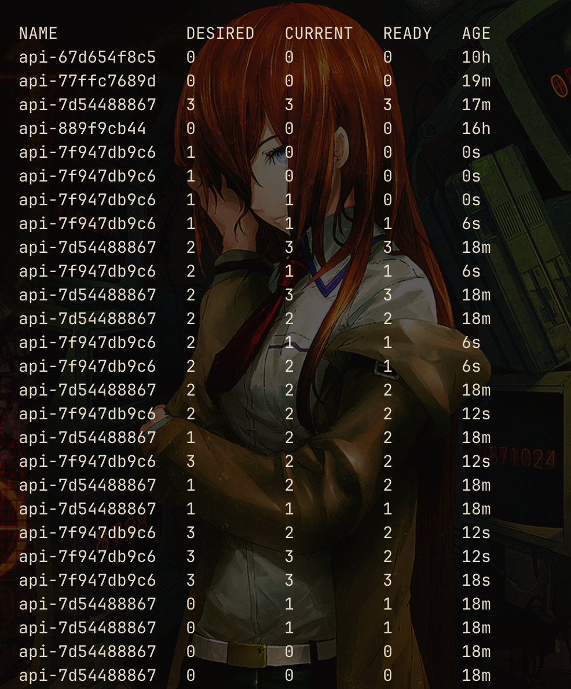

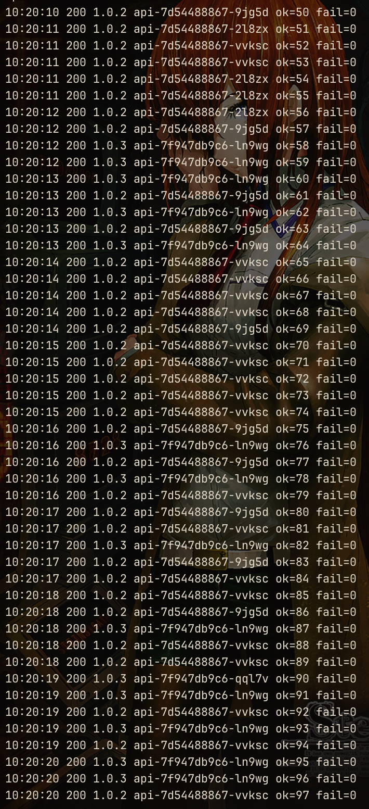

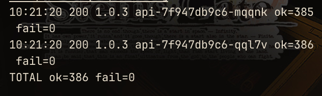

### Сломанная версия и rollback

Дальше выставил api переменную HEALTH_FAIL=true и сделал helm upgrade. Появился новый ReplicaSet api-6fd86dc68c и один новый под.

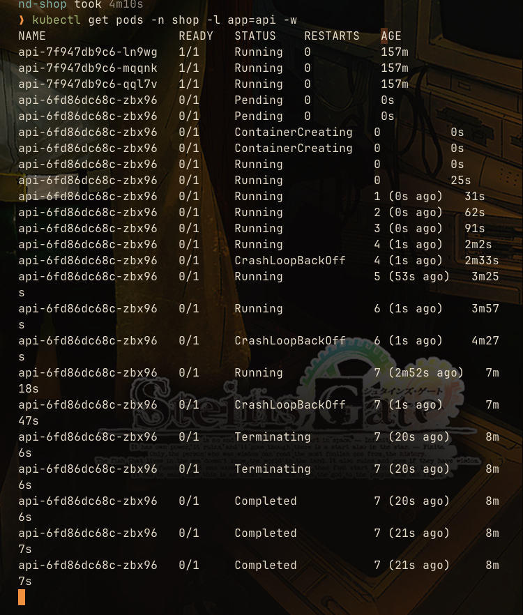

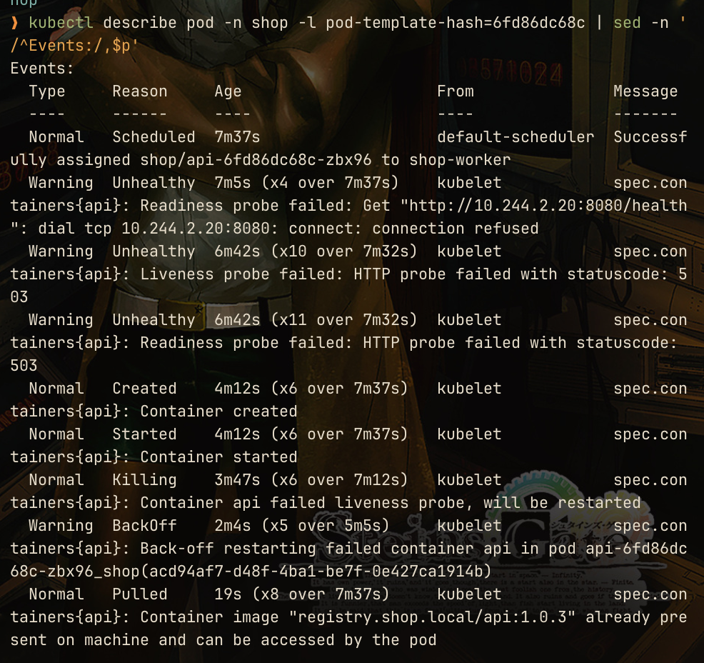

Как и ожидалось новый под отвечал на /health кодом 503.

Поэтому не проходила readiness проба, и под так и не стал Ready. 

Liveness не проходила и поэтому kubelet перезапускал контейнер, пока тот не ушёл в CrashLoopBackOff.

Каак мы видим 
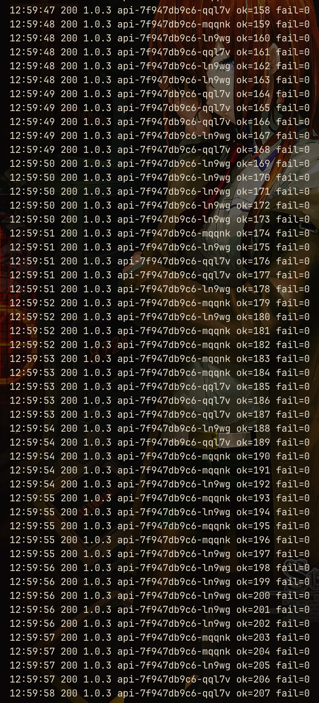

Из-за maxUnavailable = 0 контроллер Deployment не может удалить старый под, пока новый не станет Ready. 

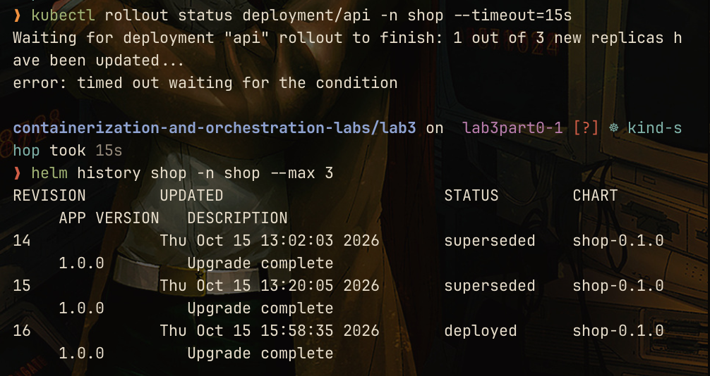

Поэтому тупо rollout остановился на 1 out of 3.

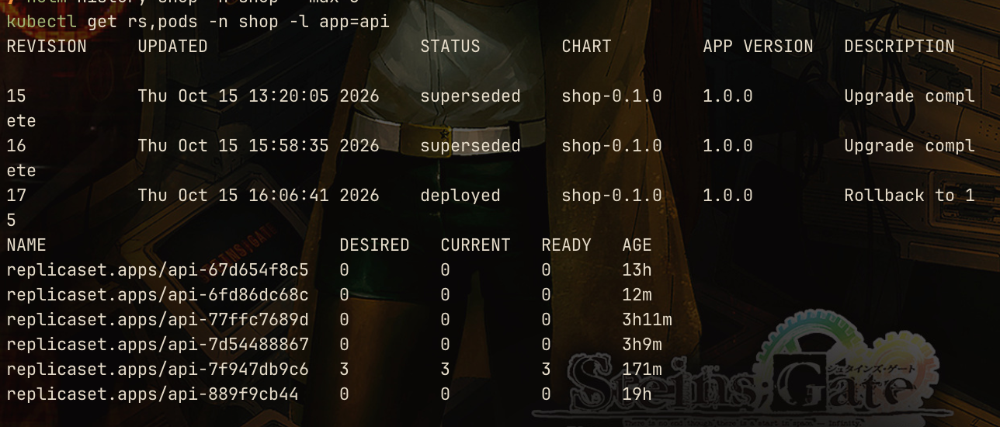

## Часть 3: Postgres через оператора

### Выбор оператора

Снова по совету великой нейронки я взял CloudNativePG, и стал разбираться с тем, как он работает
Во-первых, этот оператор-программа, по факту делающая работу контроллера,
работает с новым типом `Cluster`, который добавлен в k8s через CRD, и контроллер, как раз следит за этим типом
И когда мы создаем объект Cluster наш CloudNativePG-pod подписан на наш API-Server и если таблица 
Cluster была изменена, то CloudNativePG будет с ней работать

### Установка оператора и Kyverno

Первая попытка установить оператор не увенчалась успехом, когда я запустил 

`helm repo add cnpg https://cloudnative-pg.github.io/charts`

`helm install cnpg cnpg/cloudnative-pg -n cnpg-system --create-namespace --version 0.29.1 --wait`

ничего не сработало, потому что снова не прошло политики

```
Error: server-side apply failed for object cnpg-system/cnpg-cloudnative-pg apps/v1, Kind=Deployment:
admission webhook "validate.kyverno.svc-fail" denied the request:
require-labels:   autogen-only-shop-labels   ... /spec/template/metadata/labels/app/
require-limits:   autogen-only-shop-limits   ... /spec/template/spec/containers/0/resources/limits/
trusted-registry: autogen-only-shop-registry ... /spec/template/spec/containers/0/image/
```

добавил исключение, переустановил, оператор поднялся

И тут возникает 2 проблема: когда Postgres попросил диск, Kyverno заблокировал служебный под провижинера дисков kind:

```
failed to provision volume with StorageClass "standard":
resource Pod/local-path-storage/helper-pod-create-pvc-... was blocked due to the following policies
require-labels, require-limits, trusted-registry
```

Проблема в том, что Postgres создаёт PVC (запрос на диск). Провижинер дисков kind на него реагирует и запускает временный под, который создаёт на ноде папку под этот диск. Вот только под принадлежит kind, а не мне, поэтому его зарубили те же три политики. А без пода нету диска, поэтому postgres не стартует. Добавил в исключение в `require-limits.yaml`

```yaml
namespaces:
    cnpg-system
    local-path-storage
```

И оно запустилось 

### Postgres в чарте

мы пишем свой шаблончик `postgres-cluster.yaml`

в которой описываем объект кластера

```yaml
apiVersion: postgresql.cnpg.io/v1
kind: Cluster
metadata:
  name: postgres
spec:
  instances: {{ .Values.postgres.instances }}
  imageName: {{ .Values.postgres.image.repository }}:{{ .Values.postgres.image.tag }}
  storage:
    size: {{ .Values.postgres.storage.size }}
  resources:
    limits:
      cpu: {{ .Values.postgres.resources.limits.cpu }}
      memory: {{ .Values.postgres.resources.limits.memory }}
  inheritedMetadata:
    labels:
      app: postgres
```

Поды, PVC и Service создаёт уже оператор. 

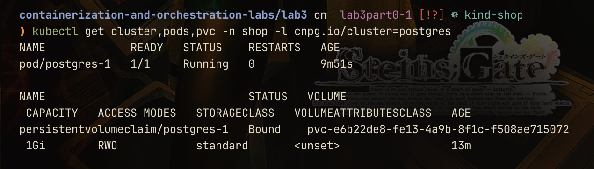

под с бд запустился, и диск тоже создался и привязался к поду ( status Bound )

### api и worker работают с базой

тестим работу /order и /orders

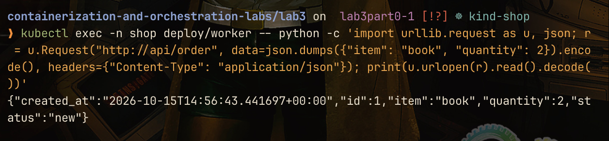

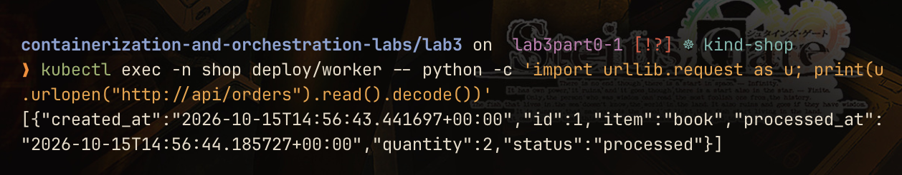

Оператор сам генерит пароль и собирает полную строку подключения

Он кладёт её в Secret с именем postgres-app а внутри как раз находится нужное нам поле uri, а Secret хранится в etcd. Это описано в документации оператора CloudNativePG

Ну и чтобы наш api обратился к поду с бд  `api-deployment.yaml` как раз описывает как называется secret и какой ключ в него помещаем.

```yaml
 env:
 - name: DATABASE_URL
    valueFrom:
    secretKeyRef:
        name: postgres-app
        key: uri
```

При запуске пода kubelet берёт значение из Secret и передаёт его в контейнер как переменную DATABASE_URL

### Reconciliation: удалил под Postgres

Дальше я удалил под postgres с помощью

`kubectl delete pod postgres-1 -n shop`


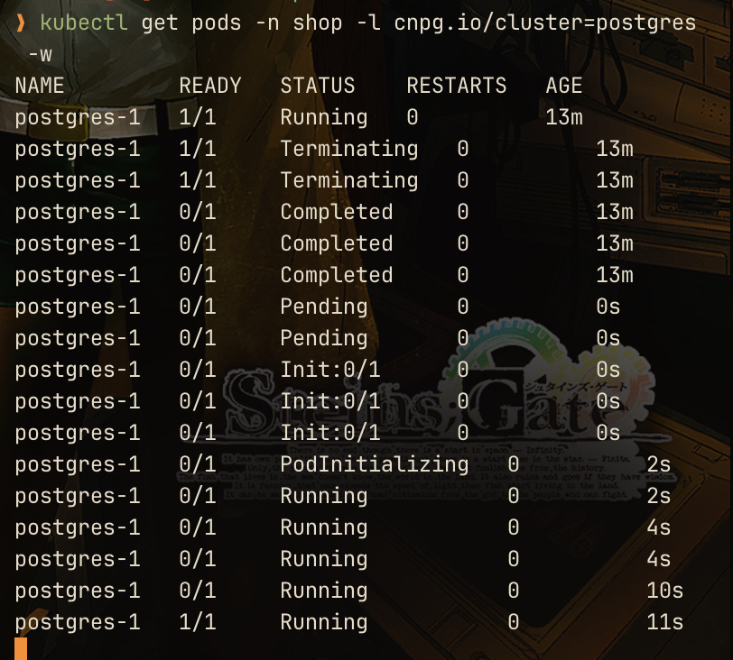

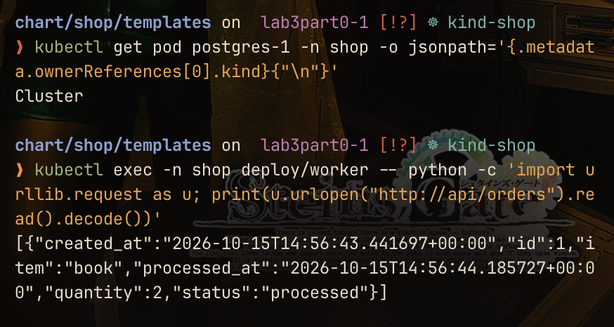

Оператор сам управляем нашим объектом кластера, replicaset не знает о них

Он сам создает поды и связывает под с именем диска, поэтому имя одно и тоже 

### spec и status

дальше я посмотрел как выглядит спека 

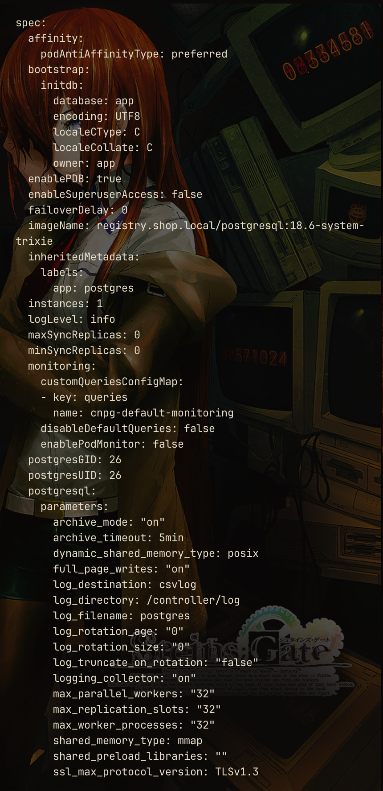

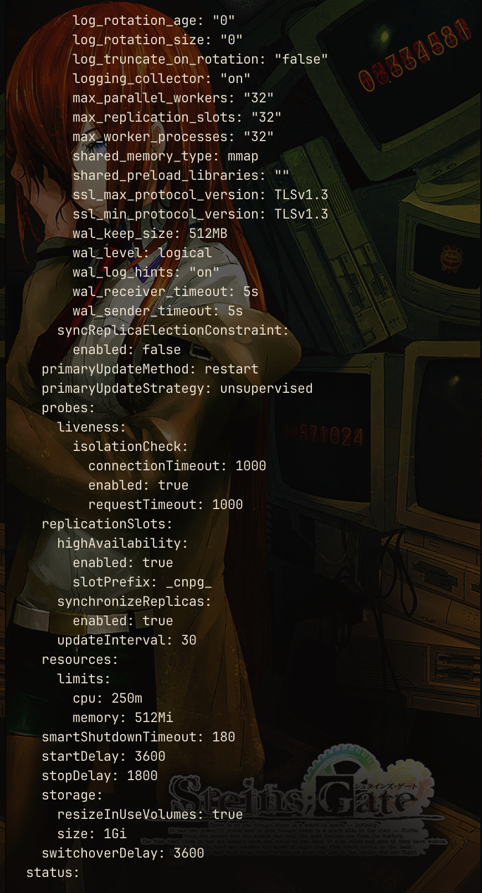

Помимо полей, которые мы написали в spec, в объекте появились значения по умолчанию. Часть подставил api-server из схемы CRD, остальное дописал webhook оператора при создании объекта

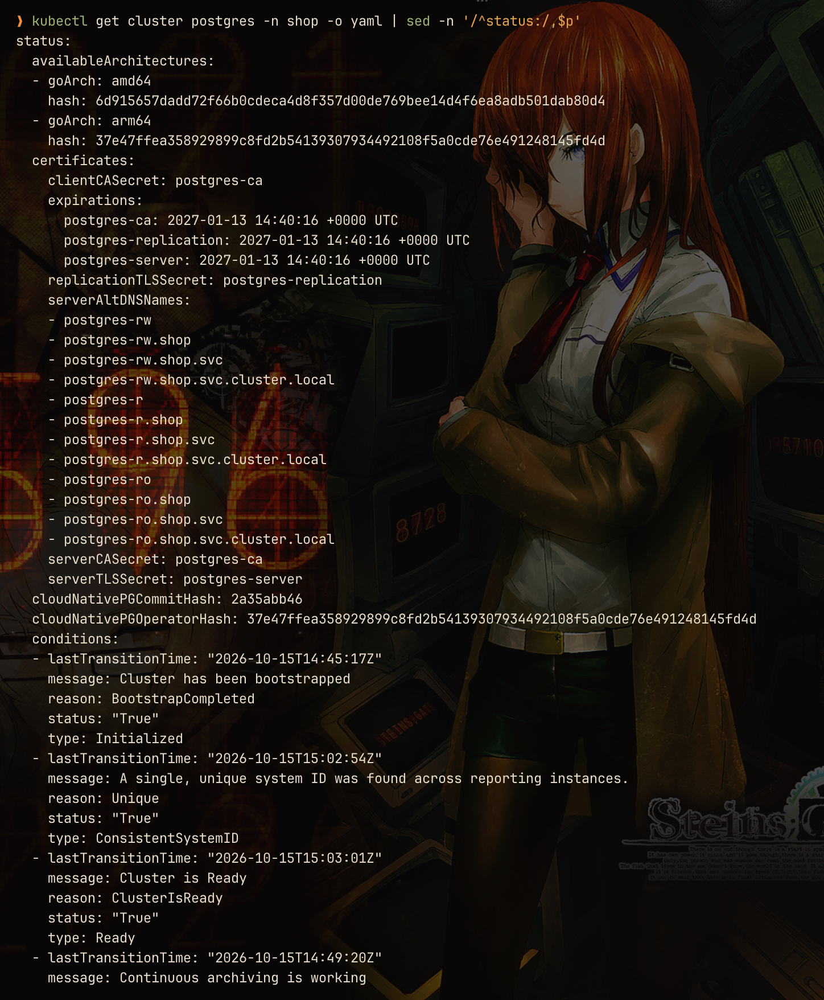

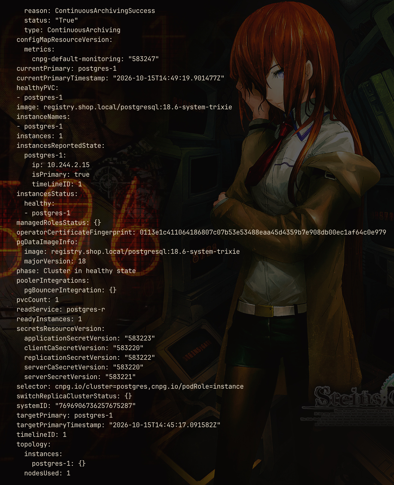

статус - это фактическое состояние и там видно, сколько, например, у нас сейчас запущено готовых инстансов

оператор просто сравнивает значение спеки с реальностью,проводит махинации, а отчет пишет в status

### Оператор против controller-manager

Если сравнивать оператор и controller-manager,
controller-manager часть кубера, а оператор это обычный отдельный под в своем namespace, который не является его частью. Оператор следит ток за своим типом (Cluster), а controller-manager за своими встроенными типами Deployment, ReplicaSet. Ну spec и status у них работает одинаково и оба работают по одному циклу: сравнивают spec с реальностью и исправляют расхождение.
Если говорить конкретно про Postgre, то там оператор еще и знает, кто главный и у кого какой диск, в отличие от ReplicaSet, который дает тебе одинаковые поды, которые ничем не отличаются

## Часть 4: Падение control plane

### Выключаем etcd

Вроде, казалось бы, достаточно убить просто под с etcd и все сработает, но проблема в том что когда мы пишем 

`kubectl delete pod etcd-shop-control-plane`

это не сам под а его копия

kubelet дает копию API-server для публикации информации, поэтому удалив его kubelet просто увидит что ее нету в apiServer и даст новую
а etcd будет жить 

Причина этому статические поды. ectd работает с самого создания кластера. Они подключаются через yaml файлики в `/etc/kubernetes/manifests` а kubelet следит за этими статик подами и если файлик исчезает kubelet просто не запустит ее заново 


но тут возникает идея давайте просто, чтобы убить именно оригинал идем в обход API-server сразу в containerd и стопаем его через `crictl stop`, НО:

kubelet следит за этими статик подами и если один из них падает kubelet просто его перезапустит

Поэтому нужны радикальные меры - mv

перемещаем наш файлик etcd.yaml в другую директорию и kubelet видит, что файла нет, и сам останавливает контейнер

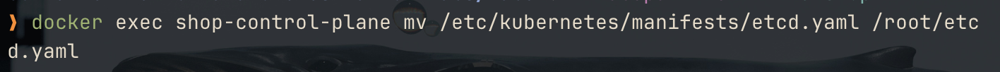

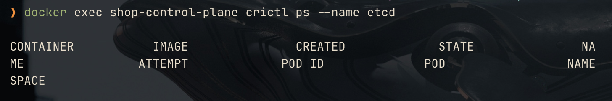

и etcd пропадает

### Доступ к api мимо API-сервера

Так как etcd стопнулась, API-server пошел за ней ( всё хранится в etcd, поэтому без etcd он не может ответить ни на один запрос ) и его liveness проба не проходит, и kubelet перезапускает его по кругу 

Теперь чтобы достучаться до api port-forward не подходит. Он ходит через API-сервер, а API-сервер упал вместе с etcd.

А curl с ноды на ClusterIP работает: маршрут до подов уже лежит в iptables на ноде, etcd не нужен.

### Управление сломалось

kubectl ловит таймаут: API-сервер принимает соединение, но молчит, потому что ждёт etcd

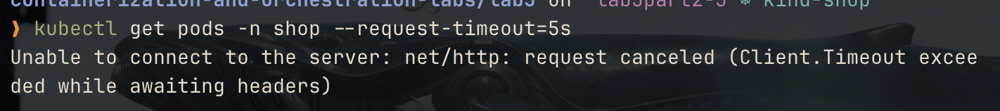

helm upgrade висит 

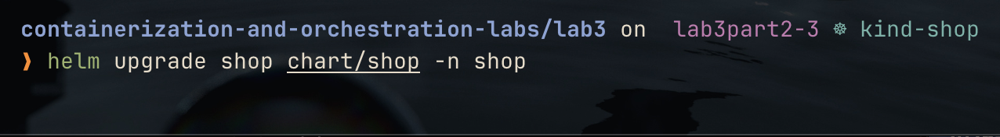

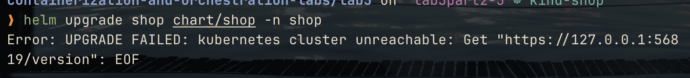

### Приложение продолжает работать

Но поды живы

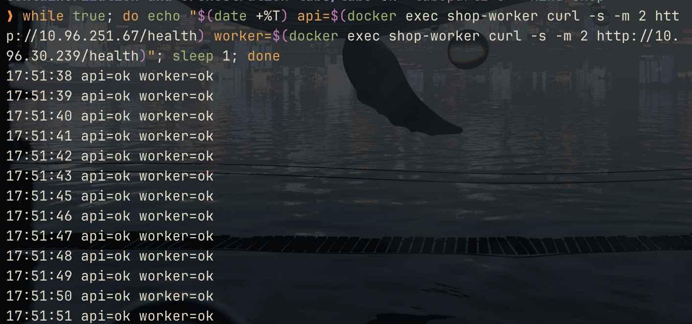

и наши api и worker отвечают

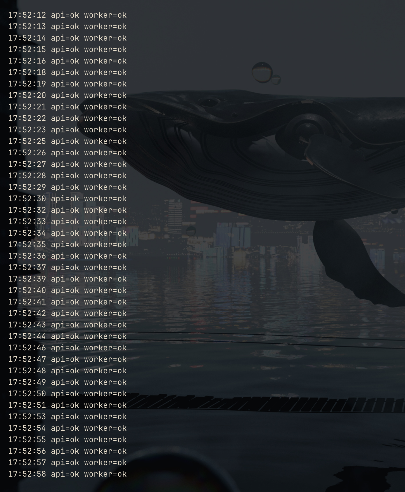

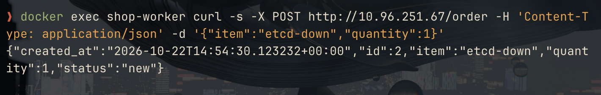

Поскольку весь трафик идёт через iptables, пароль к Postgres api получил при старте. 

В etcd лежит описание кластера, а заказы лежат в Postgres.

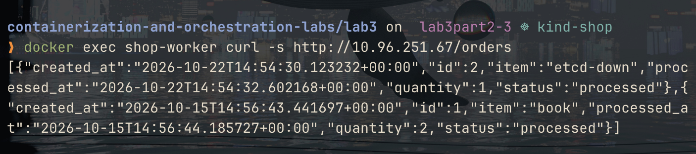

### Возвращаем control plane

А теперь вернем etcd.yaml
обратно

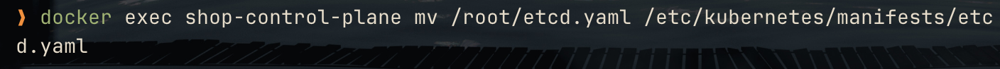

И видим что etcd поднялся, но api сервера еще нет

Почему?

Потому что как я уже сказал, пока etcd лежал, kubelet убил api сервер много раз, и пауза после след рестарта растет удваиваясь до 5 минут. И мы вынуждены ждать когда kubelet в след раз дойдет до рестарта api сервера

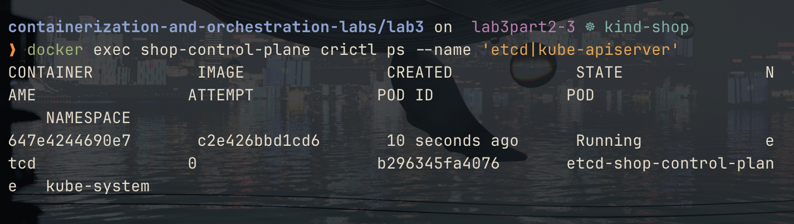

паузы между рестартами и есть CrashLoopBackOff

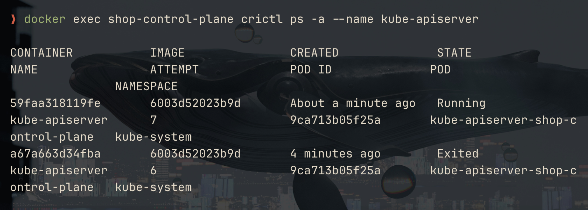

Все ноды снова и поды снова можно посмотреть

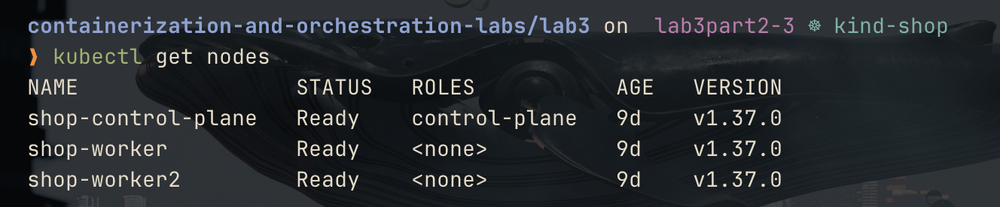

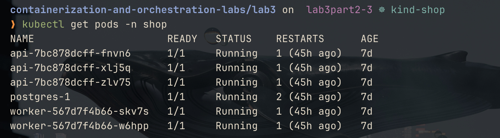


### Кластер снова управляем

И тут можно стокнутся с еще одной проблемой Kyverno не отвечает.

На самом деле проблема в том, что API-сервер лежал, поэтому Kyverno сломался (он живет за счет API-server и без него не может работать), kubelet его перезапускал, и он тоже ушёл в паузу CrashLoopBackOff.

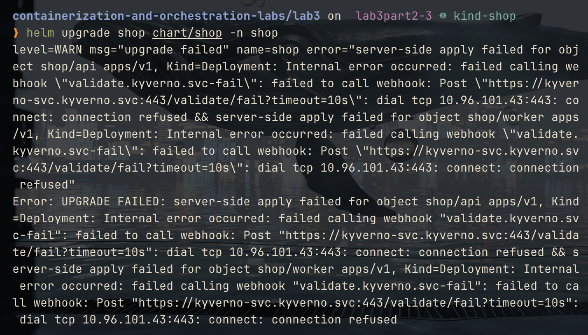

Поэтому подождав немного он тоже заработал

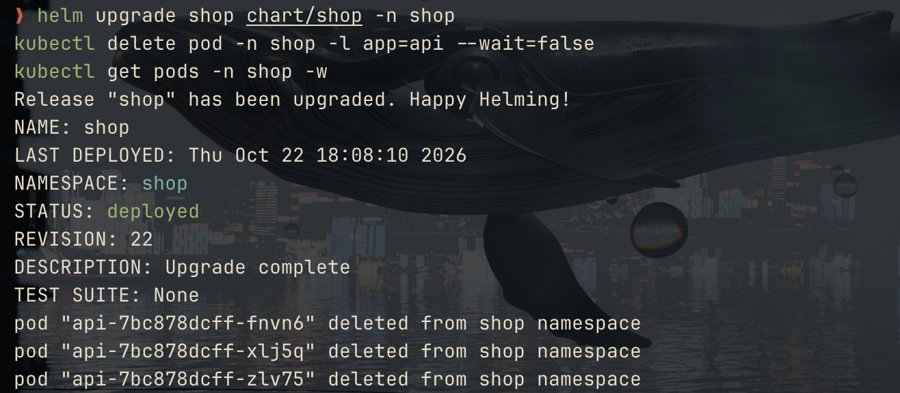

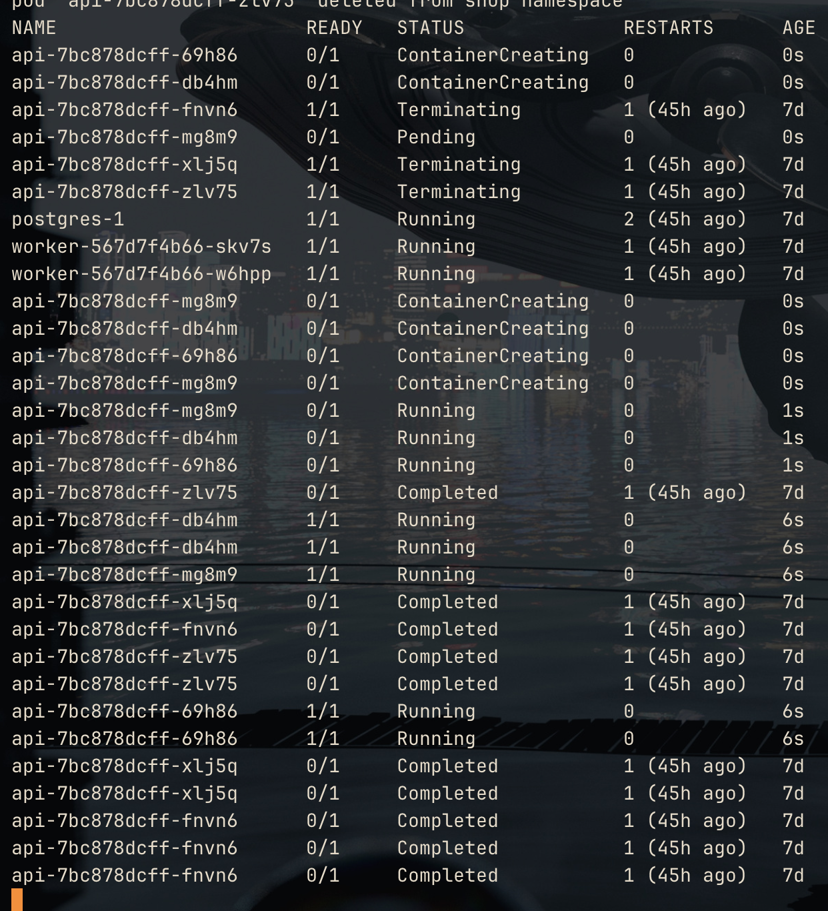

## Часть 5: Мониторинг

И тут при установке prometheus снова сработали две политики, снова добавляем исключение monitoring в exclude

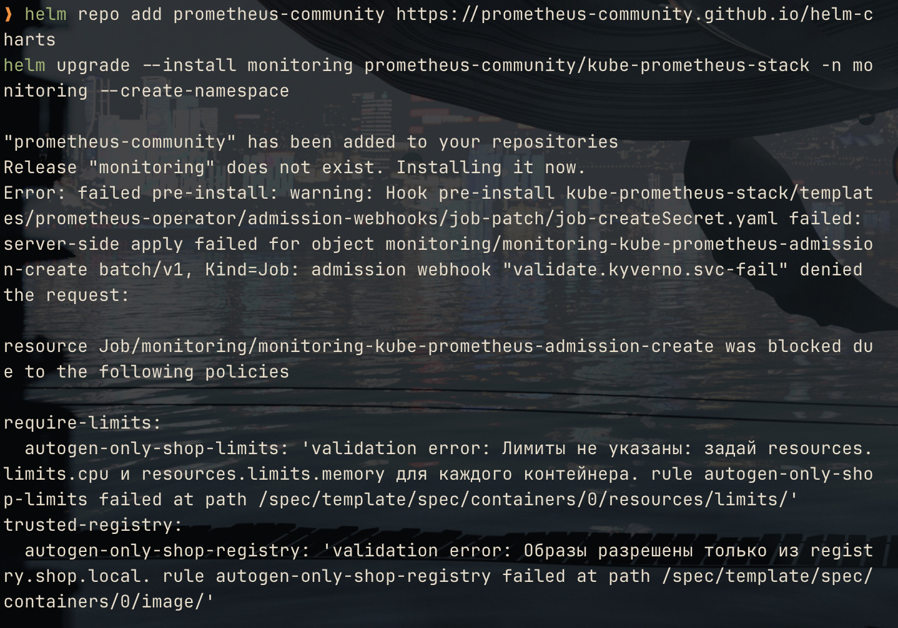

применяем

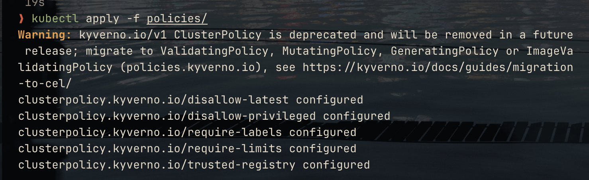

и вуаля, наш monitoring запущен

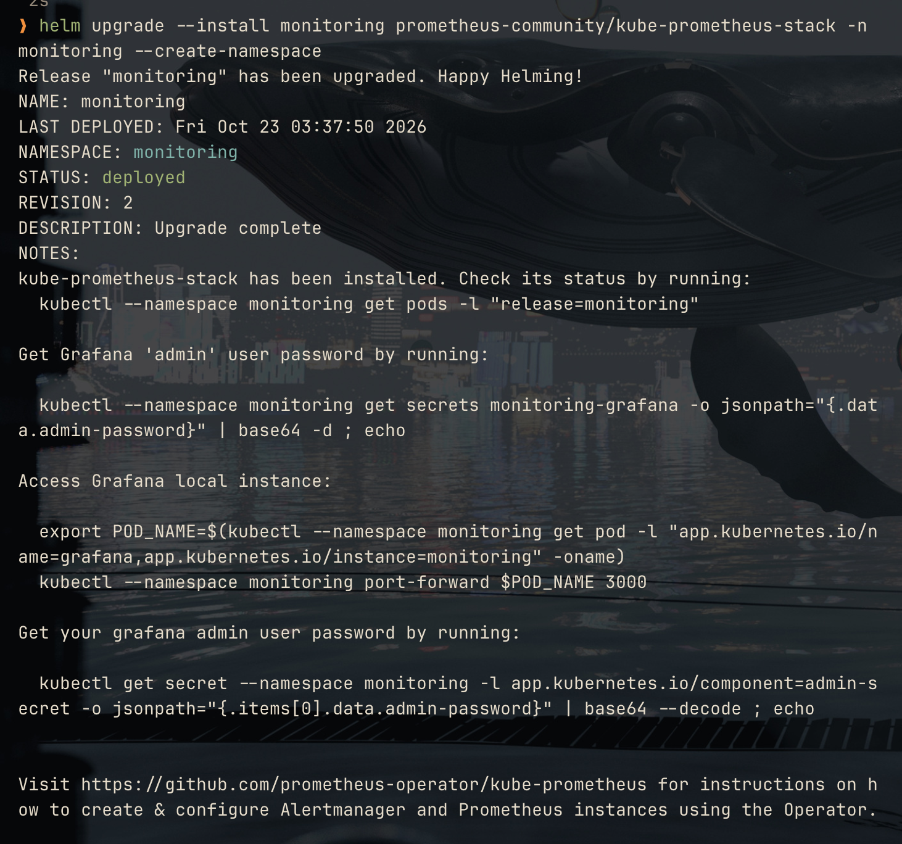


дальше копируем файл из 2 лабы в чарт shop

и рефакторим файлик

```YAML
metadata:
  name: {{ include "api.fullname" . }}            
  labels:
    {{- include "api.labels" . | nindent 4 }}  
    release: monitoring                           
spec:
  selector:
    matchLabels:
      {{- include "api.selectorLabels" . | nindent 6 }}   
```


### ServiceMonitor: Prometheus видит api

И вот наконец-то мы добрались до сбора метрик

ServiceMonitor здесь - это инструкция для Prometheus: откуда вообще надо собирать метрики

без нее он не знает, где наш api
и Prometheus оператор как раз берет только те объекты, у которых есть метка "release: monitoring"

поэтому, если мы ее не поставим, ServiceMonitor просто не появится в prometheus 

matchLabels просто ищет Service с меткой app:api

ну и дальше идут endpoints: как часто забирать,
по какому адресу находятся

после отправки наших файликов через helm upgrade 
спустя время у нас в prometheus появились метрики подов


### Красные таргеты control plane

К слову, таргеты control plane сидят вообще в DOWN

связано это с тем, что они по умолчанию отдают метрики ток на локальный айпи 127.0.0.1, то есть только тому, кто сидит на той же ноде. 

Prometheus же работает в отдельном поде и приходит по IP ноды, поэтому у нас возникает connection refused


### Подбираем запросы для алертов

Используем простой алерт `up{job="api"}`


и видим, что вывелись все поды, потому что мы не отфильтровали на живых и мертвых

поэтому проверяем, мертвы ли поды или нет `up{job="api"} == 0`


Нет ничего — все поды живы, и это нормально

Затем делаем 2-й и 3-й алерты, которые проверяют пятисотки за последние 5 минут и рестарты больше 2 за последние 10 минут


Неудивительно, что все пока что хорошо 

### PrometheusRule в чарте

Создаем правило для prometheus

это правило тоже подгоняет нам Prometheus Operator при labels `release: monitoring`

Сначала мы делаем helm upgrade, далее это все берет оператор и отправляет в объект кубера ConfigMap
и уже kubelet копирует наш файл в сам под Prometheus, где Prometheus перечитывает его


`chart/shop/templates/api-prometheusrule.yaml`:

```YAML
apiVersion: monitoring.coreos.com/v1
kind: PrometheusRule
metadata:
  name: api
  labels:
    release: monitoring
spec:
  groups:
    - name: shop
      rules:
        - alert: ApiDown
          expr: up{job="api"} == 0
          for: 2m
          labels:
            severity: critical
          annotations:
            summary: "Под {{ "{{" }} $labels.pod {{ "}}" }} не отвечает"
        - alert: ApiHigh5xxErrors
          expr: increase(shop_http_requests_total{status=~"5.."}[5m]) > 0
          for: 2m
          labels:
            severity: critical
          annotations:
            summary: "Под {{ "{{" }} $labels.pod {{ "}}" }} отдаёт 5xx на {{ "{{" }} $labels.path {{ "}}" }}"
        - alert: ShopPodRestarting
          expr: increase(kube_pod_container_status_restarts_total{namespace="shop"}[10m]) > 2
          for: 2m
          labels:
            severity: critical
          annotations:
            summary: "Под {{ "{{" }} $labels.pod {{ "}}" }} перезапускается слишком часто" 
```

`for: 2m` говорит о том, сколько надо жить нашему алерту, чтобы улететь в firing (до этого будет висеть в `pending`) 

поставил 2 минуты, чтобы понапрасну не тревожить человека из-за rolling update, например :)

`summary: "Под {{ "{{" }} $labels.pod {{ "}}" }} перезапускается слишком часто"` имеет `{{ "{{" }}`, потому что иначе Helm попробует обработать это значение, а нам нужно, чтобы это сделал Prometheus

### Почему я выбрал эти алерты

#### ApiDown — `up{job="api"} == 0`

просто проверяет на живность наши поды

Под, который не отвечает, не обслуживает заказы. 

Пока подов 3, сервис ещё работает на оставшихся, но запас прочности уменьшился: если упадёт ещё один, нагрузка ляжет на последний.

Лучше узнать об этом сразу, а не когда упадут все.

#### ApiHigh5xxErrors — `increase(...[5m]) > 0`

проверяет, насколько счетчик вырос за последние N минут (просто в Prometheus счетчик идет постоянно и он никогда не уменьшается, а только растет, поэтому используем `increase(...[5m])`, которая проверяет, насколько вырос счетчик за ПОСЛЕДНИЕ 5 минут)
и если количество таких пятисоток у нас больше 0, алерт срабатывает
`increase(shop_http_requests_total{status=~"5.."}[5m]) > 0`

Зачем?

500 видят живые пользователи: заказ не оформился, страница сломалась. 

При этом под может быть живым и всё равно отдавать ошибки, например если упала база.

#### ShopPodRestarting — `increase(...[10m]) > 2`

по факту делает то же самое, только сравнивает счетчик рестартов наших подов и если за последние 10 минут их было больше 2 — что-то идет не так

Под, который постоянно перезапускается, снаружи может выглядеть нормально: Kubernetes его поднимает, и сервис как будто работает. 

но по факту не хватает памяти, падает приложение, не проходит проба. Поэтому поставил максимум 2 перезапуска, ибо 3-5 перезапусков за 10 минут выглядит странновато 


Все наши алерты проходят и все отлично. Причем эти алерты появились не сразу, а ток через несколько минут, потому что по цепочке проходит довольно много времени, ведь kubelet синхронизирует ConfigMap в поды примерно раз в минуту

### Проверка: ломаем api

Поехали! Дальше ломаем api 

я включил healthFail, чтобы наш health_check намеренно ломался

и что произошло

Новый под api начал отвечать 500 на /health
А это значит, что liveness постоянно будет его перезапускать, но 3 старых пода живут и принимают запросы

а Service не посылает на 0/1 новый с CrashLoopBackOff контейнер, потому что он не готов и не прошел readiness пробу

Итого:

ApiHigh5xxErrors: kubelet дёргает /health пробами, получает 500, и счётчик пятисоток растёт

ShopPodRestarting: liveness перезапускает под больше 2 раз за 10 минут

ApiDown: пока контейнер мёртв между перезапусками, Prometheus не может забрать /metrics, и up = 0.

В pending он улетает, когда наш алерт живет меньше чем 2 минуты из `for: 2m`
Поэтому, как только 2 минуты прошли, он стал FIRING


чиним, `helm upgrade shop . -n shop` (убираем healthFail) и готово:

К слову, пока чинил:

у Helm есть неочевидное правило. 

Если при helm upgrade не передать ни одного --set и ни одного -f, Helm берёт значения из прошлой ревизии, а не из values.yaml

Поэтому мне пришлось явно сделать `--reset-values`, чтобы сбросить healthFail:true

```bash

❯ helm upgrade shop . -n shop --reset-values

Release "shop" has been upgraded. Happy Helming!
NAME: shop
LAST DEPLOYED: Sat Oct 24 00:58:05 2026
NAMESPACE: shop
STATUS: deployed
REVISION: 32
DESCRIPTION: Upgrade complete
TEST SUITE: None

lab3/chart/shop on  lab3part2-3 [!?] ☸ kind-shop
❯ helm get values shop -n shop
USER-SUPPLIED VALUES:
null

```

Как итог:


### Happy end

это было тяжело, но мы справились с этим зверем под названием кубернетес


