# Лабораторная работа 4 - SLA критического пути под перегрузкой

https://github.com/KeladKaal/containerization-and-orchestration/blob/main-rus/lecture-4-scheduling-resources/lab.md

## Part 0 - batch

`services/batch` содержит минимальное Kotlin приложение для фоновой нагрузки.

Параметры приложения:

- `MEMORY_MB` - объём удерживаемой памяти;
- `CPU_WORKERS` - число потоков, выполняющих вычислительный цикл.


Приложение собрано как Kotlin/JVM-приложение. Для сборки использовалась
двухэтапная Docker-сборка: на первом этапе Gradle собирает приложение, на
втором оно запускается в образе `eclipse-temurin:25-jre` от непривилегированного
пользователя `batch`.

Образ получил явный тег:

```text
registry.shop.local/batch:0.1.0
```

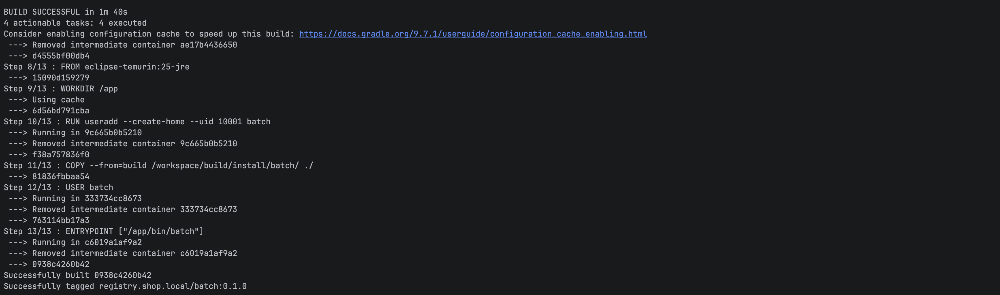

Контейнер запущен с параметрами `MEMORY_MB=128` и `CPU_WORKERS=1`. Внутри
контейнера приложение выделяет 128 MiB памяти и запускает один бесконечный
вычислительный поток.

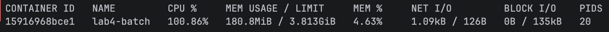

По данным `docker stats`, контейнер потреблял около 100% одного CPU и 180.8 MiB
памяти. Потребление памяти выше заданных 128 MiB объясняется накладными
расходами JVM и самого процесса: переменная `MEMORY_MB` задаёт размер массива,
а не полный RSS контейнера.

Логи подтверждают, что приложение запустилось с ожидаемыми параметрами и
продолжает работать:

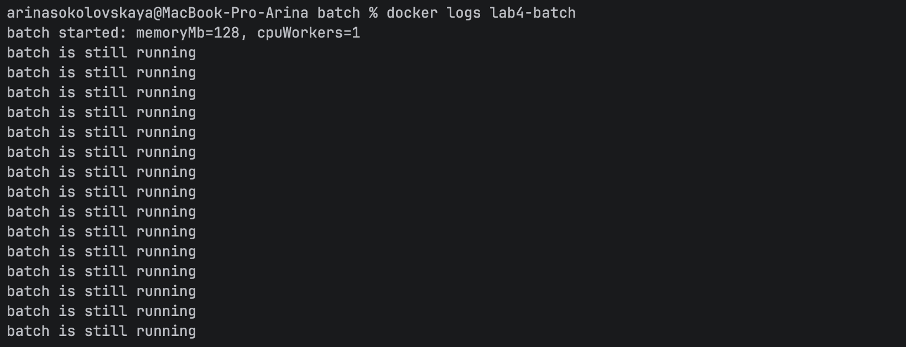

## Часть 1: выбор механизма разнесения подов

Для разнесения реплик API можно использовать `podAntiAffinity` или
`topologySpreadConstraints`.

`podAntiAffinity` задаёт правило размещения относительно других подов. В
строгом режиме `requiredDuringSchedulingIgnoredDuringExecution` он запрещает
размещать подходящие поды в одном домене топологии. Если использовать в
качестве домена Kubernetes-ноду (`kubernetes.io/hostname`), то на одной ноде
может находиться не более одной реплики API.

В нашем кластере две worker-ноды и три реплики API. Поэтому строгий
`podAntiAffinity` оказался бы слишком жёстким: две реплики разместились бы на
разных нодах, а третья осталась бы в состоянии `Pending`. Мягкий режим
`preferredDuringSchedulingIgnoredDuringExecution` позволил бы запустить все
реплики, но не гарантировал бы их разнесение.

`topologySpreadConstraints` описывает не запрет соседства, а требуемое
распределение подов между доменами топологии. В нашем случае доменом является
Kubernetes-нода. Параметр `maxSkew` задаёт максимально допустимую разницу в
количестве подходящих подов между нодами, а `whenUnsatisfiable` определяет
поведение планировщика, если это условие невозможно выполнить.

Для лабы выбран механизм `topologySpreadConstraints` с распределением по
нодам и допустимым перекосом `maxSkew: 1`. При трёх репликах и двух worker-нодах
ожидается распределение `2 + 1`. При этом все реплики могут быть запущены, а
разница в количестве реплик между нодами не превышает одной.

Этот механизм выбран потому, что он лучше соответствует задаче лабы: требуется
не просто запретить совместное размещение подов, а равномерно распределить
реплики критического сервиса между доступными нодами. Такое распределение
повышает отказоустойчивость: отказ одной ноды не приводит к потере всех
реплик API.

Выбор механизма оформлен декларативно в Helm-чарте. В `values.yaml` задан
параметр `scheduling.mechanism: topologySpreadConstraints`, а шаблон API
подставляет соответствующий блок `topologySpreadConstraints` в Pod-шаблон.
Поэтому правило является частью описания приложения и воспроизводится при
каждом `helm upgrade`, а не задаётся ручным изменением уже созданного
Deployment.

## Часть 2: тесная площадка

Для эксперимента используется kind-кластер с двумя worker-нодами. Это
позволяет одновременно разместить несколько реплик критического сервиса и
создать ограничение по ресурсам для фоновой нагрузки `batch`.

Перед добавлением `batch` в Helm-чарт была сформулирована начальная гипотеза
по его ресурсам на основании наблюдения из Части 0: контейнер потреблял около
100% одного CPU и 180.8 MiB памяти.

Начальные значения:

| Ресурс | requests | limits |
|---|---:|---:|
| CPU | 100m | 1000m |
| Memory | 64Mi | 256Mi |

Лимит памяти выбран выше наблюдавшегося RSS, чтобы на первом запуске не
получить `OOMKilled` из-за слишком маленького ограничения. Requests меньше
limits намеренно: планировщик резервирует для `batch` небольшую гарантированную
долю ресурсов, а сам контейнер при наличии свободной ёмкости может потреблять
больше. Эти значения являются первоначальной гипотезой и в дальнейшем будут
сопоставлены с фактическими наблюдениями.

### Проблема при создании kind-кластера

Первая попытка создать кластер `shop` завершилась ошибкой на этапе запуска
control-plane. В логе kind API-сервер перестал отвечать:

```text
failed to create cluster
connect: connection refused
```

Диагностика показала, что Docker Desktop был ограничен примерно 4 GiB памяти.
При этом уже запущенный кластер `kind-lab2` занимал 2.452 GiB, а старый
контейнер `lab4-batch` - ещё около 183 MiB и один CPU. Создание ещё трёх
контейнеров kind привело к нехватке ресурсов во время инициализации API-сервера.

Поэтому проблема возникла до установки Helm-чарта и не была связана с
`batch` или `topologySpreadConstraints`. Для повторной попытки нужно временно
остановить старый кластер `lab2` и контейнер `lab4-batch` либо увеличить лимит
ресурсов Docker Desktop. Остановка контейнеров не удаляет кластер и позволяет
вернуть его позже.

После временной остановки `kind-lab2` и контейнера `lab4-batch` кластер
`shop` был создан успешно. В нём работают две worker-ноды, необходимые для
проверки распределения реплик API:

```text
NAME                 STATUS   ROLES           VERSION
shop-control-plane   Ready    control-plane   v1.37.0
shop-worker          Ready    <none>          v1.37.0
shop-worker2         Ready    <none>          v1.37.0
```

Текущий kubectl-контекст - `kind-shop`. Старый кластер `kind-lab2` не удалён,
а только временно остановлен для освобождения ресурсов Docker.

Состояние нод также проверено через OpenLens:

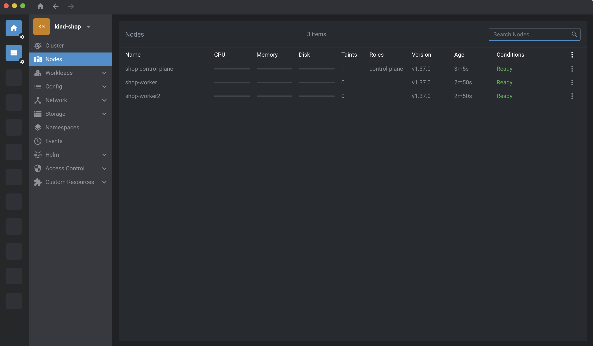

### Сборка и загрузка образов

Образы API и worker были собраны с теми тегами, которые указаны в
`values.yaml`: `api:1.0.3` и `worker:1.0.0`. Образ `batch:0.1.0` был собран в
Части 0.

Первая попытка загрузить образ PostgreSQL обычной командой
`kind load docker-image` завершилась ошибкой:

```text
ctr: content digest ... not found
```

Причина связана с multi-platform metadata: kind импортировал образ через
`ctr images import --all-platforms`, хотя локально был доступен только ARM64
вариант. Для исправления образ PostgreSQL загружается в каждую ноду через
`ctr images import --digests`, без флага `--all-platforms`. После этого образ
был успешно импортирован в `shop-control-plane`, `shop-worker` и `shop-worker2`.

Остальные локальные образы были загружены тем же способом одной командой:

```text
make load-image IMAGE="registry.shop.local/api:1.0.3 registry.shop.local/worker:1.0.0 registry.shop.local/batch:0.1.0"
```

В выводе команды присутствуют последовательные этапы загрузки в каждую из
трёх нод: `shop-control-plane`, `shop-worker` и `shop-worker2`. Для всех трёх
образов (`api:1.0.3`, `worker:1.0.0`, `batch:0.1.0`) импорт завершился без
ошибок. Таким образом, все образы, необходимые для дальнейшего развёртывания
чарта, доступны на каждой ноде kind-кластера.

### Установка Kyverno

Kyverno был установлен в namespace `kyverno` через Helm-чарт версии `3.9.1`.
Поскольку первая попытка установки была остановлена во время ожидания готовности,
повторный запуск выполнил успешное обновление релиза до ревизии 2:

```text
Release "kyverno" has been upgraded. Happy Helming!
STATUS: deployed
REVISION: 2
Chart version: 3.9.1
Kyverno version: v1.19.1
```

После установки все основные компоненты Kyverno готовы:

```text
kyverno-admission-controller   1/1   Running
kyverno-background-controller  1/1   Running
kyverno-cleanup-controller     1/1   Running
kyverno-reports-controller     1/1   Running
kyverno-migrate-resources      0/1   Completed
```

Компонент `kyverno-migrate-resources` является одноразовой Job, поэтому его
статус `Completed` означает успешное завершение миграции, а не ошибку.
Helm также вывел предупреждение, что одна реплика admission-controller не
обеспечивает отказоустойчивый режим HA. Для локального учебного kind-кластера
это допустимо.

### Применение политик

После готовности Kyverno были применены пять кластерных политик:

```text
clusterpolicy.kyverno.io/disallow-latest created
clusterpolicy.kyverno.io/disallow-privileged created
clusterpolicy.kyverno.io/require-labels created
clusterpolicy.kyverno.io/require-limits created
clusterpolicy.kyverno.io/trusted-registry created
```

Проверка показала, что все политики активны для admission-проверок и готовы:

```text
NAME                  ADMISSION   BACKGROUND   READY   MESSAGE
disallow-latest       true        true         True    Ready
disallow-privileged   true        true         True    Ready
require-labels        true        true         True    Ready
require-limits        true        true         True    Ready
trusted-registry      true        true         True    Ready
```

При применении Kyverno вывел предупреждение о deprecated API
`kyverno.io/v1 ClusterPolicy`. Это предупреждение о будущем переходе на новые
типы политик, а не ошибка: текущие политики успешно созданы и имеют статус
`Ready`.

Порядок установки важен: Kyverno проверяет новые запросы к Kubernetes API на
этапе admission. Поэтому сначала устанавливаются политики, а уже затем
разворачивается приложение `shop`. Иначе некорректные Pod-ы могли бы успеть
создаться до включения проверок; установка политики не является заменой
валидации уже созданных ресурсов.

Политика `require-limits` требует, чтобы в каждом контейнере были указаны
`resources.limits.cpu` и `resources.limits.memory`. В общем случае отсутствие
лимита может привести к неконтролируемому потреблению ресурсов и `OOM`, но в
данной конфигурации такой Pod будет отклонён Kyverno ещё до запуска.

### Установка CloudNativePG

После Kyverno был установлен оператор CloudNativePG через Helm-чарт версии
`0.29.1` в namespace `cnpg-system`:

```text
Release "cnpg" does not exist. Installing it now.
STATUS: deployed
REVISION: 1
DESCRIPTION: Install complete
```

Проверка показала, что Pod оператора готов:

```text
NAME                                   READY   STATUS    RESTARTS   AGE
cnpg-cloudnative-pg-7b5f5d7b65-2gk2x   1/1     Running   0          18s
```

Оператор добавляет в Kubernetes API ресурс `Cluster` группы
`postgresql.cnpg.io/v1`. Поэтому его установка необходима до развёртывания
PostgreSQL-ресурса из Helm-чарта `shop`.

### Первый запуск чарта и устранение проблем

При первом запуске чарта Helm не мог завершить ожидание готовности всех
ресурсов. У одной реплики API был статус `Pending`. Планировщик сообщил:

```text
1 node(s) had untolerated taint(s), 2 node(s) didn't match pod topology spread constraints
```

Причина состояла в том, что control-plane имел taint
`node-role.kubernetes.io/control-plane:NoSchedule`, но всё равно учитывался
при расчёте топологических доменов. В результате две worker-ноды не могли
разместить третью реплику при `maxSkew: 1`. Для исправления в
`topologySpreadConstraints` добавлен параметр:

```yaml
nodeTaintsPolicy: Honor
```

После этого при расчёте учитываются только подходящие ноды, и для трёх реплик
на двух worker-нодах становится допустимым распределение `2 + 1`.

Второй проблемой был Pod `batch`. Сначала он завершался с ошибкой:

```text
java.lang.OutOfMemoryError: Java heap space
```

Приложение выделяет `ByteArray` размером `128 MiB`, а стандартный максимальный
heap JVM при лимите контейнера оказался недостаточным. В чарт добавлена
переменная `JAVA_TOOL_OPTIONS`, а параметры batch скорректированы:

```yaml
MEMORY_MB: 128
JAVA_TOOL_OPTIONS: -Xmx256m
resources:
  requests:
    memory: 64Mi
  limits:
    memory: 384Mi
```

Лимит увеличен с первоначальных `256Mi` до `384Mi`, чтобы учесть heap и
нативные накладные расходы JVM, не уменьшая моделируемую нагрузку приложения.

### Итоговое развёртывание

После исправлений Helm-чарт прошёл lint-проверку и был обновлён до ревизии 4:

```text
1 chart(s) linted, 0 chart(s) failed
STATUS: deployed
REVISION: 4
DESCRIPTION: Upgrade complete
```

На момент проверки все Pod-ы находились в состоянии `Running` и были готовы:

```text
NAME                      READY   STATUS    RESTARTS   NODE
api-989df757d-58gc4       1/1     Running   0           shop-worker2
api-989df757d-7wn7n       1/1     Running   0           shop-worker
api-989df757d-phvvn       1/1     Running   0           shop-worker2
batch-6cb49bf449-bsqwr    1/1     Running   0           shop-worker2
postgres-1                1/1     Running   0           shop-worker
worker-567d7f4b66-b95zj   1/1     Running   0           shop-worker2
worker-567d7f4b66-qrnms   1/1     Running   0           shop-worker
```

Таким образом, три реплики API распределены между worker-нодами в соотношении
`2 + 1`, batch запущен с заданной фоновой нагрузкой, PostgreSQL работает через
CloudNativePG, а все ограничения Kyverno допускают итоговый набор ресурсов.

Через несколько минут после развёртывания выполнена повторная проверка. Все
Pod-ы сохранили готовность, а счётчик перезапусков остался равен нулю:

```text
NAME                      READY   STATUS    RESTARTS   NODE
api-989df757d-58gc4       1/1     Running   0           shop-worker2
api-989df757d-7wn7n       1/1     Running   0           shop-worker
api-989df757d-phvvn       1/1     Running   0           shop-worker2
batch-6cb49bf449-bsqwr    1/1     Running   0           shop-worker2
postgres-1                1/1     Running   0           shop-worker
worker-567d7f4b66-b95zj   1/1     Running   0           shop-worker2
worker-567d7f4b66-qrnms   1/1     Running   0           shop-worker
```

Состояние PostgreSQL подтверждено оператором:

```text
postgres   1   1   Cluster in healthy state   postgres-1
```

Логи batch подтверждают запуск с заданными параметрами и продолжающуюся
работу процесса:

```text
Picked up JAVA_TOOL_OPTIONS: -Xmx256m
batch started: memoryMb=128, cpuWorkers=1
batch is still running
```

Финальное состояние приложения также проверено визуально в OpenLens:

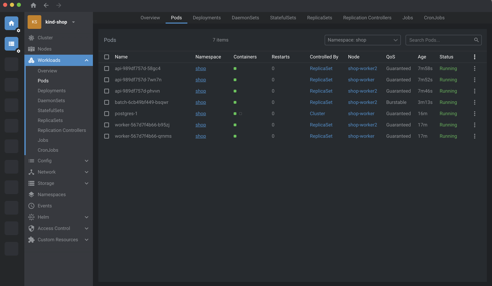

### Подготовка мониторинга для Части 3

Для получения реальных рекомендаций ресурсов нужен Prometheus-стек в том же
кластере `kind-shop`, где работает namespace `shop`. Prometheus из другого
кластера не может собирать метрики этих Pod-ов.

Перед установкой мониторинга в политики `require-labels`, `require-limits` и
`trusted-registry` добавлен namespace `monitoring` в список инфраструктурных
исключений. Это не ослабляет проверки для приложения в namespace `shop`.
Политики `disallow-latest` и `disallow-privileged` продолжают применяться к
ресурсам мониторинга.

После обновления политик все пять ClusterPolicy имеют статус `Ready`:

```text
disallow-latest       true   true   True   Ready
disallow-privileged   true   true   True   Ready
require-labels        true   true   True   Ready
require-limits        true   true   True   Ready
trusted-registry      true   true   True   Ready
```

### Установка Prometheus-стека

Для Части 3 мониторинг установлен в тот же кластер `kind-shop`, где находится
приложение `shop`. Использован Helm-релиз `monitoring` чарта
`kube-prometheus-stack` в namespace `monitoring`.

После завершения установки все основные компоненты готовы:

```text
alertmanager-monitoring-kube-prometheus-alertmanager-0   2/2   Running
monitoring-grafana                                       3/3   Running
monitoring-kube-prometheus-operator                      1/1   Running
monitoring-kube-state-metrics                             1/1   Running
monitoring-prometheus-node-exporter                       1/1   Running
prometheus-monitoring-kube-prometheus-prometheus-0       2/2   Running
```

Prometheus и связанные компоненты устанавливаются в отдельный namespace
`monitoring`, а `ServiceMonitor` приложения будет добавлен в Helm-чарт `shop`.

После добавления шаблона `ServiceMonitor` Helm-релиз `shop` обновлён до
ревизии 5:

```text
STATUS: deployed
REVISION: 5
DESCRIPTION: Upgrade complete
```

Проверка Kubernetes-ресурса показала, что мониторинг API создан:

```text
NAME   AGE
api    5s
```

Объект собирает метрики сервиса `api` через именованный порт `http`, endpoint
`/metrics` и интервалом `15s`.

Работа `ServiceMonitor` проверена в интерфейсе Prometheus. Target
`serviceMonitor/shop/api/0` обнаружил все три реплики API, и каждый endpoint
`/metrics` имеет состояние `UP`:

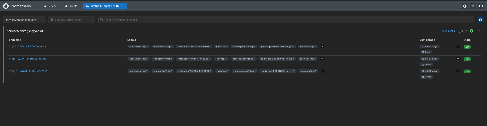

### Нагрузочный тест для Части 3

Для создания реальной нагрузки был использован сценарий k6
`lab4/load/order-load.js`. Через локальный port-forward он отправлял запросы
`POST /order`: API принимал запрос и записывал заказ в PostgreSQL.

Параметры сценария: 5 виртуальных пользователей и 3 минуты работы. Результат:

```text
checks_total.......: 3669
checks_succeeded...: 100.00%
checks_failed......: 0.00%
http_req_failed....: 0.00%
http_reqs..........: 3669   20.359069/s
http_req_duration..: avg=44.3ms  p(90)=101.91ms  p(95)=129.01ms  max=230.59ms
```

Все 3669 заказов были успешно созданы. Полученные метрики будут использованы
`krr` для рекомендации значений `requests` и `limits` критического пути.


## Часть 5: Приоритеты, ресурсы и PDB

Дальше надо было объяснить куберу, что оформление заказа у нас важное,
а ночная аналитика может и подождать :)

Заказ проходит через `api`, который записывает его в `postgres`. Если один
из этих сервисов перестанет работать, заказ не оформится. `batch` просто создаёт фоновую нагрузку, поэтому при нехватке
ресурсов хочется сначала пожертвовать им.

Для этого добавили в чарт `PriorityClass`, настроили `requests/limits` и
сделали `PodDisruptionBudget`. По ходу выяснилось, что маленькие цифры из KRR
ещё надо проверить на живом приложении.

Чарт всё ещё лежит в `lab3/chart/shop/`. Все команды ниже выполняются из корня
репозитория, а финальные значения лежат в `values-part5-final.yaml`.

### Сначала приводим площадку в порядок

В старом `shop` было три ноды, а по заданию нужно максимум две. Поэтому подняли
отдельный кластер `shop-lab4`: один control-plane и один worker.

```text
NAME                      STATUS   ROLES
shop-lab4-control-plane   Ready    control-plane
shop-lab4-worker          Ready    <none>
```

Control-plane тоже разрешили принимать поды приложения. Иначе у нас формально
две ноды, а для размещения `shop` доступен только worker.
Конфиг лежит в `kind-config.yaml`.

Старый кластер оставили для исходных измерений KRR, а потом остановили.
Два кластера одновременно делили один Docker Desktop, и это заметно мешало
проверке задержек. Контейнеры старого `shop` и его диски сохранились.
В новом кластере своя учебная база.

Текущий контекст - `kind-shop-lab4`. Если нужно явно выбрать его отдельный конфиг:

```bash
export KUBECONFIG=/Users/ahiru/.kube/shop-lab4-config
```

### PriorityClass: кому нужнее место

Создали два класса приоритета:

```text
NAME                 VALUE    GLOBAL-DEFAULT   PREEMPTIONPOLICY
shop-shop-critical   100000   false            PreemptLowerPriority
shop-shop-batch      -1000    false            Never
```

`value` - число, по которому планировщик сравнивает важность подов.
Чем больше число, тем выше приоритет.

`shop-shop-critical` назначили `api` и `postgres`, а `shop-shop-batch` - нашему
фоновому сервису. У `worker` остался обычный приоритет `0`.

```yaml
priorityClassName: shop-shop-critical
```

Для API это поле попадает в `spec.template.spec` Deployment. С PostgreSQL
делаем через `Cluster.spec.priorityClassName`, а нужное поле в поды переносит
уже оператор CloudNativePG.

`PreemptLowerPriority` разрешает планировщику освободить место для нового
критического пода, вытеснив менее приоритетные поды. Но для этого действительно
должна возникнуть нехватка ресурсов. Одно появление PriorityClass ещё не
доказывает, что мы увидели preemption - это эксперимент следующей части.

У batch стоит `Never`. Тут название немного сбивает с толку: это означает,
что **сам batch не будет вытеснять других**. Более приоритетный под всё ещё
может вытеснить batch.

Шаблон лежит в `lab3/chart/shop/templates/priorityclasses.yaml`. В имени класса
есть namespace и имя Helm-релиза: PriorityClass действует на весь кластер,
поэтому просто назвать его `critical` для каждого релиза было бы неудобно.
`globalDefault: false` оставили, чтобы случайно не назначить наш приоритет всем
посторонним подам.

### Ресурсы: почему просто поставить Guaranteed не получится

Класс QoS Kubernetes определяет по ресурсам контейнеров. Отдельного поля
«сделай мне Guaranteed» в values мы не добавляли.

Для Guaranteed у всех контейнеров пода должны быть указаны CPU и память,
причём `requests = limits` по обоим ресурсам. Для API получилось так:

```yaml
resources:
  requests:
    cpu: 100m
    memory: 100Mi
  limits:
    cpu: 100m
    memory: 100Mi
```

`requests` планировщик учитывает, когда решает, помещается ли под на ноду.
CPU request также влияет на распределение CPU при конкуренции. `limits`
задают верхнюю границу: при исчерпании CPU-квоты процесс ждёт следующего
периода, а превышение лимита памяти может закончиться OOM.

У batch запросы меньше лимитов:

```yaml
resources:
  requests:
    cpu: 100m
    memory: 256Mi
  limits:
    cpu: 1000m
    memory: 512Mi
```

Так получается Burstable. Он может использовать больше своего request,
пока ресурсы доступны, но лимит у него всё равно есть. Политики из третьей
лабы продолжают работать и для batch.

### KRR: почему PostgreSQL вообще пропал из отчёта

В первых запусках KRR показал `api` и `worker`, а PostgreSQL в таблице не было.
Хотя база работала и метрики собирались.

Причина оказалась в том, как CNPG создаёт поды. В третьей лабе уже выясняли,
что ими управляет сам оператор через объект `Cluster`. Deployment или
StatefulSet перед ним нет, а обычный KRR такой ресурс не обнаруживал.

Поэтому добавили небольшой адаптер обнаружения CNPG в исходники KRR.
Он читает реальный `Cluster`, находит его поды по метке `cnpg.io/cluster`
и передаёт их обычному расчёту KRR. Формулы CPU и памяти оставили прежними.

Это наше локальное расширение. Patch и точный commit исходников сохранили
в `lab4/krr-cnpg/`. Подготовка адаптера запускается одной командой:

```bash
bash lab4/scripts/setup-krr-cnpg.sh
```

Скрипт берёт зафиксированную версию KRR, добавляет обнаружение CNPG и
устанавливает зависимости в отдельное Python-окружение.

После этого PostgreSQL появился в отчёте:

| Сервис | Было до измерений: CPU / память | KRR без повышенного нижнего порога CPU |
|---|---|---|
| api | 250m / 128Mi | 11m / 100Mi |
| worker | 250m / 128Mi | 10m / 100Mi |
| postgres | 250m / 512Mi | 26m / 137Mi |

Числа в таблице взяты из исходного отчёта KRR. Сам JSON сохранили
в `lab4/evidence/krr/cnpg-raw.json`.

Метрики брали из Prometheus старого `shop` по нашему приложению после нагрузки
на создание заказов. Окно анализа - час, шаг - 15 секунд. Потом эти настройки
проверяли уже в двухнодовом кластере.

### Маленький request ещё нужно проверить

В самом первом отчёте KRR советовал API `10m` CPU. Сделали request и limit
одинаковыми, чтобы получить Guaranteed, и приложение начало плохо запускаться.

`10m` - это всего `0,01` ядра. Python с Gunicorn ещё запускается, а liveness
уже стучится в `/health`, не получает ответ и просит kubelet перезапустить
контейнер. И так по кругу :(

В событиях было:

```text
Container api failed liveness probe, will be restarted
```

Добавили startup-пробу, которая даёт приложению до 120 секунд на запуск.
Пока она не прошла, liveness и readiness не выполняются. Таймаут HTTP-проб
также увеличили до двух секунд.

API после этого смог стартовать, но под нагрузкой появились таймауты
подключения к базе. В CPU-статистике было ограничение в **593 из 603 периодов**:
контейнер постоянно упирался в свою квоту.

Тут важный момент: KRR в стратегии `simple` предлагает CPU request и советует
вообще убрать CPU limit. Он рассчитывает, что приложение сможет кратковременно
взять больше CPU. Мы же сделали limit равным маленькому request и этот запас
убрали ради Guaranteed.

Поэтому в следующем расчёте явно задали нижний порог:

```text
api и worker: --cpu-min 100
postgres:     --cpu-min 250
```

Для PostgreSQL сначала тоже проверяли `100m`, но получили ошибки подключения
и заметный throttling. Для базы оставили порог `250m`.

Эти пороги выбраны по результатам проверок запуска и запросов. Они не являются
95-м перцентилем из исходного отчёта и не доказывают, что меньшего бюджета
никогда не хватит. Параметры запуска сохранены вместе с результатами KRR.

После этих запусков KRR получили для API и worker по `100m` CPU и `100Mi`
памяти, для PostgreSQL - `250m` CPU и `137Mi` памяти. Результаты сохранили
в `deployments-final.json` и `postgres-final.json` в папке `lab4/evidence/krr/`.
По ним скрипт `scripts/derive-part5-values.py` сформировал
`values-part5-final.yaml`.

У API и PostgreSQL CPU limits сделали равными этим requests. У worker
сохранили конечный CPU limit `250m`, потому что ограждения из третьей лабы
требуют лимиты у всех. Память взяли из KRR: `100Mi` у API/worker и `137Mi` у базы.

KRR всё ещё предупреждал о неполной истории. Предупреждение осталось в
сохранённых отчётах; требование к числу точек мы не уменьшали. Это короткое
учебное измерение, а для полноценного рабочего профиля надо наблюдать дольше.

### И тут ещё упал batch

Пока разбирались с API, batch завершался с другой ошибкой:

```text
Exception in thread "main" java.lang.OutOfMemoryError: Java heap space
```

Приложение хочет удерживать массив на `128 MiB`, а heap JVM по умолчанию
оказался слишком маленьким для массива вместе со служебными объектами.
Лимит контейнера и размер Java heap - разные настройки.

Передали через values:

```yaml
javaToolOptions: "-XX:MaxRAMPercentage=70.0"
```

Эта строка попадает в `JAVA_TOOL_OPTIONS`. Максимальный heap JVM теперь может
занимать до 70% доступной контейнеру памяти. На момент проверки batch работал
с `MEMORY_MB=128`, `CPU_WORKERS=1` и без перезапусков.

Сам образ в итоге собрали через `Dockerfile.standalone`: стандартная Java,
`javac` и уже скачанные образы Temurin. Загрузка зависимостей Kotlin обрывалась
на сетевых ошибках. Kotlin-версию оставили в репозитории.

Пересобрать и загрузить образ в новый кластер можно так:

```bash
docker build -f lab4/services/batch/Dockerfile.standalone \
  -t registry.shop.local/batch:0.1.0 lab4/services/batch

kind load docker-image registry.shop.local/batch:0.1.0 --name shop-lab4
```

Для седьмой части это тоже пригодится: если увеличить `MEMORY_MB` сильнее,
чем допускает heap, получим Java OOM. Это ещё не будет доказательством
вытеснения пода из-за нехватки памяти на ноде.

### PDB: сколько подов можно добровольно убрать

Дальше добавили `PodDisruptionBudget`. Он нужен, например, при `drain`, когда
поды выселяют через Eviction API перед обслуживанием ноды.

Для API поставили `minAvailable: 1`. Реплик три, поэтому при трёх здоровых
подах можно добровольно выселить два:

```text
NAME            MIN AVAILABLE   ALLOWED DISRUPTIONS
api             1               2
shop-postgres   1               0
```

У PostgreSQL всего одна реплика и тоже `minAvailable: 1`. Поэтому добровольно
выселить её сейчас нельзя. Селектор PDB выбирает primary по меткам CNPG.

Оператор умеет создавать свои PDB. Чтобы они не пересекались с нашими,
в `Cluster` отключили автоматическое создание через `enablePDB: false`.
Наши шаблоны лежат в `lab3/chart/shop/templates/pdb.yaml`, значения - в values.

Но запасная база от PDB не появляется. Если нода с единственным PostgreSQL
упадёт, бюджет не сможет сохранить работающую реплику на сломанной ноде.

PDB также не останавливает node-pressure eviction. При preemption планировщик
старается учитывать бюджеты, но может их нарушить.

И Guaranteed не означает «этот под теперь бессмертный». Для scheduler
preemption важен приоритет. При eviction под давлением kubelet учитывает
превышение requests, приоритет и относительное потребление ресурса. Поэтому
объяснение «любой Burstable всегда удаляется раньше любого Guaranteed»
получилось бы слишком простым.

### Применяем и смотрим, что получилось

```bash
helm upgrade shop lab3/chart/shop -n shop \
  -f lab4/values-part5-final.yaml --wait --timeout 5m

bash lab4/scripts/wait-part5.sh
```

Со вторым скриптом тоже была причина. `helm --wait` может закончить ожидание,
пока оператор ещё обновляет PostgreSQL. Если в этот момент начать тест,
можно попасть прямо в перезапуск базы.

Поэтому отдельно ждём `Cluster in healthy state`, готовность пода и совпадение
его реальных ресурсов с желаемыми в `Cluster`. Прогон во время перезапуска
сохранили отдельно и в финальные результаты не засчитывали.

После применения релиз `shop` получил ревизию 3:

```text
STATUS: deployed
REVISION: 3
DESCRIPTION: Upgrade complete
```

Проверяем именно статус подов, а не только то, что написали в YAML:

```bash
bash lab4/scripts/show-part5.sh qos
bash lab4/scripts/show-part5.sh pdb
```

В выводе получилось следующее:

| Сервис | CPU request / limit | Память request / limit | QoS | Приоритет |
|---|---|---|---|---|
| api, 3 реплики | 100m / 100m | 100Mi / 100Mi | Guaranteed | 100000 |
| postgres | 250m / 250m | 137Mi / 137Mi | Guaranteed | 100000 |
| batch | 100m / 1000m | 256Mi / 512Mi | Burstable | -1000 |
| worker, 2 реплики | 100m / 250m | 100Mi / 100Mi | Burstable | 0 |

Все семь подов были готовы. PostgreSQL - в `Cluster in healthy state`.

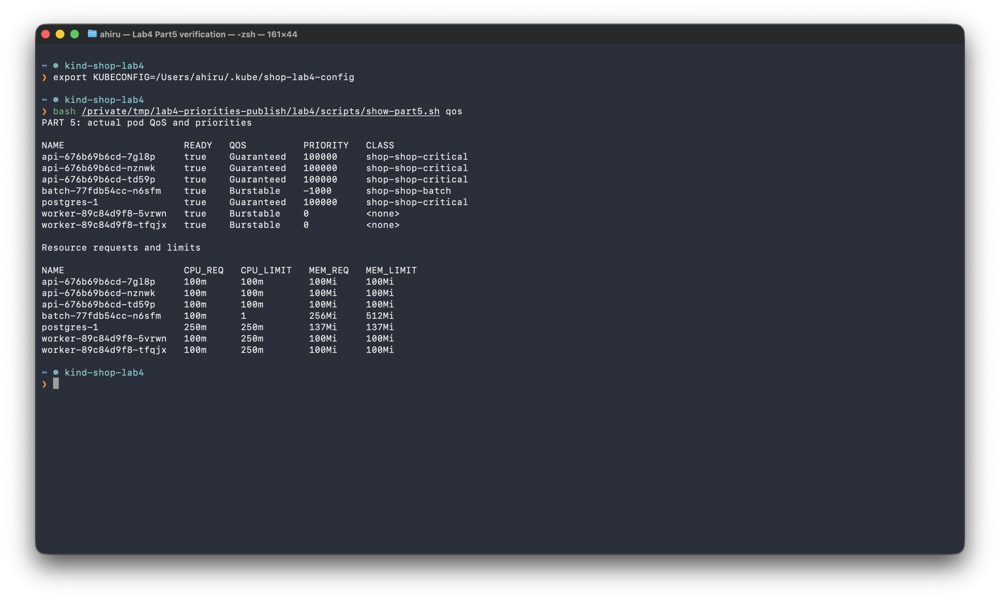

Kyverno тоже остался на месте: все пять политик в `Ready`. Для проверки
отправили манифест без лимитов через server-side dry-run и получили:

```text
require-limits:
  only-shop-limits: validation error: Лимиты не указаны
```

То есть во время настройки приоритетов наши ограждения никуда не пропали.

### Заказы после всех изменений

После завершения обновления базы прогнали запросы через Service внутри
кластера: `api.shop.svc.cluster.local`. Запросы отправлял Python-клиент из
worker-пода. Локальный port-forward в этом тесте не использовали.

Получилось:

```text
Запросов:             300
Ответов 201:          300
Ошибок:               0
Темп:                 5 запросов/с
Длительность:         около минуты
p95 успешных ответов: 31.25 ms
```

Заказы создаются, batch работает, критические поды имеют нужный QoS и
приоритет. Но это пока проверка работоспособности после изменения настроек.
Pending и preemption проверили в шестой части ниже. Давление по памяти
и SLA под перегрузкой относятся к следующим частям.

Для исходных рекомендаций KRR использовался мониторинг старого кластера.
В новом есть CRD `ServiceMonitor`/`PrometheusRule`, но полноценный стек
мониторинга для дальнейших графиков ещё предстоит установить.

Полные выводы команд и JSON с результатами сохранил в `lab4/evidence/`.
В тексте выше приведены сами настройки, статусы подов и результаты запросов.

При подготовке шестой части удалось снять окно Terminal. Скриншот QoS выше
показывает обычные настройки перед опытом, а ниже - контрольная проверка PDB
после возврата обычного числа реплик.

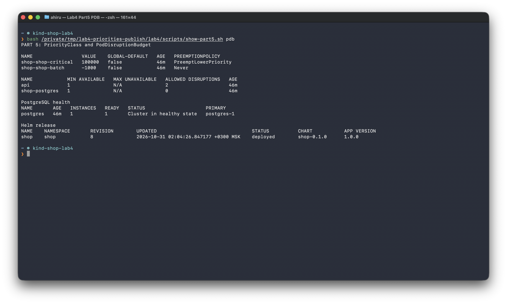

Старый кластер при необходимости можно включить обратно:

```bash
docker start shop-control-plane shop-worker shop-worker2
```

## Часть 6: Нехватка ресурсов и preemption

Теперь проверяем, помогают ли наши приоритеты на практике. Для этого заполнили
двухнодовый `shop-lab4` фоновыми подами, а потом попросили место для новых API.
PostgreSQL в этом опыте продолжал работать с настройками пятой части.

### Сначала заполняем кластер

На время опыта оставили одну реплику API, а `batch.replicas` подняли до 20.
У каждого batch запросили `1000m` CPU и `128Mi` памяти, лимиты оставили
`1500m` и `256Mi`. Класс QoS остался Burstable, приоритет -1000.

Чтобы увидеть именно работу планировщика, временно поставили
`CPU_WORKERS=0` и `MEMORY_MB=16`. То есть поды резервировали CPU через requests,
а вычислительные потоки были выключены. Давление по памяти здесь не создавали:
его будем разбирать отдельно.

Сначала убрали старые batch через `values-part6-prepare.yaml`, затем применили
`values-part6-fill.yaml`. Это позволило закончить предыдущую версию Deployment
перед изменением запросов ресурсов.

Из 20 batch **13 запустились, а 7 остались Pending**:

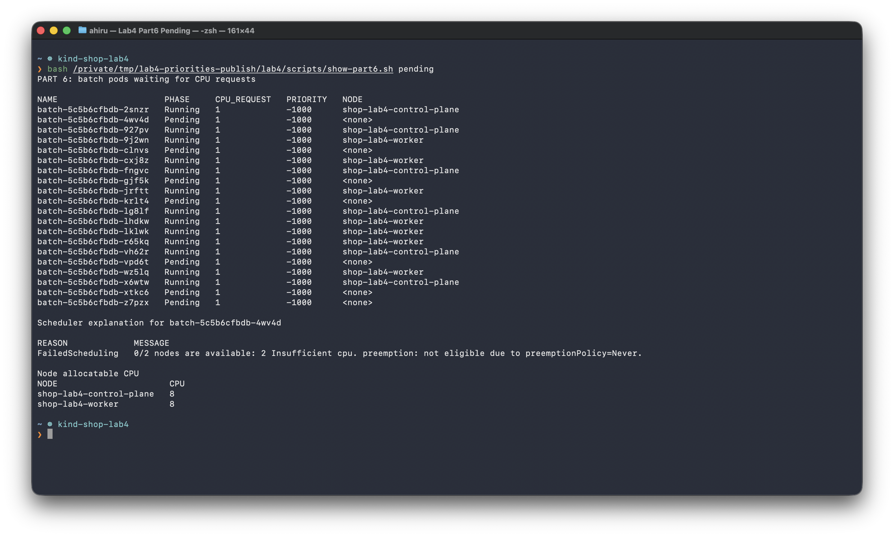

Внизу скриншота видно причину: на обеих нодах `Insufficient cpu`.
У batch также указано `preemptionPolicy=Never`, поэтому сам он чужие поды
ради места выселять не может.

Планировщик считает requests уже размещённых подов. На control-plane было
занято `7400m` из `8000m`, на worker - `7600m` из `8000m`. Оставалось `600m`
и `400m`, а одному новому batch нужен целый `1000m` на одной ноде.

Фактическая загрузка CPU при этом могла быть небольшой. Вычислительные потоки
мы как раз выключили, но запросы ресурсов остались. Вот почему свободный CPU
в данный момент и возможность разместить ещё один под - разные вещи.
Ноды kind делят один Mac, их логическая ёмкость не означает два отдельных
физических компьютера по восемь ядер.

### Добавляем API с высоким приоритетом

Дальше подняли `api.replicas` с 1 до 16 через `values-part6-preempt.yaml`.
Это 15 новых подов по `100m`, всего нужно ещё `1500m` CPU. Свободного бюджета
requests на двух нодах было только `1000m`.

Теперь у планировщика появились новые поды с приоритетом `100000`, которым
нужно освободить место. И вот тут уже сработал preemption:

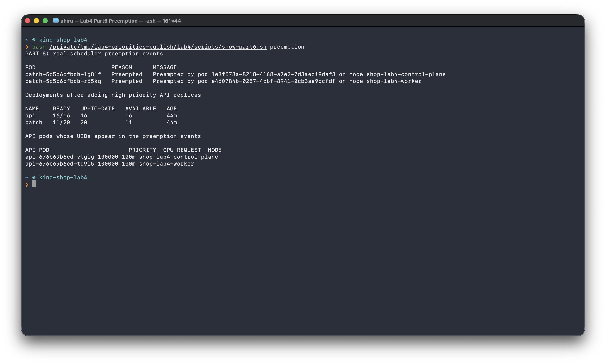

В событиях есть две конкретные жертвы:

- `batch-5c5b6cfbdb-lg8lf` на control-plane;
- `batch-5c5b6cfbdb-r65kq` на worker.

У обеих причина `Preempted`, а в сообщении указан UID пода, ради которого
освобождается место. Эти UID сопоставили с реальными API:
`api-676b69b6cd-vtglg` и `api-676b69b6cd-td9l5`. У них приоритет `100000`,
у вытесненных batch был `-1000`.

После этого **все 16 API стали Ready**. У batch осталось **11 работающих
реплик и 9 Pending**. Deployment продолжает хотеть 20 реплик, поэтому создаёт
замену вытесненным подам, но свободного места для них по-прежнему нет.

Само увеличение числа batch не вытесняет уже работающий API. В этом опыте
нужны были новые высокоприоритетные поды, которым не хватило места.
Доказательством стали именно события `Preempted` с UID новых API.

Ресурсы API и PostgreSQL из пятой части не меняли. Приоритеты использовались
те же. Удаление batch руками для получения этого результата не выполняли:
жертв выбрал планировщик. Подготовительное уменьшение реплик batch происходило
раньше, до заполнения кластера, и к доказательству preemption не относится.

### Возвращаем обычную нагрузку

После проверки вернули `values-part5-final.yaml`: три API и один batch
с обычными `MEMORY_MB=128` и `CPU_WORKERS=1`.

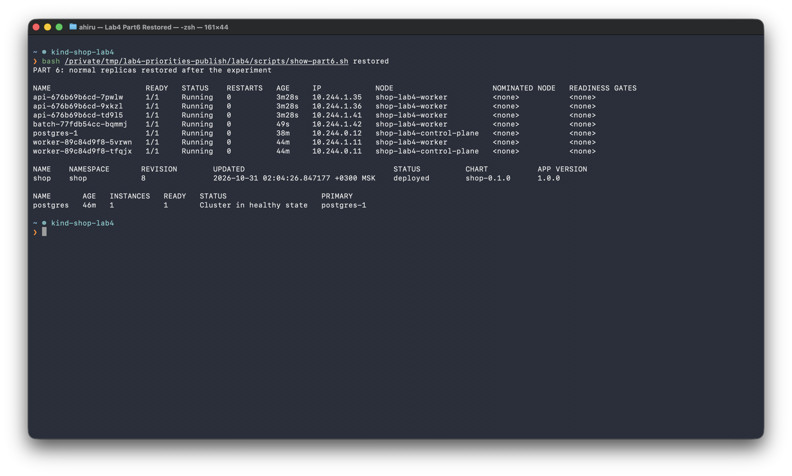

Helm получил ревизию **8**, статус `deployed`, база осталась в
`Cluster in healthy state`. После preemption, ещё до возврата обычных реплик,
проверили создание заказов через Service: **60 из 60 получили 201**, ошибок нет.
Это проверка работоспособности, а доказательство SLA под перегрузкой относится
к восьмой части.

Для повторения опыта использовали следующие команды из корня репозитория:

```bash
helm upgrade shop lab3/chart/shop -n shop \
  -f lab4/values-part5-final.yaml -f lab4/values-part6-prepare.yaml
kubectl -n shop wait --for=delete pods -l app=batch --timeout=45s

helm upgrade shop lab3/chart/shop -n shop \
  -f lab4/values-part5-final.yaml -f lab4/values-part6-fill.yaml

helm upgrade shop lab3/chart/shop -n shop \
  -f lab4/values-part5-final.yaml -f lab4/values-part6-fill.yaml \
  -f lab4/values-part6-preempt.yaml

helm upgrade shop lab3/chart/shop -n shop \
  -f lab4/values-part5-final.yaml --wait --timeout 4m
```

Между заполнением и увеличением API дождались Pending и сняли первый скриншот.
После увеличения API сохранили события и второй скриншот. Для этапа с Pending
`--wait` намеренно не добавляли: все 20 batch одновременно не помещаются,
поэтому ожидание готовности всего Deployment не завершилось бы успешно.

Скриншоты лежат в `lab4/screenshots/`, исходные события, состояния подов и
проверка UID сохранены в `lab4/evidence/part6/`.
