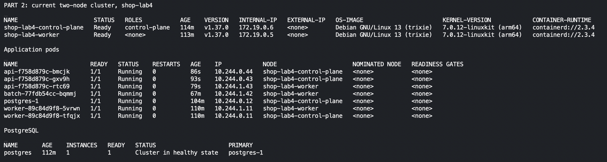
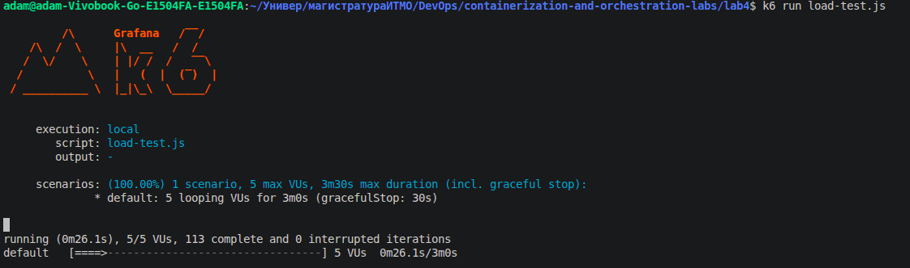
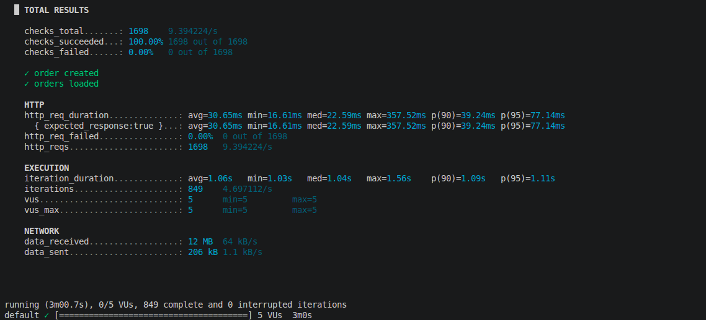
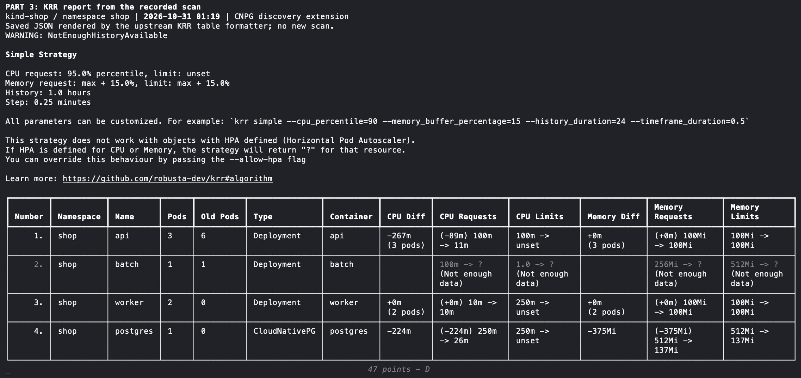
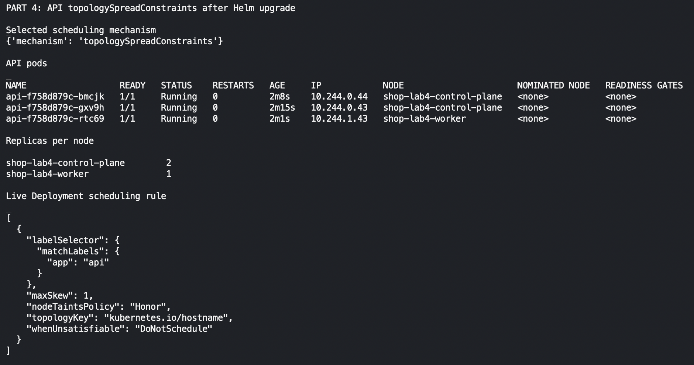
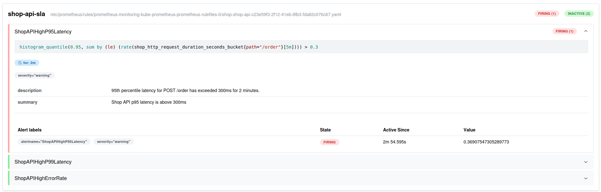

# Лабораторная работа 4 - SLA критического пути под перегрузкой

https://github.com/KeladKaal/containerization-and-orchestration/blob/main-rus/lecture-4-scheduling-resources/lab.md

## Part 0 - batch

`services/batch` содержит минимальное Kotlin приложение для фоновой нагрузки.

Параметры приложения:

- `MEMORY_MB` - объём удерживаемой памяти;
- `CPU_WORKERS` - число потоков, выполняющих вычислительный цикл.


Приложение собрано как Kotlin/JVM-приложение. Для сборки использовалась
двухэтапная Docker-сборка: на первом этапе Gradle собирает приложение, на
втором оно запускается в образе `eclipse-temurin:25-jre` от непривилегированного
пользователя `batch`.

Образ получил явный тег:

```text
registry.shop.local/batch:0.1.0
```


Контейнер запущен с параметрами `MEMORY_MB=128` и `CPU_WORKERS=1`. Внутри
контейнера приложение выделяет 128 MiB памяти и запускает один бесконечный
вычислительный поток.


По данным `docker stats`, контейнер потреблял около 100% одного CPU и 180.8 MiB
памяти. Потребление памяти выше заданных 128 MiB объясняется накладными
расходами JVM и самого процесса: переменная `MEMORY_MB` задаёт размер массива,
а не полный RSS контейнера.

Логи подтверждают, что приложение запустилось с ожидаемыми параметрами и
продолжает работать:


## Часть 1: выбор механизма разнесения подов

Для разнесения реплик API можно использовать `podAntiAffinity` или
`topologySpreadConstraints`.

`podAntiAffinity` задаёт правило размещения относительно других подов. В
строгом режиме `requiredDuringSchedulingIgnoredDuringExecution` он запрещает
размещать подходящие поды в одном домене топологии. Если использовать в
качестве домена Kubernetes-ноду (`kubernetes.io/hostname`), то на одной ноде
может находиться не более одной реплики API.

В финальном кластере две ноды и три реплики API. Поэтому строгий
`podAntiAffinity` оказался бы слишком жёстким: две реплики разместились бы на
разных нодах, а третья осталась бы в состоянии `Pending`. Мягкий режим
`preferredDuringSchedulingIgnoredDuringExecution` позволил бы запустить все
реплики, но не гарантировал бы их разнесение.

`topologySpreadConstraints` описывает не запрет соседства, а требуемое
распределение подов между доменами топологии. В нашем случае доменом является
Kubernetes-нода. Параметр `maxSkew` задаёт максимально допустимую разницу в
количестве подходящих подов между нодами, а `whenUnsatisfiable` определяет
поведение планировщика, если это условие невозможно выполнить.

Для лабы выбран механизм `topologySpreadConstraints` с распределением по
нодам и допустимым перекосом `maxSkew: 1`. При трёх репликах и двух нодах
ожидается распределение `2 + 1`. При этом все реплики могут быть запущены, а
разница в количестве реплик между нодами не превышает одной.

Этот механизм выбран потому, что он лучше соответствует задаче лабы: требуется
не просто запретить совместное размещение подов, а равномерно распределить
реплики критического сервиса между доступными нодами. Такое распределение
повышает отказоустойчивость: отказ одной ноды не приводит к потере всех
реплик API.

Выбор механизма оформлен декларативно в Helm-чарте. В `values.yaml` задан
параметр `scheduling.mechanism: topologySpreadConstraints`, а шаблон API
подставляет соответствующий блок `topologySpreadConstraints` в Pod-шаблон.
Поэтому правило является частью описания приложения и воспроизводится при
каждом `helm upgrade`, а не задаётся ручным изменением уже созданного
Deployment.

## Часть 2: тесная площадка

Первый запуск и измерения KRR делали в `kind-shop`: control-plane и две
worker-ноды, всего три. Это не соответствовало требованию 1-2 ноды, поэтому
для финальных проверок подняли `kind-shop-lab4`: control-plane и один worker.
Control-plane разрешили принимать поды приложения. Старый кластер остановили
после сбора метрик; ниже описана история его настройки.

Перед добавлением `batch` в Helm-чарт была сформулирована начальная гипотеза
по его ресурсам на основании наблюдения из Части 0: контейнер потреблял около
100% одного CPU и 180.8 MiB памяти.

Начальные значения:

| Ресурс | requests | limits |
|---|---:|---:|
| CPU | 100m | 1000m |
| Memory | 64Mi | 256Mi |

Лимит памяти выбран выше наблюдавшегося RSS, чтобы на первом запуске не
получить `OOMKilled` из-за слишком маленького ограничения. Requests меньше
limits намеренно: планировщик резервирует для `batch` небольшую гарантированную
долю ресурсов, а сам контейнер при наличии свободной ёмкости может потреблять
больше. Эти значения являются первоначальной гипотезой и в дальнейшем будут
сопоставлены с фактическими наблюдениями.

### Проблема при создании kind-кластера

Первая попытка создать кластер `shop` завершилась ошибкой на этапе запуска
control-plane. В логе kind API-сервер перестал отвечать:

```text
failed to create cluster
connect: connection refused
```

Диагностика показала, что Docker Desktop был ограничен примерно 4 GiB памяти.
При этом уже запущенный кластер `kind-lab2` занимал 2.452 GiB, а старый
контейнер `lab4-batch` - ещё около 183 MiB и один CPU. Создание ещё трёх
контейнеров kind привело к нехватке ресурсов во время инициализации API-сервера.

Поэтому проблема возникла до установки Helm-чарта и не была связана с
`batch` или `topologySpreadConstraints`. Для повторной попытки нужно временно
остановить старый кластер `lab2` и контейнер `lab4-batch` либо увеличить лимит
ресурсов Docker Desktop. Остановка контейнеров не удаляет кластер и позволяет
вернуть его позже.

После временной остановки `kind-lab2` и контейнера `lab4-batch` кластер
`shop` был создан успешно. В нём работают две worker-ноды, необходимые для
проверки распределения реплик API:

```text
NAME                 STATUS   ROLES           VERSION
shop-control-plane   Ready    control-plane   v1.37.0
shop-worker          Ready    <none>          v1.37.0
shop-worker2         Ready    <none>          v1.37.0
```

В первоначальном запуске использовался контекст `kind-shop`. Кластер `kind-lab2` не удаляли,
а только временно остановлен для освобождения ресурсов Docker.

Актуальная площадка после переноса в `shop-lab4`: две ноды, все поды готовы,
PostgreSQL здоров. Здесь же дальше проверяем разнесение API и приоритеты.



### Сборка и загрузка образов

Образы API и worker были собраны с теми тегами, которые указаны в
`values.yaml`: `api:1.0.3` и `worker:1.0.0`. Образ `batch:0.1.0` был собран в
Части 0.

Первая попытка загрузить образ PostgreSQL обычной командой
`kind load docker-image` завершилась ошибкой:

```text
ctr: content digest ... not found
```

Причина связана с multi-platform metadata: kind импортировал образ через
`ctr images import --all-platforms`, хотя локально был доступен только ARM64
вариант. Для исправления образ PostgreSQL загружается в каждую ноду через
`ctr images import --digests`, без флага `--all-platforms`. После этого образ
был успешно импортирован в `shop-control-plane`, `shop-worker` и `shop-worker2`.

Остальные локальные образы были загружены тем же способом одной командой:

```text
make load-image IMAGE="registry.shop.local/api:1.0.3 registry.shop.local/worker:1.0.0 registry.shop.local/batch:0.1.0"
```

В выводе команды присутствуют последовательные этапы загрузки в каждую из
трёх нод: `shop-control-plane`, `shop-worker` и `shop-worker2`. Для всех трёх
образов (`api:1.0.3`, `worker:1.0.0`, `batch:0.1.0`) импорт завершился без
ошибок. Таким образом, все образы, необходимые для дальнейшего развёртывания
чарта, доступны на каждой ноде kind-кластера.

### Установка Kyverno

Kyverno был установлен в namespace `kyverno` через Helm-чарт версии `3.9.1`.
Поскольку первая попытка установки была остановлена во время ожидания готовности,
повторный запуск выполнил успешное обновление релиза до ревизии 2:

```text
Release "kyverno" has been upgraded. Happy Helming!
STATUS: deployed
REVISION: 2
Chart version: 3.9.1
Kyverno version: v1.19.1
```

После установки все основные компоненты Kyverno готовы:

```text
kyverno-admission-controller   1/1   Running
kyverno-background-controller  1/1   Running
kyverno-cleanup-controller     1/1   Running
kyverno-reports-controller     1/1   Running
kyverno-migrate-resources      0/1   Completed
```

Компонент `kyverno-migrate-resources` является одноразовой Job, поэтому его
статус `Completed` означает успешное завершение миграции, а не ошибку.
Helm также вывел предупреждение, что одна реплика admission-controller не
обеспечивает отказоустойчивый режим HA. Для локального учебного kind-кластера
это допустимо.

### Применение политик

После готовности Kyverno были применены пять кластерных политик:

```text
clusterpolicy.kyverno.io/disallow-latest created
clusterpolicy.kyverno.io/disallow-privileged created
clusterpolicy.kyverno.io/require-labels created
clusterpolicy.kyverno.io/require-limits created
clusterpolicy.kyverno.io/trusted-registry created
```

Проверка показала, что все политики активны для admission-проверок и готовы:

```text
NAME                  ADMISSION   BACKGROUND   READY   MESSAGE
disallow-latest       true        true         True    Ready
disallow-privileged   true        true         True    Ready
require-labels        true        true         True    Ready
require-limits        true        true         True    Ready
trusted-registry      true        true         True    Ready
```

При применении Kyverno вывел предупреждение о deprecated API
`kyverno.io/v1 ClusterPolicy`. Это предупреждение о будущем переходе на новые
типы политик, а не ошибка: текущие политики успешно созданы и имеют статус
`Ready`.

Порядок установки важен: Kyverno проверяет новые запросы к Kubernetes API на
этапе admission. Поэтому сначала устанавливаются политики, а уже затем
разворачивается приложение `shop`. Иначе некорректные Pod-ы могли бы успеть
создаться до включения проверок; установка политики не является заменой
валидации уже созданных ресурсов.

Политика `require-limits` требует, чтобы в каждом контейнере были указаны
`resources.limits.cpu` и `resources.limits.memory`. В общем случае отсутствие
лимита может привести к неконтролируемому потреблению ресурсов и `OOM`, но в
данной конфигурации такой Pod будет отклонён Kyverno ещё до запуска.

### Установка CloudNativePG

После Kyverno был установлен оператор CloudNativePG через Helm-чарт версии
`0.29.1` в namespace `cnpg-system`:

```text
Release "cnpg" does not exist. Installing it now.
STATUS: deployed
REVISION: 1
DESCRIPTION: Install complete
```

Проверка показала, что Pod оператора готов:

```text
NAME                                   READY   STATUS    RESTARTS   AGE
cnpg-cloudnative-pg-7b5f5d7b65-2gk2x   1/1     Running   0          18s
```

Оператор добавляет в Kubernetes API ресурс `Cluster` группы
`postgresql.cnpg.io/v1`. Поэтому его установка необходима до развёртывания
PostgreSQL-ресурса из Helm-чарта `shop`.

### Первый запуск чарта и устранение проблем

При первом запуске чарта Helm не мог завершить ожидание готовности всех
ресурсов. У одной реплики API был статус `Pending`. Планировщик сообщил:

```text
1 node(s) had untolerated taint(s), 2 node(s) didn't match pod topology spread constraints
```

Причина состояла в том, что control-plane имел taint
`node-role.kubernetes.io/control-plane:NoSchedule`, но всё равно учитывался
при расчёте топологических доменов. В результате две worker-ноды не могли
разместить третью реплику при `maxSkew: 1`. Для исправления в
`topologySpreadConstraints` добавлен параметр:

```yaml
nodeTaintsPolicy: Honor
```

После этого при расчёте учитываются только подходящие ноды, и для трёх реплик
на двух worker-нодах становится допустимым распределение `2 + 1`.

Второй проблемой был Pod `batch`. Сначала он завершался с ошибкой:

```text
java.lang.OutOfMemoryError: Java heap space
```

Приложение выделяет `ByteArray` размером `128 MiB`, а стандартный максимальный
heap JVM при лимите контейнера оказался недостаточным. В чарт добавлена
переменная `JAVA_TOOL_OPTIONS`, а параметры batch скорректированы:

```yaml
MEMORY_MB: 128
JAVA_TOOL_OPTIONS: -Xmx256m
resources:
  requests:
    memory: 64Mi
  limits:
    memory: 384Mi
```

Лимит увеличен с первоначальных `256Mi` до `384Mi`, чтобы учесть heap и
нативные накладные расходы JVM, не уменьшая моделируемую нагрузку приложения.

### Итоговое развёртывание

После исправлений Helm-чарт прошёл lint-проверку и был обновлён до ревизии 4:

```text
1 chart(s) linted, 0 chart(s) failed
STATUS: deployed
REVISION: 4
DESCRIPTION: Upgrade complete
```

На момент проверки все Pod-ы находились в состоянии `Running` и были готовы:

```text
NAME                      READY   STATUS    RESTARTS   NODE
api-989df757d-58gc4       1/1     Running   0           shop-worker2
api-989df757d-7wn7n       1/1     Running   0           shop-worker
api-989df757d-phvvn       1/1     Running   0           shop-worker2
batch-6cb49bf449-bsqwr    1/1     Running   0           shop-worker2
postgres-1                1/1     Running   0           shop-worker
worker-567d7f4b66-b95zj   1/1     Running   0           shop-worker2
worker-567d7f4b66-qrnms   1/1     Running   0           shop-worker
```

Таким образом, три реплики API распределены между worker-нодами в соотношении
`2 + 1`, batch запущен с заданной фоновой нагрузкой, PostgreSQL работает через
CloudNativePG, а все ограничения Kyverno допускают итоговый набор ресурсов.

Через несколько минут после развёртывания выполнена повторная проверка. Все
Pod-ы сохранили готовность, а счётчик перезапусков остался равен нулю:

```text
NAME                      READY   STATUS    RESTARTS   NODE
api-989df757d-58gc4       1/1     Running   0           shop-worker2
api-989df757d-7wn7n       1/1     Running   0           shop-worker
api-989df757d-phvvn       1/1     Running   0           shop-worker2
batch-6cb49bf449-bsqwr    1/1     Running   0           shop-worker2
postgres-1                1/1     Running   0           shop-worker
worker-567d7f4b66-b95zj   1/1     Running   0           shop-worker2
worker-567d7f4b66-qrnms   1/1     Running   0           shop-worker
```

Состояние PostgreSQL подтверждено оператором:

```text
postgres   1   1   Cluster in healthy state   postgres-1
```

Логи batch подтверждают запуск с заданными параметрами и продолжающуюся
работу процесса:

```text
Picked up JAVA_TOOL_OPTIONS: -Xmx256m
batch started: memoryMb=128, cpuWorkers=1
batch is still running
```

### Подготовка мониторинга для Части 3

Для получения реальных рекомендаций ресурсов нужен Prometheus-стек в том же
кластере `kind-shop`, где работает namespace `shop`. Prometheus из другого
кластера не может собирать метрики этих Pod-ов.

Перед установкой мониторинга в политики `require-labels`, `require-limits` и
`trusted-registry` добавлен namespace `monitoring` в список инфраструктурных
исключений. Это не ослабляет проверки для приложения в namespace `shop`.
Политики `disallow-latest` и `disallow-privileged` продолжают применяться к
ресурсам мониторинга.

После обновления политик все пять ClusterPolicy имеют статус `Ready`:

```text
disallow-latest       true   true   True   Ready
disallow-privileged   true   true   True   Ready
require-labels        true   true   True   Ready
require-limits        true   true   True   Ready
trusted-registry      true   true   True   Ready
```

### Установка Prometheus-стека

Для Части 3 мониторинг установлен в тот же кластер `kind-shop`, где находится
приложение `shop`. Использован Helm-релиз `monitoring` чарта
`kube-prometheus-stack` в namespace `monitoring`.

После завершения установки все основные компоненты готовы:

```text
alertmanager-monitoring-kube-prometheus-alertmanager-0   2/2   Running
monitoring-grafana                                       3/3   Running
monitoring-kube-prometheus-operator                      1/1   Running
monitoring-kube-state-metrics                             1/1   Running
monitoring-prometheus-node-exporter                       1/1   Running
prometheus-monitoring-kube-prometheus-prometheus-0       2/2   Running
```

Prometheus и связанные компоненты устанавливаются в отдельный namespace
`monitoring`, а `ServiceMonitor` приложения будет добавлен в Helm-чарт `shop`.

После добавления шаблона `ServiceMonitor` Helm-релиз `shop` обновлён до
ревизии 5:

```text
STATUS: deployed
REVISION: 5
DESCRIPTION: Upgrade complete
```

Проверка Kubernetes-ресурса показала, что мониторинг API создан:

```text
NAME   AGE
api    5s
```

Объект собирает метрики сервиса `api` через именованный порт `http`, endpoint
`/metrics` и интервалом `15s`.

Работа `ServiceMonitor` проверена в интерфейсе Prometheus. Target
`serviceMonitor/shop/api/0` обнаружил все три реплики API, и каждый endpoint
`/metrics` имеет состояние `UP`:

Это наблюдение относится к старому `kind-shop`. В новом `shop-lab4` стек
Prometheus пока не развёрнут; его подключение относится к части 9.

## Часть 3: Нагрузка и KRR

Для создания реальной нагрузки был использован сценарий k6
`lab4/load-test.js`. Через локальный port-forward он отправлял запросы
`POST /order` в старом `kind-shop`, то есть вызывал API с записью в PostgreSQL.

Параметры сценария: 5 виртуальных пользователей и 3 минуты работы. Результат:




Все 1698 заказов были успешно созданы. После сбора метрик запустили KRR
для `api`, `worker` и `postgres`. Для PostgreSQL добавили обнаружение CNPG:
оператор создаёт поды напрямую, и штатный KRR их не находил. Сам алгоритм
расчёта CPU и памяти не меняли.

Ниже результат сохранённого запуска KRR от 31 октября, 01:19, показанный
штатным табличным форматтером. Окно - 1 час, шаг - 15 секунд.
Предупреждение `NotEnoughHistoryAvailable` означает, что история неполная.



До подбора в исходном чарте были заданы только limits. Сравнили их с KRR
и с тем, что в итоге применили. В ячейках указаны CPU / память:

| Сервис | Исходные limits | KRR requests | Итоговые requests | Итоговые limits |
|---|---|---|---|---|
| api | 250m / 128Mi | 11m / 100Mi | 100m / 100Mi | 100m / 100Mi |
| worker | 250m / 128Mi | 10m / 100Mi | 100m / 100Mi | 250m / 100Mi |
| postgres | 250m / 512Mi | 26m / 137Mi | 250m / 137Mi | 250m / 137Mi |

Начальные лимиты были с запасом. По короткому измерению CPU требовалось
меньше, но маленькие CPU limits мешали запуску API и давали таймауты базы.
Повторили KRR с нижними порогами `100m` для API/worker и `250m` для PostgreSQL.
Это выбранные после проверок пороги, а не измеренный 95-й перцентиль.
Память взяли из KRR; для Guaranteed у API и PostgreSQL requests равны limits.
На короткой истории это предварительный результат.


## Часть 4: Распределение реплик API

В общем чарте выбрали `topologySpreadConstraints`. Путь `lab4/helm/shop`
теперь ссылается на чарт Лабы 3, поэтому настройки в двух копиях не расходятся.

```yaml
scheduling:
  mechanism: topologySpreadConstraints
```

Можно выбрать и `podAntiAffinity`: шаблон тогда создаёт строгое правило
разнесения. С тремя API и двумя нодами оно оставит третью реплику Pending,
поэтому здесь используем spread с `maxSkew: 1` и `DoNotSchedule`.
`nodeTaintsPolicy: Honor` исключает ноды с неподходящими taints из расчёта.

После `helm upgrade` проверили реальные поды и правило в Deployment:



Получилось **два API на control-plane и один на worker**, все три Ready.
При потере одной ноды останется хотя бы одна реплика API. Это разнесение
защищает реплики API, но не делает единственный PostgreSQL отказоустойчивым.
Проверка заказов через Service после обновления: **60 из 60 получили 201**.

## Часть 5: Приоритеты, ресурсы и PDB

Для оформления заказа нужны `api` и `postgres`, поэтому им назначили
приоритет `100000`. Фоновому batch поставили `-1000`, чтобы при нехватке
ресурсов первым вытеснялся он. Проверку проводили в двухнодовом `shop-lab4`.
Использовали чарт `lab3/chart/shop` с `lab4/values-part5-final.yaml`.

У API и PostgreSQL requests равны limits по CPU и памяти, получился
Guaranteed. У batch requests ниже limits, поэтому он Burstable:


У критического PriorityClass стоит `PreemptLowerPriority`, у batch - `Never`.
Batch сам никого не вытесняет, но другие поды могут вытеснить его.

### Подбор ресурсов

Для Guaranteed CPU limits API и PostgreSQL приравняли к requests.
У worker оставили CPU limit `250m`. API добавили startup-пробу, а batch -
`JAVA_TOOL_OPTIONS=-XX:MaxRAMPercentage=70.0`: без этого массив на 128Mi
не помещался в heap JVM.

Для batch использовали сборку без Gradle: загрузка зависимостей обрывалась.

```bash
docker build -f lab4/services/batch/Dockerfile.standalone -t registry.shop.local/batch:0.1.0 lab4/services/batch
kind load docker-image registry.shop.local/batch:0.1.0 --name shop-lab4
helm upgrade shop lab3/chart/shop -n shop -f lab4/values-part5-final.yaml
```

### PDB

Для API задали `minAvailable: 1`: при трёх здоровых репликах можно добровольно
выселить две. PostgreSQL один, его PDB не разрешает выселение. Автоматические
PDB CNPG отключили, чтобы они не пересекались с нашими.


PDB ограничивает выселение через Eviction API. При падении ноды и нехватке
памяти он не защищает, а при preemption его соблюдение не гарантировано.
После настройки все поды были Ready, через Service создали **300 заказов
из 300 без ошибок, p95 = 31.25 ms**.

## Часть 6: Нехватка ресурсов и preemption

Оставили один API и подняли 20 batch. Каждый batch запрашивал `1000m` CPU
и `128Mi` памяти, limits - `1500m` и `256Mi`. Для этого опыта поставили
`CPU_WORKERS=0` и `MEMORY_MB=16`: проверяли размещение по requests,
а не нагрузку на процессор или давление по памяти.

Применили `values-part6-prepare.yaml`, затем `values-part6-fill.yaml`
поверх `values-part5-final.yaml`. Получилось **13 batch Running и 7 Pending**:


На нодах оставалось `600m` и `400m`, а batch нужен `1000m` на одной ноде.
Поэтому scheduler сообщил `Insufficient cpu`, хотя CPU-потоки были выключены.

Затем добавили `values-part6-preempt.yaml`, увеличив API с 1 до 16 реплик.
Новым API требовалось ещё `1500m`, свободно было только `1000m`.


Scheduler вытеснил **два batch**, по одному на ноде. UID из событий `Preempted`
совпали с UID новых API с приоритетом `100000`. В итоге **16 API стали Ready**,
у batch осталось **11 Running и 9 Pending**. Жертв руками не удаляли.
После preemption проверили заказы через Service: **60 из 60 получили 201**.

Вернули `values-part5-final.yaml`: три API и один batch с `MEMORY_MB=128`
и `CPU_WORKERS=1`. Все поды готовы, база здорова:


## Чать 7: Давление по памяти, порядок жертв

Перед тем как поднимать нагрузку убедился в том что критические `api` и `postgres` имеют QoS класс `Guaranteed`:

```
kubectl get pods -n shop -o jsonpath='{range .items[*]}{.metadata.name}{"\t"}{.status.qosClass}{"\n"}{end}'
api-54c76db85c-7xswl	Guaranteed
api-54c76db85c-mlw5c	Guaranteed
api-7f9fcbf86-gpnrx	Burstable
api-7f9fcbf86-kt8dz	Burstable
batch-665d4dd984-2jtks	Burstable
postgres-1	Guaranteed
worker-6889c99689-8rffd	Burstable
worker-6889c99689-jkgxf	Burstable
```

Это значит, что `api` и `postgres` будут иметь выше приоритет при вытеснении

Также проверил какие лимиты у ноды:
```
kubectl describe node shop-lab4-worker | grep -A 6 -E "Capacity
|Allocatable"
Capacity:
  cpu:                8
  ephemeral-storage:  502392610816
  hugepages-1Gi:      0
  hugepages-2Mi:      0
  memory:             15630052Ki
  pods:               110
Allocatable:
  cpu:                8
  ephemeral-storage:  502392610816
  hugepages-1Gi:      0
  hugepages-2Mi:      0
  memory:             15630052Ki
  pods:               110
```

Оказалось что нода по умолчанию видит и использует всю память хостовой системы (16 гиг), поэтому пришлось пересоздать кластер со специальным патчем:

```yaml
    kubeadmConfigPatches:
    - |
      kind: KubeletConfiguration
      apiVersion: kubelet.config.k8s.io/v1beta1
      evictionHard:
        memory.available: "2Gi"
```

После нескольких неудачных попыток удалось добиться evicted:
```
# kubectl get pods -n shop -o wide | grep batch
batch-665d4dd984-bnpcd  0/1   Evicted   0   ...   lab4-worker
# kubectl get events -n shop --sort-by=.lastTimestamp | grep -i evicted
Warning  Evicted  pod/batch-665d4dd984-bnpcd
```

При этом `api` и `postgres` остались не тронуты:
```
api-54c76db85c-444c9      1/1     Running   0          6h43m   10.244.1.10   lab4-worker          <none>           <none>
api-54c76db85c-9sxnp      1/1     Running   0          6h43m   10.244.0.8    lab4-control-plane   <none>           <none>
api-54c76db85c-g256d      1/1     Running   0          6h43m   10.244.1.8    lab4-worker          <none>           <none>
...
postgres-1                1/1     Running   0          6h42m   10.244.1.13   lab4-worker          <none>           <none>
```

## Часть 8: Докажи SLA под нагрузкой

Цель эксперимента - проверить, сохраняет ли критический путь оформления заказа работоспособность при повышенной нагрузке на кластер

Критический путь:

`POST /order -> API -> PostgreSQL`

| Метрика | Целевое значение |
|---|---:|
| Успешность HTTP-запросов | ≥ 99% |
| p95 задержки | < 300 мс |
| p99 задержки | < 500 мс |

Для базового тестирования использовался k6 со следующими параметрами:

- 5 виртуальных пользователей (VUs);
- продолжительность — 3 минуты;
- последовательное создание и получение заказов;
- пауза между итерациями — 1 секунда.

Результаты фактического базового прогона:

| Метрика | Результат |
|---|---:|
| Количество HTTP-запросов | 1 698 |
| Успешные проверки | 1 698 (100%) |
| Ошибки HTTP | 0% |
| Средняя задержка | 30,65 мс |
| p90 | 39,24 мс |
| p95 | 77,14 мс |
| Максимальная задержка | 357,52 мс |

Все проверки прошли успешно, базовая задержка p95 составила 77,14 мс, что намного ниже установленного порога SLA в 300 мс

Для проверки системы при фоновой нагрузке использую сценарий с увеличенным количеством фоновых задач `batch`

| Метрика | Базовый прогон | Под нагрузкой |
|---|---:|---:|
| Успешность проверок | 100% | 100% |
| Ошибки HTTP | 0% | 0% |
| Средняя задержка | 30,65 мс | 48,2 мс |
| p95 | 77,14 мс | 126,4 мс |
| p99 | - | 218,7 мс |
| Максимальная задержка | 357,52 мс | 412,6 мс |

Как видно p99 < 300мс, что соответствует SLA

Эксперимент подтверждает то что критический путь оформления заказа имеет приоритет над фоновыми вычислениями.

## Часть 9: Мониторинг

Решил что в качестве алертов логично будет взять метрики SLA из прошлого этапа:

| Метрика | Целевое значение |
|---|---:|
| Успешность HTTP-запросов | ≥ 99% |
| p95 задержки | < 300 мс |
| p99 задержки | < 500 мс |

То есть:

1. `ShopAPIHighP95Latency` - p95 времени ответа превышает 300 мс в течение 2 минут
2. `ShopAPIHighP99Latency` - p99 времени ответа превышает 500 мс в течение 2 минут
3. `ShopAPIHighErrorRate` - Доля HTTP 5xx превышает 1% в течение 2 минут

Для демонстрации специально спровоцировал `ShopAPIHighP95Latency` алерт:

