# Лаба 5 — Zero-trust сеть с доказательством

В этой работе развернул приложение `shop` в Kubernetes, настроил сеть через Cilium, ограничил доступ между подами с помощью NetworkPolicy и подключил сетевой мониторинг, кроме самих политик нужно было проверить, что приложение переживает удаление подов, а запрещённые соединения действительно блокируются

## Что используется

- `kind` - локальный кластер Kubernetes: одна control-plane нода и две worker-ноды
- `Cilium` - CNI (сетевой плагин) и применение NetworkPolicy
- `Hubble` - просмотр сетевых потоков и заблокированных соединений
- `Helm` - развёртывание `shop` и инфраструктурных компонентов
- `CloudNativePG` - PostgreSQL через оператор
- `Prometheus`, `Grafana`, `Alertmanager` - метрики, графики и алерты

## Часть 0 — Выбор CNI

По умолчанию kind использует `kindnet`, но он не умеет применять NetworkPolicy. Получилась бы довольно бессмысленная лабораторная: политики создаются, `kubectl` их показывает, а трафик фактически никак не ограничивается.

Выбрал Cilium вместо Calico, потому что интересно посмотреть карту трафика через Hubble для наглядности

В `kind.yaml` отключил стандартный CNI, создал две worker-ноды и настроил проброс порта `30080` с компьютера внутрь узла kind:

```yaml
kind: Cluster
apiVersion: kind.x-k8s.io/v1alpha4

networking:
  disableDefaultCNI: true
  kubeProxyMode: iptables

nodes:
  - role: control-plane
    extraPortMappings:
      - containerPort: 30080
        hostPort: 30080
        listenAddress: "127.0.0.1"
        protocol: TCP

  - role: worker
  - role: worker
```

Cilium установил через Helm, включил Hubble Relay и UI. `kube-proxy` оставил включённым, чтобы отдельно изучить его роль в маршрутизации Service.

```bash
kind create cluster --name shop-zt --config kind.yaml
kubectl get nodes -o wide
kubectl get pods -n kube-system
```

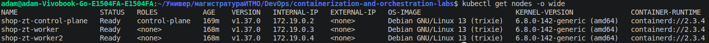

## Часть 1 — Как устроена сеть Pod

Развернул `shop` через Helm. В чарте находятся два Deployment (`shop-api` - 3 реплики, `shop-worker` - 2 реплики), NodePort Service для API и ресурс `Cluster` от CloudNativePG. Приложение создаёт заказы в PostgreSQL, а worker периодически помечает их обработанными.

```bash
helm upgrade --install shop ./helm/shop -n shop --create-namespace --wait
kubectl get pods -n shop -o wide
```

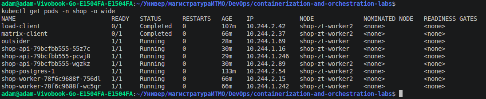

### eth0 и veth

Поскольку образы приложения собраны на `scratch`, в них нет даже `sh` и `ip`. Поэтому добавил диагностический контейнер `netshoot` через `kubectl debug`, он использует сеть того же пода.

```bash
kubectl debug -n shop -it pod/<имя-api-пода> \
  --image=nicolaka/netshoot:latest \
  --target=api --profile=general -- sh

ip -br addr
ip -d link show eth0
ip route
cat /sys/class/net/eth0/iflink
```

У одного из api под получил:

- Pod: shop-api-79bcfbb555-55z7c
- Node: shop-zt-worker
- Pod IP: 10.244.1.16/32
- eth0: индекс 10, peer @if11
- iflink: 11

Затем зашёл в Docker-контейнер узла kind:

```bash
docker exec shop-zt-worker ip -o link show
```

Там нашёл:

```
11: lxced7ebfdd7441@if10
```

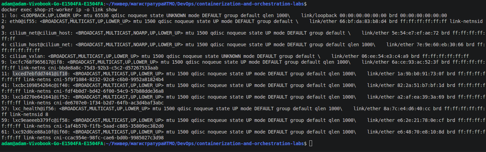

То есть `eth0` внутри пода (индекс 10) связан с `lxced7ebfdd7441` на стороне нод (это два конца одной пары `veth`). Интерфейс пода находится в отдельном сетевом namespace, а второй конец на ноде. Cilium через него обрабатывает трафик подов.

У ноды также есть интерфейс `cilium_vxlan`, онн показывает что VXLAN интерфейс создан, но сам по себе ещё не доказывает, что каждый пакет идёт через него. Для этого можно отдельно проверить статус/маршрутизацию Cilium.

API pod находились на адресах `10.244.2.15` (`worker2`) и `10.244.1.242` (`worker`), ping до этих адресов успешно доходит

```bash
curl --noproxy '*' http://10.244.1.242:8080/health
ok
curl --noproxy '*' http://shop-api:80/health
ready
```

## Часть 2 — Service и хаос Pod

API опубликован через `Service` типа `NodePort` (`30080`), поэтому с компьютера можно обращаться к `http://localhost:30080`

Разница между типами Service:

- `NodePort` открывает порт на нодах. В kind для доступа с компьютера дополнительно используется `extraPortMappings`
- `LoadBalancer` предполагает внешний балансировщик, предоставляемый инфраструктурой. В чистом kind его автоматически нет
- `Headless Service` (`clusterIP: None`) не создаёт общий виртуальный IP: DNS отдаёт адреса конечных точек. Например, такой подход используется для адресации экземпляров PostgreSQL

### Почему Service переживает смену Pod

Клиент использует имя `shop-api.shop.svc.cluster.local`, а не IP определённого пода. DNS возвращает адрес Service, а дальше сетевые правила перенаправляют соединения к доступным подам. `EndpointSlice` содержит эндпоинты и их состояние готовности. Когда под удаляется, контроллеры обновляют этот список, а Deployment создаёт новую реплику с другим IP

В конфигурации kind указан режим `kube-proxy: iptables`

`iptables` использует правила Linux для перенаправления соединений. `IPVS` — другой механизм балансировки на уровне ядра, который исторически лучше работал на очень большом количестве сервисов и конечных точек. На трёх нодах разница почти не заметна; важнее она при масштабе и частых изменениях правил. В нашей лабораторной оставил `iptables`, чтобы видеть обычный путь через kube-proxy:

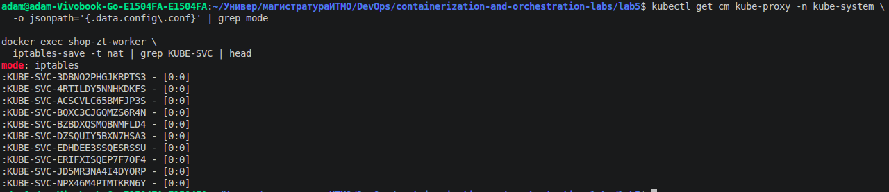

### Проверка с удалением Pod

Сделал два скрипта:

- `scripts/load.sh` отправляет 500 `POST /orders` с интервалом примерно 0,25 секунды. Клиент работает внутри Kubernetes, обращаясь к API по DNS-имени Service. Результат каждого запроса записывается в `evidence/requests.csv`.
- `scripts/chaos.sh` случайно выбирает под `api` или `worker`, сохраняет его имя и IP в `evidence/chaos.csv`, удаляет под и ждёт восстановления числа реплик перед следующей итерацией.

```bash
kubectl exec -i -n shop load-client -- sh -s \
  < scripts/load.sh | tee evidence/requests.csv
```

Параллельно в другом терминале:

```bash
./scripts/chaos.sh 12
kubectl get pods -n shop -o wide -w
```

Данные визуализируются скриптом `scripts/plot.py`. Вертикальные линии показывают удаления подов, точки - успешные и неуспешные запросы.

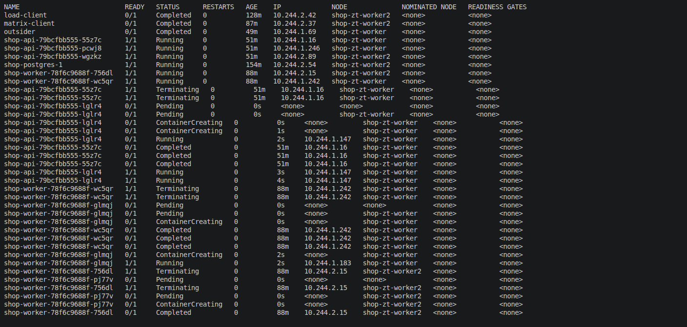

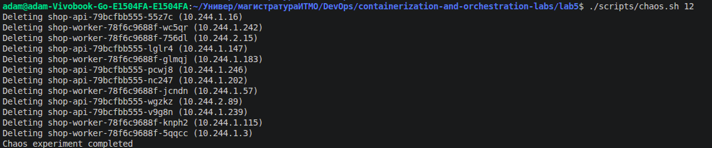

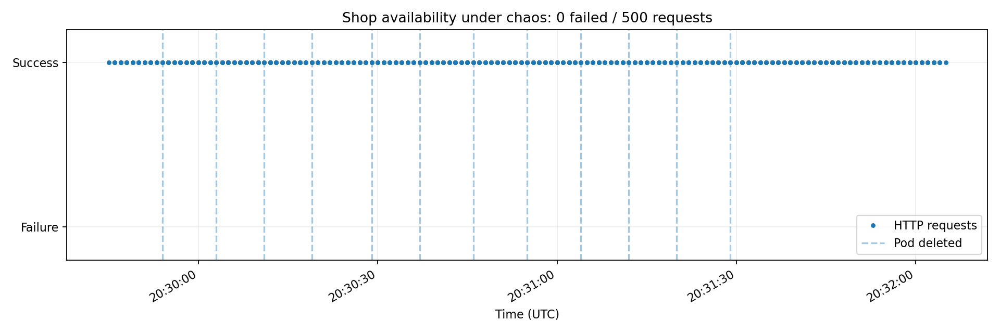

| Показатель | Значение |
|---|---|
| Всего запросов | 500 |
| Неуспешных запросов | 0 |
| Удалено подов | 12 |
| Изменялись ли IP новых подов | нет |

## Часть 3 — Матрица доступа

До включения ограничений определил, кому вообще нужно общаться по сети: по умолчанию запрещаем ingress и egress, затем открываем только необходимое

| Откуда | Куда | Порт | Должно быть |
|---|---|---|---|
| Клиент с меткой `run=load-client` | API | TCP 8080 | Allow |
| API | PostgreSQL | TCP 5432 | Allow |
| Worker | PostgreSQL | TCP 5432 | Allow |
| Клиент | PostgreSQL | TCP 5432 | Deny |
| Посторонний под | PostgreSQL | TCP 5432 | Deny |
| Посторонний под | API | TCP 8080 | Deny |
| Worker | API | TCP 8080 | Deny |
| API | Другой API под | TCP 8080 | Deny |
| PostgreSQL | API | TCP 8080 | Deny |

Кроме прикладных соединений пришлось учитывать системные:

- запросы под к CoreDNS, UDP/TCP 53
- доступ CloudNativePG Operator к PostgreSQL на портах 8000 и 5432;
- выход PostgreSQL к Kubernetes API
- внешний вход на API через NodePort (с учётом преобразования адресов)
- доступ Prometheus к портам метрик API (9090) и PostgreSQL (9187)

## Часть 4 — NetworkPolicy и CiliumNetworkPolicy

Все политики лежат в `helm/shop/templates/`, а метки и порты вынесены в `helm/shop/values.yaml`. Включаются через `networkPolicy.enabled`

Главное правило - `default-deny`:

```yaml
apiVersion: networking.k8s.io/v1
kind: NetworkPolicy
metadata:
  name: shop-default-deny
spec:
  podSelector: {}
  policyTypes:
    - Ingress
    - Egress
```

`podSelector: {}` означает все поды в namespace `shop`. Политики в Kubernetes аддитивные: дополнительные allow-правила открывают только нужные направления.

Для двусторонне ограниченной сети нужны и разрешение исходящего соединения у источника, и входящего у получателя

Отдельно описал разрешения для DNS, Client -> API, API/Worker -> PostgreSQL, доступа CloudNativePG Operator и Prometheus. Для специфичных сущностей Cilium (`world`, `host`, `remote-node`, `kube-apiserver`) использовал `CiliumNetworkPolicy`, так как обычная NetworkPolicy их не описывает

```bash
helm template shop ./helm/shop -n shop \
  --set networkPolicy.enabled=true

helm upgrade shop ./helm/shop -n shop --wait

kubectl get networkpolicy -n shop
kubectl get ciliumnetworkpolicy -n shop
```

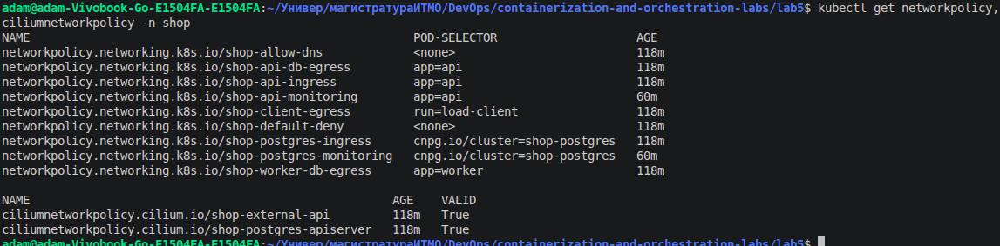

Сначала проверил шаблоны через `helm template` и `helm lint`, потом применил Helm upgrade.

Если после включения политик пропадает связность, можно вернуть `networkPolicy.enabled=false` через Helm, удалять всю базу и кластер не требуется

## Часть 5 — Проверка матрицы

Для проверки написал `scripts/verify-matrix.sh`. Он создаёт тестовые поды (`matrix-client` и `outsider`), запускает диагностические контейнеры в API/Worker/PostgreSQL, проверяет DNS и пытается установить TCP-соединения через `nc`. Результаты сохраняются в `evidence/access-matrix.csv`.

```bash
chmod +x scripts/verify-matrix.sh
./scripts/verify-matrix.sh
cat evidence/access-matrix.csv
```

Таблица ниже — **ожидаемая матрица**. Столбец фактического результата заполняется только после запуска скрипта:

| Источник | Назначение | Ожидалось | Фактически |
|---|---|---|---|
| Client | API:80 через Service | Allow | allow |
| Client | PostgreSQL:5432 | Deny | Deny |
| API | PostgreSQL:5432 | Allow | Allow |
| API | Другой API Pod:8080 | Deny | Deny |
| Worker | PostgreSQL:5432 | Allow | Allow |
| Worker | API:8080 | Deny | Deny |
| Outsider | API:8080 | Deny | Deny |
| Outsider | PostgreSQL:5432 | Deny | Deny |
| PostgreSQL | API:8080 | Deny | Deny |

```csv
source,destination,expected,observed,result
client,shop-api.shop.svc.cluster.local:80,allow,allow,PASS
api,shop-postgres-rw.shop.svc.cluster.local:5432,allow,allow,PASS
worker,shop-postgres-rw.shop.svc.cluster.local:5432,allow,allow,PASS
client,10.244.2.54:5432,deny,deny,PASS
outsider,10.244.2.54:5432,deny,deny,PASS
outsider,10.244.2.48:8080,deny,deny,PASS
worker,10.244.2.48:8080,deny,deny,PASS
api,10.244.1.172:8080,deny,deny,PASS
postgres,10.244.2.48:8080,deny,deny,PASS
```

Hubble:
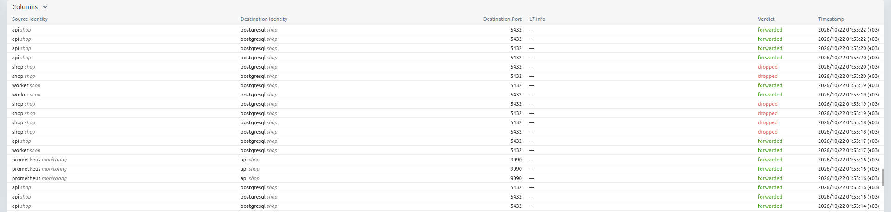

## Часть 6 — Скрытая поломка

Сделал `scripts/inject-failure.sh`: он случайно выбирает один из четырёх вариантов и передаёт его как дополнительный файл значений в `helm upgrade`:

1. неверная метка API в allow-правиле;
2. неверная метка PostgreSQL;
3. неверный порт PostgreSQL (`15432` вместо `5432`);
4. неправильный порт DNS (`5353` вместо `53`).

Сама ошибка записывается в `evidence/.fault-values.yaml`, а ответ в `evidence/.fault-answer.txt`

```bash
./scripts/inject-failure.sh
kubectl get pods -n shop
curl --noproxy '*' --max-time 5 http://localhost:30080/ready
```

Для диагностики проверял сначала DNS (`dig`), затем TCP (`nc`), а потом искал соответствующий поток в Hubble и сравнивал его с NetworkPolicy. Так можно различить две ситуации: DNS не разрешает имя вообще или DNS работает, но соединение с PostgreSQL режется политикой.

**Сведения о фактически выпавшей поломке:**
- **Симптом:** DNS работает и успешно возвращает IP PostgreSQL (`10.96.238.8`), но TCP соединение с базой на порту 5432 завершается таймаутом
- **Отправитель -> получатель, порт:** `shop-api -> shop-postgres-rw:5432`
- **Событие/причина в Hubble:** соединение не проходит. Причину `DROPPED / POLICY_DENIED` необходимо подтвердить по соответствующему событию Hubble
- **Ошибка в правиле Helm:** скрипт подменил `networkPolicy.selectors.api.app` с `api` на `api-broken`. Из-за несовпадения меток разрешающие правила больше не применяются к настоящим Pod API
- **Как исправил:** вернул `app: api` через исходный `values.yaml` и обновил helm релиз
- **Повторная проверка матрицы:** 9/9 pass

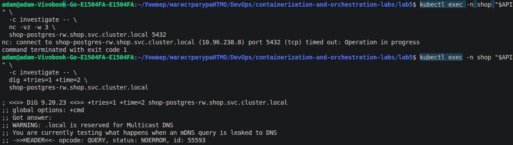

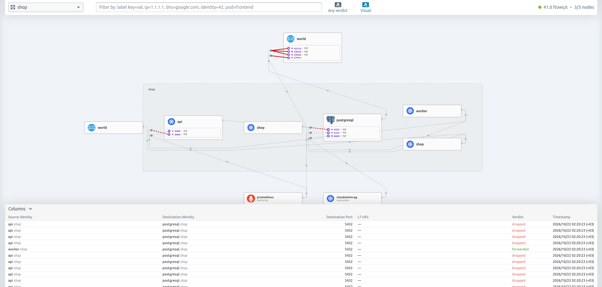

После определения причины вернул исходные значения Helm без файла поломки, перезапустил API и Worker для новых соединений, затем повторил `verify-matrix.sh`

```
$ column -s, -t evidence/access-matrix.csv
source    destination                                   expected  observed  result
client    shop-api.shop.svc.cluster.local:80            allow     allow     PASS
api       shop-postgres-rw.shop.svc.cluster.local:5432  allow     allow     PASS
worker    shop-postgres-rw.shop.svc.cluster.local:5432  allow     allow     PASS
client    10.244.2.54:5432                              deny      deny      PASS
outsider  10.244.2.54:5432                              deny      deny      PASS
outsider  10.244.2.128:8080                             deny      deny      PASS
worker    10.244.2.128:8080                             deny      deny      PASS
api       10.244.1.226:8080                             deny      deny      PASS
postgres  10.244.2.128:8080                             deny      deny      PASS
```

## Часть 7 — Мониторинг сети и алерты

Через Helm включил Prometheus, Grafana и Alertmanager. В Cilium/Hubble включил экспорт метрик потоков, дропов, DNS и TCP. Мониторы и правила приложения добавлены в Helm чарт `shop`:

- `ServiceMonitor` для `shop-api` на порту `9090` (`/metrics`);
- `PodMonitor` для метрик CloudNativePG на порту `9187`;
- `PrometheusRule` с тремя правилами;
- NetworkPolicy, разрешающие Prometheus подключаться к портам метрик, но не ко всем портам приложения.

### Графики

В Grafana использовал запросы:

```
# Интенсивность HTTP-запросов
sum(rate(shop_http_requests_total[1m]))

# Сетевые потоки Hubble
sum(rate(hubble_flows_processed_total[1m]))

# Блокировки политиками
sum(rate(hubble_drop_total{reason="POLICY_DENIED"}[1m]))
```

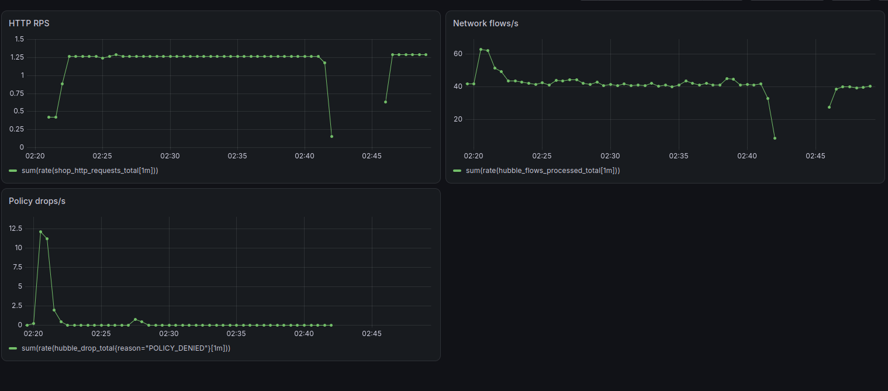

А вот про DNS я совсем забыл. Сначала решил что обойдусь без него, потому что метрики hubble_dns_queries_total и hubble_dns_responses_total упорно ничего не показывали. А потом перечитал задание и оказалось что DNS там обязателен, так что пришлось возвращаться и разбираться почему всё пустое.

В итоге дело было в том, что одного включения DNS метрик в Hubble недостаточно. Я разрешил DNS трафик обычной NetworkPolicy, но не настроил его разбор на уровне L7 через Cilium, поэтому сами запросы проходили, dig нормально получал адреса, а нужных метрик в Prometheus всё равно не было (не самая очевидная вещь честно говоря)

Добавил в Helm чарт ещё одну CiliumNetworkPolicy для DNS visibility, там разрешил запросы к CoreDNS на 53 порту и добавил rules.dns с matchPattern: "*", чтобы Cilium пропускал DNS через свой прокси и мог видеть запросы и ответы

Применил изменения через helm upgrade, потом из outsider отправил несколько десятков DNS запросов через dig, сначала к shop-api.shop.svc.cluster.local, потом к специально несуществующему имени, после этого проверил в Prometheus hubble_dns_queries_total и hubble_dns_responses_total - наконец-то появились данные

Затем быстро добавил недостающую панель с DNS запросами в Grafana:

```
# queries
sum(rate(hubble_dns_queries_total[5m]))

# errors
sum by (rcode) (increase(hubble_dns_responses_total[5m]))
```

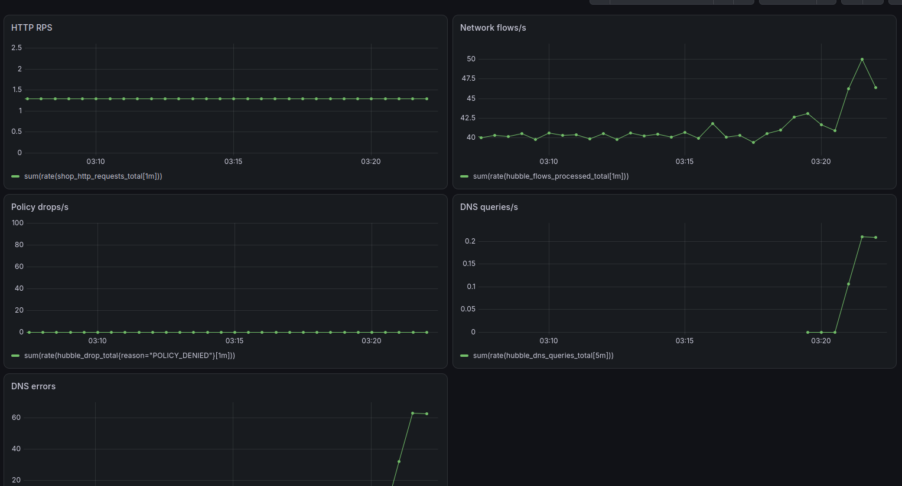

### Три алерта

- ShopAPIDown: нет доступных для опроса экземпляров API в течение минуты. Необходим для того чтобы узнать что приложение перестало отвечать/экспортировать метрики
- ShopPolicyDrops: есть `POLICY_DENIED` за последние 2 минуты. Необходим для того чтобы заметить блокировки политиками
- ShopDNSFailures: есть неуспешные DNS ответы за 5 минут. Необходим чтобы обнаружить проблемы с DNS

У второго алерта есть недостаток: в zero trust сети часть блокировок ожидаемая. Поэтому для production его нужно сужать до конкретных критичных направлений, иначе будут лишние уведомления

### Проверка алерта ShopPolicyDrops

Для проверки отправил заведомо запрещённые соединения из `outsider` к PostgreSQL. В Prometheus выполнил запрос:

```promql
sum(increase(hubble_drop_total{reason="POLICY_DENIED"}[2m]))
```

Получил значение **853** (пик) - это оценка прироста счётчика блокировок примерно на 853 за две минуты

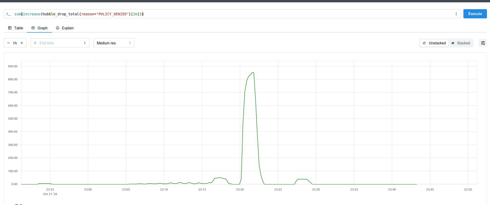

После этого проверил `ShopPolicyDrops` в Prometheus — алерт перешёл в `Firing`.

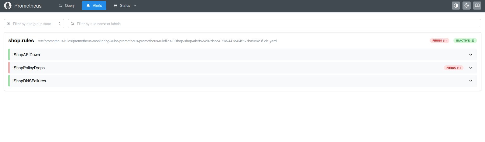

Это подтверждает, что метрики Cilium собираются Prometheus, правило загружено и на реально заблокированном трафике срабатывает алерт

### Вывод

Разобрался с тонкостями настройки сети в Kubernetes и обработкой трафика cilium, спроектировал и настроил zero trust систему, а также подключил мониторинг для сетевых метрик