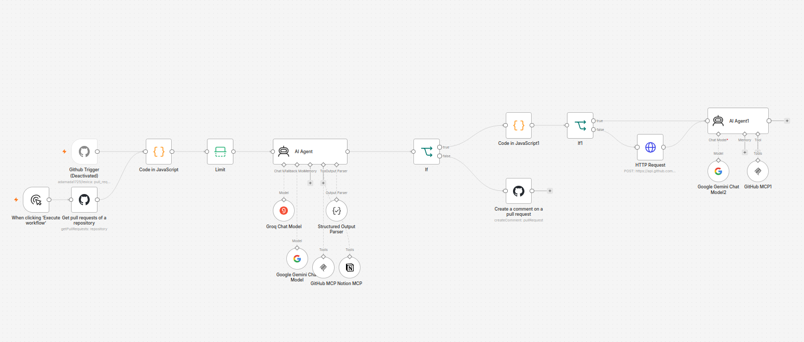
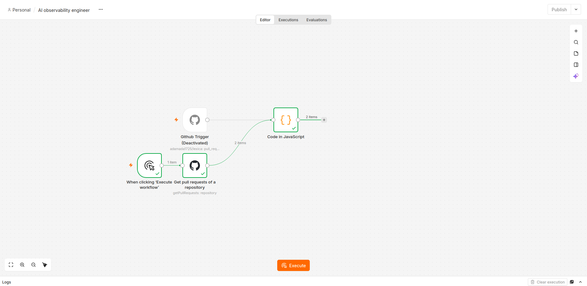
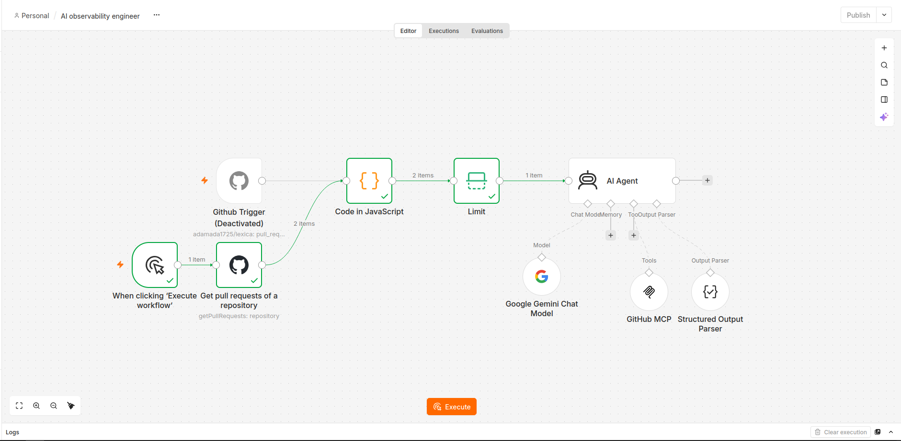
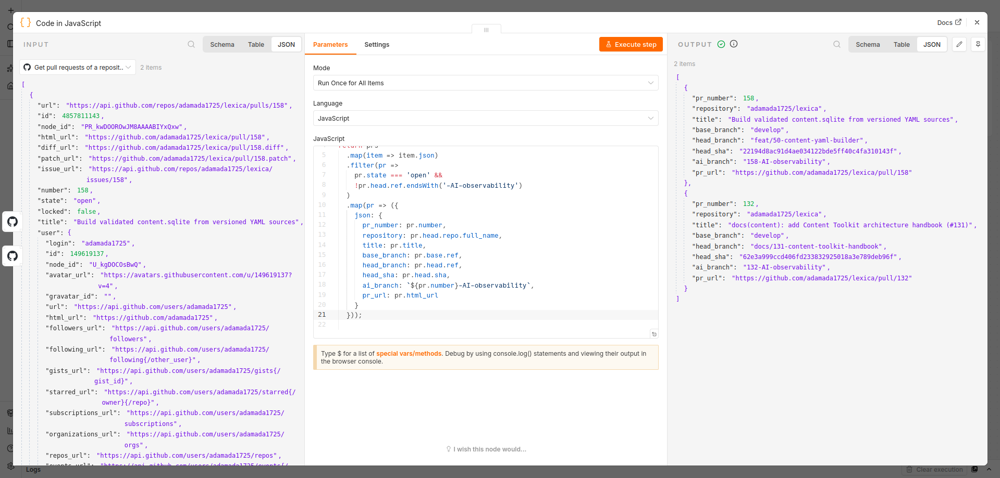
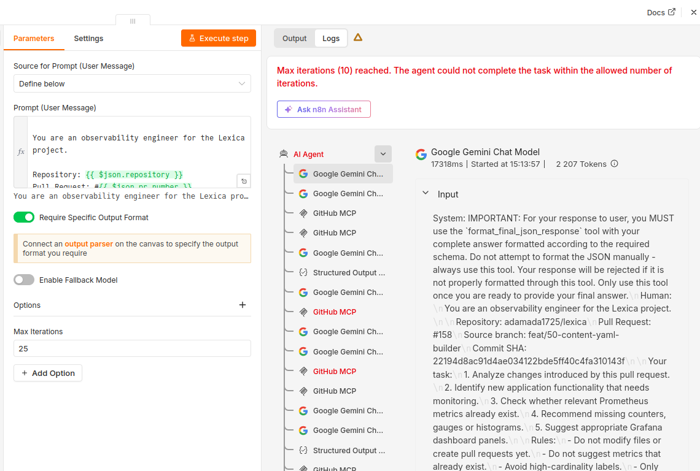
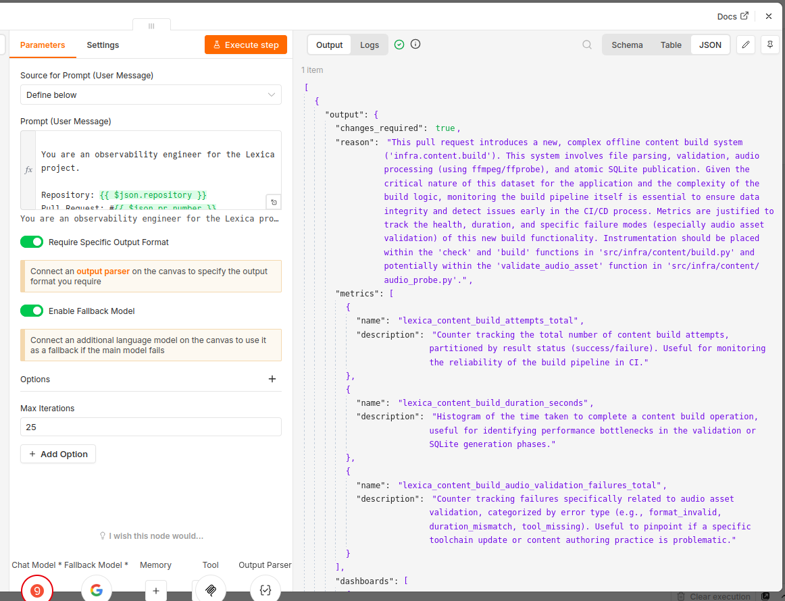
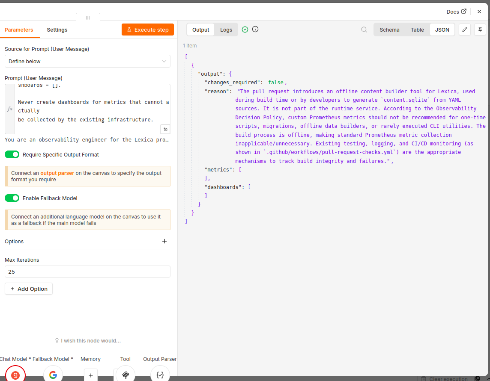
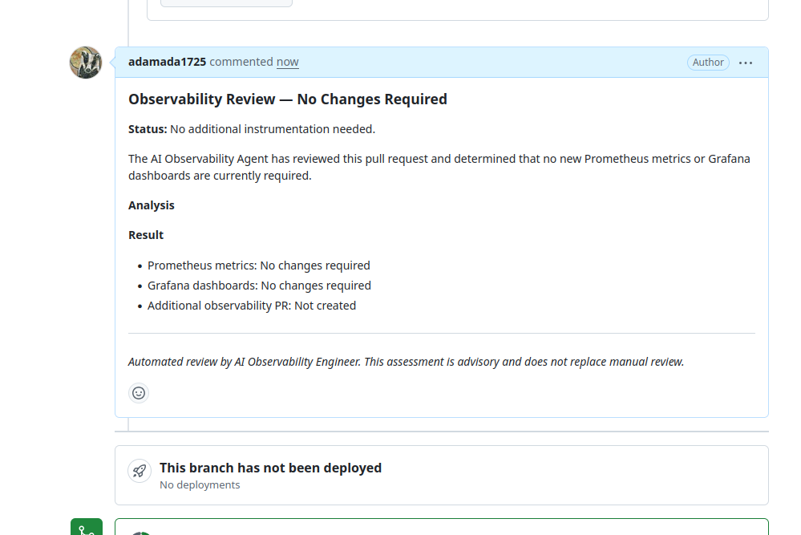
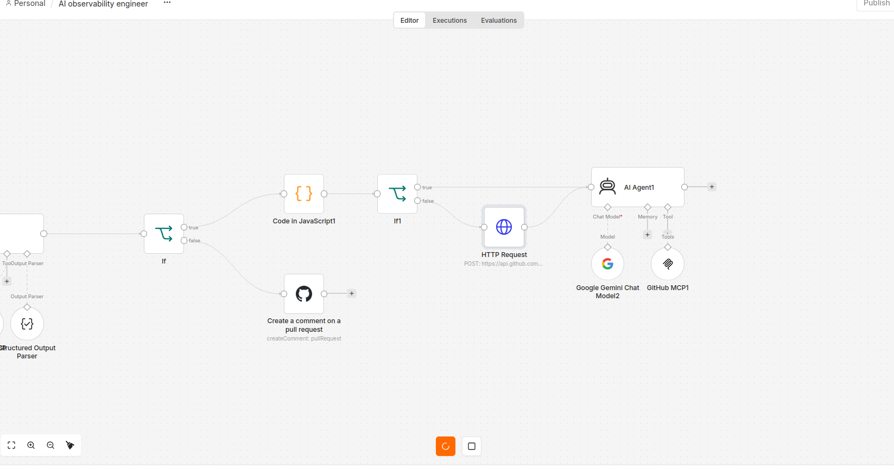
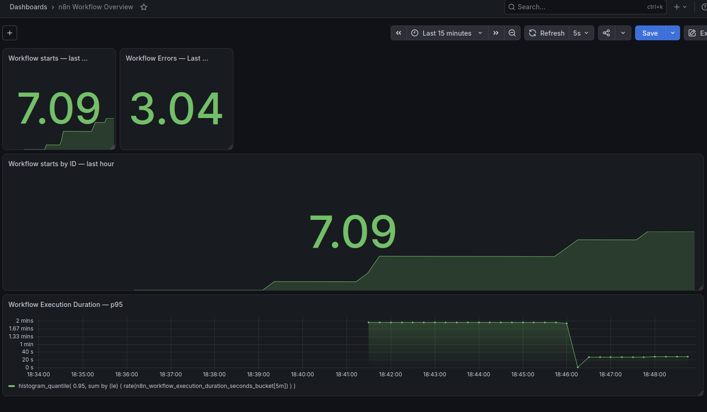

# Лаба 8 — Автоматизация devops-процесса с n8n + AI

## Чать 1 - Кейс

AI Observability Engineer для небольшого стартапа.

Я решил внедрить в собственный проект n8n workflow, который автоматически генерирует дашборды. То есть я пишу код, делаю PR в develop, n8n подхватывает, решает, нужно ли для этих изменений добавлять дашборд, и если нужно, то создает отдельную ветку с предложенным JSON, который потом импортируется в Grafana

> **Почему именно дашборды?**
> <br> Дашборды в большинстве случаев делаются вручную через интерфейс графаны, что может занимать достаточно много времени, особенно если делать их качественно и красиво. На мой взгляд ИИ может оптимизировать этот процесс, так как в большинстве случаев необходимо лишь сделать правильный запрос, выбрать правильные графики и параметры (юниты, легенда, ...), а также добавить описание и прочее

| Вопрос | Ответ |
| --- | --- |
| Кому это помогает? | В данном случае - только мне, единственному разработчику) Но в общем случае - это может быть полезно как для DevOps-инженера, избавляя его от ручной работы, так и для других участников команды, которым необходимо смотреть бизнес-метрики и дашборды |
| Какую проблему решает и почему сейчас это неудобно делать руками? | Создание дашбордов в графане. Неудобно делать руками - так как достаточно много настроек |
| Что именно делает автоматизация от начала до конца: триггер → шаги → результат? | Новый PR -> Вердикт (стоит ли добавлять дашборд) -> Поиск уже существующей AI-observability ветки / создание -> Реализация в виде JSON -> PR AI-observability ветки |

## Часть 2 - Что должно быть

**Сам флоу выглядит примерно так**:

- GitHub PR trigger (webhook) / для теста ручной тригер - достает PR из репозитория и передает агенту
- Агент, который решает, стоит ли для новых изменений генерировать дашборды в графане. На выходе structured output JSON с обоснованием, списком дашбордов и метрик
  - Если вердикт "нет" - оставляет в исходном PR комментарий с пояснениями
- Далее проверка, существует ли уже ветка AI-observability
  - Если нет, то создается ветка от исходной и передается дальше
- Агент, реализущий дашборды. На выходе коммит с JSON для графаны, взаимодействие с репо с помощью GitHub MCP

Графически это все выглядит так:


## Часть 3 - Реализация локально

Поднял локально n8n через docker, создал новый workflow. В качестве тригера я решил выбрать Pull Request в моем репо GitHub, кажется это единственный логичный вариант. Но, так как я пока делаю все локально и github не сможет мне отправить webhook, запускать workflow буду через специальный ручной тригер, он в свою очередь подтягивает с помощью GitHub API текущие PR. Также для теста я ограничу количество PR до 1 с помощью ноды `Code in JavaScript`, очень удобная нода в которой можно с помощью JS любым способом манипулировать над входными данными (в моем случае я фильтрую JSON ответ от GitHub API, убирая закрытые/draft/ai PR)



Как выглядит `Code in JavaScript` нода



После этого я добавил ноду `AI Agent`, которая должна на выходе выдавать следующий JSON:
```json
{
  "changes_required": true,
  "reason": "Обоснование",
  "metrics": [
    {
      "name": "metric name",
      "description": "metric description"
    }
  ],
  "dashboards": [
    {
      "name": "dashboard name",
      "description": "dashboard description"
    }
  ]
}
```

Сама нода состоит из нескольких компонентов:
- Модель: сама ИИ модель, которая будет обрабатывать данные
- Память: можно подключить для дополнительного контекста
- Tools (тулы): различные MCP, с которыми ИИ может взаимодействовать
- Fallback модель: на случай, если основная модель отвалится
- Output Parser: "адаптер", который переводит хаотичный текстовый ответ ИИшки в структурированный вид, например JSON. Без этого очень сложно построить детерменированный workflow

В моем случае в качестве модели я выбрал бесплатный Gemini, позже добавил fallback модель Groq, а из тулов добавил GitHub MCP, чтобы модель могла свободно наполнять свой контекст информацией из репо. Позже я также добавил Notion MCP. В Notion хранится продуктовый контекст, что может быть важно для построения бизнес-дашбордов.

Для каждого компонента есть также свои настройки:
- Для MCP вводим Credentials и обязательно выставляем ограниченный scope тулов, чтобы модель случайно не сделала лишние действия. В моем случае модель имеет read доступ к репо и Notion
- Для модели также вводим Credentials, выбираем необходимую версию и промпт. В промпте можно задать роль агента и инструкции. Также, что очень важно и удобно - **в любом textarea можно делать JavaScript вставки и использовать переменные из прошлых этапов**, то есть можно в промпте указать {{ $json.pr_number }}
- Для Output Parser можно задать пример выходных данных (JSON), свой пример я показал выше

После настройки ноды `AI Agent` я запустил workflow, и сразу столкнулся с проблемой `max iterations`. По умолчанию у агента выставлено ограничение итераций, то есть сколько максимально API вызовов модели он может делать. Решается это очень просто в настройках ноды, но само ограничение очень полезно - можно не бояться что workflow сожрет слишком много токенов и денег



Следующая проблема, с которой я столкнулся - prompt engineering, необходимо задать более четкий и строгий промпт. Изначально я выставил промпт в стиле "посмотри PR, опиши дашборды, которые необходимо сгенерировать". В итоге агент очень подробно и красочно описал дашборд с метриками использования отладочного CLI инструмента. 


(*я посмеялся*)

Это был реальный PR и к счастью он сразу подсветил мне эту проблему, после чего я переделал промпт и указал строгие ограничения, повторный вызов выдавал однозначный вердикт `"changes_required": false`



Следующий шаг - IF развилка. Благодаря structured output можно получить на выходе не хаотичный текст ИИ, а структурированный JSON с конкретным boolean полем.

Для false ветки я буду просто делать комментарий к соответсвующему PR (не ИИ-шаг). Комментарий генерируется по заданному шаблону с вставкой обоснования из прошлого шага:


Для true необходимо сначала найти, существует ли уже созданная ai-ветка, а если нет - создать ее. Сделал это с помощью `HTTP Request` ноды:



Далее следующий агент уже реализует изменения и выкладывает их на github, для этого ему достаточно GitHub MCP

На этом workflow практически готов. Также в процессе узнал про другие удобные фишки n8n, например можно задать тестовый mock output для любой ноды, чтобы каждый раз не прогонять весь flow заново и не подбирать необходимые данные

## Часть 4 - Мониторинг

Осталось только настроить метрики для workflow, решил взять базовые:
- Количество выполнений workflow
- Количество ошибок workflow
- Длительность выполнения workflow

Перезапустил контейнер с `-e N8N_METRICS=true \ -e N8N_METRICS_INCLUDE_MESSAGE_EVENT_BUS_METRICS=true \ -e N8N_METRICS_INCLUDE_WORKFLOW_ID_LABEL=true`, отдельно поднял prometheus и grafana. К счастью все необходимые мне метрики уже есть в n8n. Сделал простой дашборд, потыкал n8n, все корректно отображается:



Также заметил, что n8n отдает метрики по использованию AI и даже по затратам $, что может быть очень важным и полезным в реальном production кейсе

## Вывод

Благодаря этой лабораторке я познакомился с инструментом n8n и сделал свой первый workflow. Мне очень понравился n8n, и я думаю что с помощью него можно автоматизировать кучу различных процессов, и я обязательно попробую сделать это или предложить на работе.

Конечно, многие современные ИИ агенты сейчас могут свободно вызывать инструменты через MCP и в течение часа выполнять какую-то задачу, но n8n позволяет сделать весь процесс **формализованным и детерменированным**, то есть задать четкие шаги выполнения, развилки (if/switch) и конкретный результат. То есть AI становится менее хаотичным, а значит более предсказуемым инструментом. Но даже и без AI агентов очень удобно без кода выстраивать подобные workflow с готовым набором различных нод.